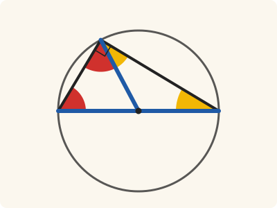

<!-- Generated by scripts/render.py. Do not edit by hand. -->

[Book III](index.md) · [← III.30](30.md) · [III.32 →](32.md)

# Book III, Proposition 31

*The angle in the semicircle is right*

> In a circle the angle in the semicircle is right, that in a greater segment less than a right angle, and that in a less segment greater than a right angle; and further the angle of the greater segment is greater than a right angle, and the angle of the less segment less than a right angle.

<p align="center"></p>

<p align="center"><em>Three equal radii (blue) cut the triangle into two, each with two equal sides, so the angle in the semicircle is the other two angles together (red and yellow). The three make two right angles, so it is a right angle.</em></p>

## Euclid's proof

_Euclid's figure, with Heath's letters, is still to be drawn; until then, Heath's own is on [scan leaf n74](https://archive.org/details/thirteenbookseu00heibgoog/page/n74)._

Let ABCD be a circle, let BC be its diameter, and E its centre, and let BA, AC, AD, DC be joined;

I say that the angle BAC in the semicircle BAC is right,

the angle ABC in the segment ABC greater than the semicircle is less than a right angle,

and the angle ADC in the segment ADC less than the semicircle is greater than a right angle.

Let AE be joined, and let BA be carried through to F.

Then, since BE is equal to EA,

the angle ABE is also equal to the angle BAE. [I. 5]

Again, since CE is equal to EA,

the angle ACE is also equal to the angle CAE. [I. 5]

Therefore the whole angle BAC is equal to the two angles ABC, ACB.

But the angle FAC exterior to the triangle ABC is also equal to the two angles ABC, ACB; [I. 32]

therefore the angle BAC is also equal to the angle FAC;

therefore each is right; [I. Def. 10]

therefore the angle BAC in the semicircle BAC is right.

Next, since in the triangle ABC the two angles ABC, BAC are less than two right angles, [I. 17]

and the angle BAC is a right angle,

the angle ABC is less than a right angle;

and it is the angle in the segment ABC greater than the semicircle.

Next, since ABCD is a quadrilateral in a circle,

and the opposite angles of quadrilaterals in circles are equal to two right angles, [III. 22]

while the angle ABC is less than a right angle,

therefore the angle ADC which remains is greater than a right angle;

and it is the angle in the segment ADC less than the semicircle.

I say further that the angle of the greater segment, namely that contained by the circumference ABC and the straight line AC, is greater than a right angle;

and the angle of the less segment, namely that contained by the circumference ADC and the straight line AC, is less than a right angle.

This is at once manifest.

For, since the angle contained by the straight lines BA, AC is right,

the angle contained by the circumference ABC and the straight line AC is greater than a right angle.

Again, since the angle contained by the straight lines AC, AF is right,

the angle contained by the straight line CA and the circumference ADC is less than a right angle.

Therefore etc.

Q. E. D.

## In Lean

🚧 Stated: the statement and Euclid's sentences are in place; the proof is to come

From [`Elements/BookIII/Prop31.lean`](../../Elements/BookIII/Prop31.lean). Euclid's sentences are the `--` comments, and our own notes are in `/- … -/`. The Lean that will carry each sentence out is still to be written; `sorry` is Lean's word for a step not yet taken.

```lean
/-- In a circle the angle in the semicircle is right, that in a greater segment less than a right
angle, and that in a less segment greater than a right angle; and further the angle of the
greater segment is greater than a right angle, and the angle of the less segment less than a
right angle. -/
theorem Prop31 {A B C E : Point} {ABCD : Circle} (hE : Centre E ABCD) (hA : OnCircle A ABCD)
    (hB : OnCircle B ABCD) (hC : OnCircle C ABCD) (hBEC : Between B E C) (hAB : A ≠ B)
    (hAC : A ≠ C) :
    ∠ B A C = ∟ ∧
      (∀ X : Point, OnCircle X ABCD → SameSideOf X B A C → ∠ A X C < ∟) ∧
      ∀ D : Point, OnCircle D ABCD → OppositeSidesOf B D A C → ∟ < ∠ A D C := by
  -- Let ABCD be a circle, let BC be its diameter, and E its centre, and let BA, AC, AD, DC be
  -- joined;
  -- I say that the angle BAC in the semicircle BAC is right,
  -- the angle ABC in the segment ABC greater than the semicircle is less than a right angle,
  -- and the angle ADC in the segment ADC less than the semicircle is greater than a right
  -- angle.
  -- Let AE be joined, and let BA be carried through to F.
  -- Then, since BE is equal to EA,
  -- the angle ABE is also equal to the angle BAE. [I. 5]
  -- Again, since CE is equal to EA,
  -- the angle ACE is also equal to the angle CAE. [I. 5]
  -- Therefore the whole angle BAC is equal to the two angles ABC, ACB.
  -- But the angle FAC exterior to the triangle ABC is also equal to the two angles ABC,
  -- ACB; [I. 32]
  -- therefore the angle BAC is also equal to the angle FAC;
  -- therefore each is right; [I. Def. 10]
  -- therefore the angle BAC in the semicircle BAC is right.
  -- Next, since in the triangle ABC the two angles ABC, BAC are less than two right
  -- angles, [I. 17]
  -- and the angle BAC is a right angle,
  -- the angle ABC is less than a right angle;
  -- and it is the angle in the segment ABC greater than the semicircle.
  -- Next, since ABCD is a quadrilateral in a circle,
  -- and the opposite angles of quadrilaterals in circles are equal to two right
  -- angles, [III. 22]
  -- while the angle ABC is less than a right angle,
  -- therefore the angle ADC which remains is greater than a right angle;
  -- and it is the angle in the segment ADC less than the semicircle.
  -- I say further that the angle of the greater segment, namely that contained by the
  -- circumference ABC and the straight line AC, is greater than a right angle;
  -- and the angle of the less segment, namely that contained by the circumference ADC and the
  -- straight line AC, is less than a right angle.
  -- This is at once manifest.
  -- For, since the angle contained by the straight lines BA, AC is right,
  -- the angle contained by the circumference ABC and the straight line AC is greater than a
  -- right angle.
  -- Again, since the angle contained by the straight lines AC, AF is right,
  -- the angle contained by the straight line CA and the circumference ADC is less than a right
  -- angle.
  -- Therefore etc.
  -- Q. E. D.
  sorry
```

## What it rests on

| | |
|---|---|
| Euclid cites | [I.5](../I/05.md), [I.17](../I/17.md), [I.32](../I/32.md), [III.22](22.md); Def. I.10 |

_Not yet proved in Lean, so what the Lean rests on is not yet known._

## Mishnah

_Commentary to come._

---

<sub>Euclid's text: T. L. Heath, *The Thirteen Books of Euclid's Elements*, vol. 2 (Cambridge, 1908), pp. 61–63; scan leaves n73–n75; figure on n74. Public domain.</sub>

<sub>The tacit rules follow the System E of Jeremy Avigad, Edward Dean and John Mumma, read alongside LeanEuclid (Logan Murphy, Kaiyu Yang, Jialiang Sun, Zhaoyu Li, Anima Anandkumar and Xujie Si).</sub>
