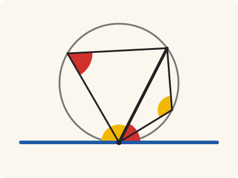
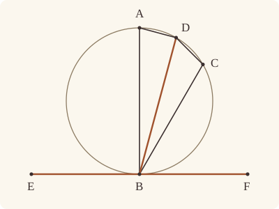

<!-- Generated by scripts/render.py. Do not edit by hand. -->

[Book III](index.md) · [← III.31](31.md) · [III.33 →](33.md)

# Book III, Proposition 32

*Angles with the tangent equal those in the alternate segments*

[Euclid's proof](#euclids-proof) · [In Lean](#in-lean) · [What it rests on](#what-it-rests-on) · [Mishnah](#mishnah)

> If a straight line touch a circle, and from the point of contact there be drawn across, in the circle, a straight line cutting the circle, the angles which it makes with the tangent will be equal to the angles in the alternate segments of the circle.

**In Lean:** ✅ proved, as Euclid states it · Euclid's argument

<p align="center"></p>

<p align="center"><em>From B, where EF (blue) touches the circle, draw BD across it, and the diameter BA at right angles to EF: the angles FBD, EBD equal BAD, DCB in the alternate segments, red to red and yellow to yellow, as does every angle in them.</em></p>

## Euclid's proof

<p align="center"></p>

<p align="center"><em>Drawn for one case: D on F's side of BA and apart from A, as in Heath's figure.</em></p>

For let a straight line EF touch the circle ABCD at the point B, and from the point B let there be drawn across, in the circle ABCD, a straight line BD cutting it;

I say that the angles which BD makes with the tangent EF will be equal to the angles in the alternate segments of the circle, that is, that the angle FBD is equal to the angle constructed in the segment BAD, and the angle EBD is equal to the angle constructed in the segment DCB.

For let BA be drawn from B at right angles to EF,

let a point C be taken at random on the circumference BD,

and let AD, DC, CB be joined.

Then, since a straight line EF touches the circle ABCD at B,

and BA has been drawn from the point of contact at right angles to the tangent,

the centre of the circle ABCD is on BA. [III. 19]

Therefore BA is a diameter of the circle ABCD;

therefore the angle ADB, being an angle in a semicircle, is right. [III. 31]

Therefore the remaining angles BAD, ABD are equal to one right angle. [I. 32]

But the angle ABF is also right;

therefore the angle ABF is equal to the angles BAD, ABD.

Let the angle ABD be subtracted from each;

therefore the angle DBF which remains is equal to the angle BAD in the alternate segment of the circle.

Next, since ABCD is a quadrilateral in a circle,

its opposite angles are equal to two right angles. [III. 22]

But the angles DBF, DBE are also equal to two right angles;

therefore the angles DBF, DBE are equal to the angles BAD, BCD,

of which the angle BAD was proved equal to the angle DBF;

therefore the angle DBE which remains is equal to the angle DCB in the alternate segment DCB of the circle.

Therefore etc.

Q. E. D.

## In Lean

| | |
|---|---|
| Proof | ✅ Proved |
| Statement | The whole enunciation. Both angles at the tangent are equal to the angles in the alternate segments, at every point of each segment. |
| Argument | Euclid's. |
| Reviewed | The statement and every passage of the argument read against Heath's text, at commit [`7b71d1782`](https://github.com/jackChallis/stoicheia/commit/7b71d1782) ([the record](../../review/III/32.toml)) |

From [`Elements/BookIII/Prop32.lean`](../../Elements/BookIII/Prop32.lean). Euclid's sentences are the `--` comments, and our own notes are in `/- … -/`; the lines under each sentence are the Lean that carries it out. The list below marks where a lemma does a step Euclid takes for granted, where the Lean takes a case Euclid's figure leaves aside and where the statement already gives a step; the `/- … -/` notes in the listing explain smaller adjustments.

**How the Lean follows the text**

- **Done by `BookI.Prop11`.** "For let BA be drawn from B at right angles to EF…" Euclid draws the perpendicular BA without a printed reference from Heath. The Lean first obtains a point X on that perpendicular by I.11, on D's side of EF; A is its meeting with the circle, found below.
- **Already given.** "let a point C be taken at random on the circumference BD…" The statement's second conclusion is said of every point C of the segment DCB, so C comes with it; the Lean takes C up where that conclusion is proved.
- **Already given.** "and let AD, DC, CB be joined." The angles and triangles are named by their points, so joining AD, DC and CB requires no further construction in the Lean.
- **Done by `Tacit.exists_centre`.** "the centre of the circle ABCD is on BA." The Lean takes a centre O from `Tacit.exists_centre`, as the [introduction](index.md) explains, then places it on BA by III.19.
- **Done by `Prop32.sameSide`.** "Therefore BA is a diameter of the circle ABCD…" The Lean takes A beyond the centre O from B by `Tacit.line_circle_beyond`, a rule we assume. `Prop32.sameSide` puts A and D on one side of EF: on opposite sides, AD would cross EF within the circle (III.2), contrary to `Touches.not_inside`. Heath gives no reference to III.2 here.
- **A further case.** "therefore the angle ADB, being an angle in a semicircle, is right." When D is A, BD is itself the diameter and there is no triangle ABD: every angle in either segment is right by III.31, as are the angles FBD and EBD.
- **Done by `angle_add_of_within`.** "Let the angle ABD be subtracted from each…" Euclid reads ABD as part of ABF before subtracting it. In the chosen case D is on F's side of BA, and `Prop32.sameSide` has put D on A's side of BF, so `angle_add_of_within` splits ABF into ABD and DBF.
- **Done by `Prop21`.** "therefore the angle DBF which remains…" Euclid's A is the end of the diameter; the statement says this of every point of the segment BAD, and III.21 makes each such angle equal to BAD. For A's position across BD from F, `Prop2.triangle` and `crossbar` give a crossing of AF with BD, and `Tacit.pasch3` separates A and F there. Heath gives no reference to III.21 or III.2 here.
- **Done by `BookI.Prop13`.** "But the angles DBF, DBE are also equal to two right angles…" Euclid takes the adjacent angles DBF and DBE to make two right angles. The Lean applies I.13, for which Heath prints no reference here.
- **A further case.** "Therefore etc." When D is on E's side of BA, the Lean gives the same argument with E and F exchanged. After the diameter case above, `Prop2.triangle` excludes any other D on BA; `OppositeSidesOf.of_between` separates E and F across BA, and `OppositeSidesOf.sameSideOf` puts D on E's side when it is not on F's. Heath gives no reference to III.2 here.

<details><summary>Before the theorem, one lemma: <code>Prop32.sameSide</code> (14 lines)</summary>

```lean
/-- Two points of a circle, neither of them the point B where the straight line EF
touches it, lie on the same side of EF. Euclid takes this for granted. Were they on
opposite sides, the straight line joining them would cross EF at a point within the
circle by III.2, and no point of a straight line touching a circle is within
it, as in III.18. -/
theorem Prop32.sameSide {B E F P Q : Point} {α : Circle} {L : Line}
    (hEF : Touches E F α)
    (hE_L : OnLine E L) (hF_L : OnLine F L) (hB_L : OnLine B L) (hB : OnCircle B α)
    (hP : OnCircle P α) (hQ : OnCircle Q α) (hPB : P ≠ B) (hQB : Q ≠ B) : SameSide P Q L := by
  have off : ∀ {R : Point}, OnCircle R α → R ≠ B → ¬ OnLine R L := fun hR hRB h =>
    (hEF.2 L hE_L hF_L).2 ⟨B, _, hRB.symm, hB_L, hB, h, hR⟩
  refine Classical.byContradiction fun hs => ?_
  obtain ⟨Y, hY_L, hPYQ⟩ := OppositeSides.exists_between ⟨off hP hPB, off hQ hQB, hs⟩
  exact hEF.not_inside ⟨L, hE_L, hF_L, hY_L⟩ (Prop2 hP hQ Y hPYQ)
```

</details>

```lean
/-- If a straight line touch a circle, and from the point of contact there be drawn across, in the
circle, a straight line cutting the circle, the angles which it makes with the tangent will be
equal to the angles in the alternate segments of the circle. -/
theorem Prop32 {B D E F : Point} {ABCD : Circle} (hB : OnCircle B ABCD)
    (hD : OnCircle D ABCD) (hBD : B ≠ D) (hEF : Touches E F ABCD) (hEBF : Between E B F) :
    (∀ A : Point, OnCircle A ABCD → OppositeSidesOf A F B D → ∠ F B D = ∠ B A D) ∧
    (∀ C : Point, OnCircle C ABCD → SameSideOf C F B D → ∠ E B D = ∠ D C B) := by
  -- For let a straight line EF touch the circle ABCD at the point B, and from the point B let
  -- there be drawn across, in the circle ABCD, a straight line BD cutting it;
  have hEF' : E ≠ F := ne_of_between_ends hEBF
  obtain ⟨L, hE_L, hF_L⟩ := Postulate1 E F hEF'
  have hB_L : OnLine B L := on_line_of_between_ends hEBF hE_L hF_L
  have onL : ∀ {P : Point}, Collinear E F P → OnLine P L := fun ⟨M, h1, h2, h3⟩ =>
    (line_unique hEF' h1 h2 hE_L hF_L) ▸ h3
  have off : ∀ {R : Point}, OnCircle R ABCD → R ≠ B → ¬ OnLine R L := fun hR hRB h =>
    (hEF.2 L hE_L hF_L).2 ⟨B, _, hRB.symm, hB_L, hB, h, hR⟩
  have hD_L : ¬ OnLine D L := off hD hBD.symm
  -- I say that the angles which BD makes with the tangent EF will be equal to the angles in
  -- the alternate segments of the circle, that is, that the angle FBD is equal to the angle
  -- constructed in the segment BAD, and the angle EBD is equal to the angle constructed in the
  -- segment DCB.
  -- For let BA be drawn from B at right angles to EF,
  obtain ⟨X, hXD, hX⟩ := BookI.Prop11 hEF' ⟨L, hE_L, hF_L, hB_L⟩ (fun h => hD_L (onL h))
  have hX_L : ¬ OnLine X L := not_on_line_of_same_side (hXD.sameSide hE_L hF_L)
  have hXB : X ≠ B := fun e => hX_L (e ▸ hB_L)
  -- let a point C be taken at random on the circumference BD,
  /- The second conclusion takes any such C, and we bring C in when we prove it, below. -/
  -- and let AD, DC, CB be joined.
  -- Then, since a straight line EF touches the circle ABCD at B,
  -- and BA has been drawn from the point of contact at right angles to the tangent,
  -- the centre of the circle ABCD is on BA. [III. 19]
  obtain ⟨O, hO⟩ := exists_centre ABCD
  have hXBO : Collinear X B O :=
    Prop19 hB hEF ⟨L, hE_L, hF_L, hB_L⟩ (fun h => hX_L (onL h))
      (fun P hP hPB => (angle_symm hXB hPB).trans (hX P hP hPB)) O hO
  -- Therefore BA is a diameter of the circle ABCD;
  obtain ⟨M, hX_M, hB_M, hO_M⟩ := hXBO
  obtain ⟨A, hA, hA_M, hAOB⟩ :=
    line_circle_beyond (centre_inside hO) hO_M hB_M (ne_of_centre_of_on hO hB)
  have hAB : A ≠ B := ne_of_between_ends hAOB
  /- A is on X's side of EF, the side of the circle, so the straight line BA is the one
     drawn at right angles to EF. -/
  have hAD_L : SameSide A D L :=
    Prop32.sameSide hEF hE_L hF_L hB_L hB hA hD hAB hBD.symm
  have hAX : OnRay A B X :=
    OnRay.of_sameSideOf (E := F) (SameSideOf.of_line (ne_of_between (between_symm hEBF)).symm
      hB_L hF_L (same_side_trans (same_side_symm hAD_L) (same_side_symm (hXD.sameSide hE_L hF_L))))
      ⟨M, hB_M, hX_M, hA_M⟩ hAB
  have hright : ∀ {P : Point}, OnLine P L → P ≠ B → ∠ A B P = ∟ := fun hP hPB => by
    rw [angle_symm hAB hPB, angle_onRay_right hAX hPB]
    exact hX _ ⟨L, hE_L, hF_L, hP⟩ hPB
  /- Euclid's figure has D on F's side of BA. We write the rest of his argument once, for
     whichever end of the tangent is on D's side, and take the case of D at A at the end. -/
  have key : ∀ {E F : Point}, Between E B F → OnLine E L → OnLine F L → SameSideOf D F B A →
      (∀ A' : Point, OnCircle A' ABCD → OppositeSidesOf A' F B D → ∠ F B D = ∠ B A' D) ∧
      (∀ C : Point, OnCircle C ABCD → SameSideOf C F B D → ∠ E B D = ∠ D C B) := by
    intro E F hEBF hE_L hF_L hDF
    have hFB : F ≠ B := (ne_of_between (between_symm hEBF))
    have hBAD : Triangle B A D := hDF.triangle
    -- therefore the angle ADB, being an angle in a semicircle, is right. [III. 31]
    have hADB : ∠ A D B = ∟ := (Prop31 hO hD hA hB hAOB hBAD.ne₂₃.symm hBD.symm).1
    -- Therefore the remaining angles BAD, ABD are equal to one right angle. [I. 32]
    obtain ⟨P, hADP⟩ := produce hBAD.ne₂₃
    have h32 := (BookI.Prop32 hBAD hADP).2
    rw [hADB, add_comm (∠ B A D) ∟, add_assoc, add_comm ∟,
      angle_symm hBD.symm hAB] at h32
    have hrem : ∠ B A D + ∠ A B D = ∟ := CommonNotion3 h32 rfl
    -- But the angle ABF is also right;
    have hABF : ∠ A B F = ∟ := hright hF_L hFB
    -- therefore the angle ABF is equal to the angles BAD, ABD.
    have h1 : ∠ A B F = ∠ B A D + ∠ A B D := hABF.trans hrem.symm
    -- Let the angle ABD be subtracted from each;
    have hDA_F : SameSideOf D A B F :=
      SameSideOf.of_line hFB.symm hB_L hF_L (same_side_symm hAD_L)
    have hsplit : ∠ A B F = ∠ A B D + ∠ D B F := angle_add_of_within hDF hDA_F
    -- therefore the angle DBF which remains is equal to the angle BAD in the alternate segment
    -- of the circle.
    have hDBF : ∠ D B F = ∠ B A D := CommonNotion3 (by rw [add_comm, ← hsplit, h1]) rfl
    /- A is on the other side of BD from F, for the straight line BD, within the angle
       ABF, crosses AF. -/
    obtain ⟨N, hB_N, hD_N⟩ := Postulate1 B D hBD
    obtain ⟨Y, hAYF, hY⟩ := crossbar hDF hDA_F
    obtain ⟨-, -, ⟨N', hB_N', hD_N', hY_N'⟩, -⟩ := hY
    have hY_N : OnLine Y N := (line_unique hBD hB_N' hD_N' hB_N hD_N) ▸ hY_N'
    have hF_N : ¬ OnLine F N := fun h =>
      hD_L ((line_unique hFB.symm hB_N h hB_L hF_L) ▸ hD_N)
    have hAF : OppositeSidesOf A F B D :=
      OppositeSidesOf.of_line hBD hB_N hD_N
        ⟨(Prop2.triangle hB hD hA hBD hBAD.ne₂₃.symm hAB.symm).off_line hB_N hD_N,
          hF_N, pasch3 hAYF hY_N⟩
    refine ⟨fun A' hA' hA'F => ?_, fun C hC hCF => ?_⟩
    · /- Any angle in that segment is the angle BAD [III. 21]. -/
      rw [angle_symm hFB hBD.symm, hDBF,
        Prop21 hA hB hD hA' (OppositeSidesOf.sameSideOf hAF.symm hA'F.symm)]
    -- Next, since ABCD is a quadrilateral in a circle,
    -- its opposite angles are equal to two right angles. [III. 22]
    have h22 := (Prop22 hA hB hC hD (hCF.trans_opposite hAF.symm).symm).2
    -- But the angles DBF, DBE are also equal to two right angles;
    have h13 : ∠ F B D + ∠ D B E = ∟ + ∟ :=
      BookI.Prop13 (between_symm hEBF) (fun ⟨K, hF_K, hE_K, hD_K⟩ =>
        hD_L ((line_unique (ne_of_between_ends hEBF).symm hF_K hE_K hF_L hE_L) ▸ hD_K))
    -- therefore the angles DBF, DBE are equal to the angles BAD, BCD,
    rw [angle_symm hFB hBD.symm, ← h22] at h13
    -- of which the angle BAD was proved equal to the angle DBF;
    rw [hDBF] at h13
    -- therefore the angle DBE which remains is equal to the angle DCB in the alternate segment
    -- DCB of the circle.
    have hEB : E ≠ B := ne_of_between hEBF
    rw [add_comm (∠ B A D), add_comm (∠ B A D)] at h13
    rw [angle_symm hEB hBD.symm]
    exact CommonNotion3 h13 rfl
  -- Therefore etc.
  have hEF_BD : OppositeSidesOf E F B D :=
    (OppositeSidesOf.of_between (Triangle.of_line hB_L hE_L (ne_of_between hEBF).symm hD_L).cab
      hEBF).swap
  by_cases hDA : D = A
  · /- When D is A, BD is the diameter: both segments are semicircles, and every angle
       in them is right by III.31, as are the angles FBD, EBD. -/
    subst hDA
    have hBOD : Between B O D := between_symm hAOB
    refine ⟨fun A' hA' hA'F => ?_, fun C hC hCF => ?_⟩
    · have hT := hA'F.triangle
      rw [angle_symm (ne_of_between (between_symm hEBF)) hBD.symm, hright hF_L
        (ne_of_between (between_symm hEBF))]
      exact ((Prop31 hO hA' hB hD hBOD hT.ne₁₃.symm hT.ne₂₃.symm).1).symm
    · have hT := hCF.triangle
      rw [angle_symm (ne_of_between hEBF) hBD.symm, hright hE_L (ne_of_between hEBF)]
      exact ((Prop31 hO hC hD hB hAOB hT.ne₂₃.symm hT.ne₁₃.symm).1).symm
  · have hDBA : ¬ OnLine D M := fun h =>
      (Prop2.triangle hD hB hA hBD.symm hAB.symm hDA) ⟨M, h, hB_M, hA_M⟩
    have hA_L : ¬ OnLine A L := off hA hAB
    have hEF_BA : OppositeSidesOf E F B A :=
      (OppositeSidesOf.of_between (Triangle.of_line hB_L hE_L (ne_of_between hEBF).symm hA_L).cab
        hEBF).swap
    by_cases hs : SameSideOf D F B A
    · exact key hEBF hE_L hF_L hs
    · have hDF : OppositeSidesOf D F B A :=
        OppositeSidesOf.of_line hAB.symm hB_M hA_M
          ⟨hDBA, fun h => hEF_BA.2 M hB_M hA_M |>.2.1 h,
            fun h => hs (SameSideOf.of_line hAB.symm hB_M hA_M h)⟩
      obtain ⟨k₁, k₂⟩ := key (between_symm hEBF) hF_L hE_L
        (OppositeSidesOf.sameSideOf hDF.symm hEF_BA.symm)
      refine ⟨fun A' hA' hA'F => ?_, fun C hC hCF => ?_⟩
      · have hT := hA'F.triangle
        rw [k₂ A' hA' (OppositeSidesOf.sameSideOf hA'F.symm hEF_BD.symm)]
        exact angle_symm hT.ne₂₃ hT.ne₁₃
      · have hT := hCF.triangle
        rw [k₁ C hC (hCF.trans_opposite hEF_BD.symm)]
        exact angle_symm hT.ne₁₃ hT.ne₂₃
  -- Q. E. D.
```

## What it rests on

| | |
|---|---|
| Heath's references | [I.32](../I/32.md), [III.19](19.md), [III.22](22.md), [III.31](31.md) |
| Lean cites | [I.11](../I/11.md), [I.13](../I/13.md), [I.32](../I/32.md), [III.2](02.md), [III.19](19.md), [III.21](21.md), [III.22](22.md), [III.31](31.md) |
| Postulates | 1, 2, 3, 4, 5 |
| Definitions taken as axioms | Def. I.15 |
| Common Notions | 1, 2, 3, 4, 5 |
| Tacit rules | 39 (listed below) |
| Its own Lean calls | Postulate 1; 9 tacit rules |
| Through lemmas | Postulates 2 and 3; Def. I.15; 23 tacit rules |

Some of these come in through lemmas [shared](../../CERTIFICATE.md#shared-steps) by many proofs: [`Prop2.triangle`](../../Elements/BookIII/Prop02.lean#L137) (III.2).

_Postulates, definitions, Common Notions and tacit rules: all that this proof rests on, counting those of the propositions it cites. The last two rows say which of the postulates, definitions and tacit rules its own Lean calls, in the proof or a helper written for it, and which it does not call but reaches through lemmas, of Book Zero or shared (a proposition it cites may rest on these too); the rest come in only through the propositions it cites or the Common Notions._

<details><summary>The 39 tacit rules beneath this proof, counting those of the propositions it cites</summary>

_(used here) marks a rule this proof's own Lean calls, in the proof or a helper written for it; (through …) marks one its own Lean does not call but reaches through the lemmas named, of [Book Zero](../../Elements/Figure) or shared, though a proposition it cites may rest on it too; and a rule with no mark comes in only through a proposition it cites or a Common Notion. The names in brackets are System E's: an Intersection rule says when straight lines and circles must meet, and an Intersections rule takes a point where they do (see [Book I's introduction](../I/index.md))._

**Reading the figure**

- [`between_cases`](../../Elements/Foundations/Tacit/Diagram.lean#L54) (through [`OppositeSides.exists_between`](../../Elements/Figure/Sides.lean#L119), [`OppositeSidesOf.sameSideOf`](../../Elements/Figure/Sides.lean#L129), [`Prop2.triangle`](../../Elements/BookIII/Prop02.lean#L137) and 1 other lemma): Of three different points on a straight line, one is between the other two. (Between 6)
- [`between_of_inside_chord`](../../Elements/Foundations/Tacit/Diagram.lean#L81) (through [`OnRay.of_sameSideOf`](../../Elements/Figure/Angles.lean#L188), [`OppositeSides.exists_between`](../../Elements/Figure/Sides.lean#L119), [`OppositeSidesOf.of_between`](../../Elements/Figure/Sides.lean#L100) and 13 other lemmas): A straight line through a point inside a circle has that point between the points where it meets the circle. (Circle 1)
- [`between_symm`](../../Elements/Foundations/Tacit/Diagram.lean#L47) (used here): If B is between A and C, it is between C and A. (Between 1)
- [`circles_meet`](../../Elements/Foundations/Tacit/Diagram.lean#L94) (through [`OnRay.of_sameSideOf`](../../Elements/Figure/Angles.lean#L188), [`OppositeSides.exists_between`](../../Elements/Figure/Sides.lean#L119), [`OppositeSidesOf.of_between`](../../Elements/Figure/Sides.lean#L100) and 7 other lemmas): If each circle passes through a point inside the other, the circles cut one another. This is the step Euclid takes for granted in I.1. (Intersection 5)
- [`circles_meet_same_side`](../../Elements/Foundations/Tacit/Constructions.lean#L79) (through [`OnRay.of_sameSideOf`](../../Elements/Figure/Angles.lean#L188), [`OppositeSides.exists_between`](../../Elements/Figure/Sides.lean#L119), [`OppositeSidesOf.of_between`](../../Elements/Figure/Sides.lean#L100) and 7 other lemmas): Two circles that cut one another do so on each side of the straight line through their centres. (Intersections 8)
- [`exists_centre`](../../Elements/Foundations/Tacit/Constructions.lean#L57) (used here): Every circle has a centre. A rule of our own, not one of System E's: its content is Euclid's Definitions I.15 and I.16.
- [`exists_point`](../../Elements/Foundations/Tacit/Constructions.lean#L35) (through [`OppositeSidesOf.of_between`](../../Elements/Figure/Sides.lean#L100), [`OppositeSidesOf.sameSideOf`](../../Elements/Figure/Sides.lean#L129), [`Prop2.triangle`](../../Elements/BookIII/Prop02.lean#L137) and 7 other lemmas): Let a point be taken. (Points 1)
- [`exists_point_inside_circle`](../../Elements/Foundations/Tacit/Constructions.lean#L42) (through [`OnRay.of_sameSideOf`](../../Elements/Figure/Angles.lean#L188), [`OppositeSides.exists_between`](../../Elements/Figure/Sides.lean#L119), [`OppositeSidesOf.of_between`](../../Elements/Figure/Sides.lean#L100) and 12 other lemmas): Let a point be taken inside the circle α. (Points 8)
- [`exists_point_on_line`](../../Elements/Foundations/Tacit/Constructions.lean#L38) (through [`OnRay.of_sameSideOf`](../../Elements/Figure/Angles.lean#L188), [`OppositeSides.exists_between`](../../Elements/Figure/Sides.lean#L119), [`OppositeSidesOf.of_between`](../../Elements/Figure/Sides.lean#L100) and 8 other lemmas): Let a point be taken on the straight line L. (Points 2)
- [`line_circle_between`](../../Elements/Foundations/Tacit/Constructions.lean#L67) (through [`OnRay.of_sameSideOf`](../../Elements/Figure/Angles.lean#L188), [`OppositeSides.exists_between`](../../Elements/Figure/Sides.lean#L119), [`OppositeSidesOf.of_between`](../../Elements/Figure/Sides.lean#L100) and 12 other lemmas): A straight line through a point B inside a circle, heading out to a point C outside it, cuts the circle between B and C. (Intersections 4)
- [`line_circle_beyond`](../../Elements/Foundations/Tacit/Constructions.lean#L73) (used here): A straight line through a point B inside a circle, produced beyond B away from C, cuts the circle there. (Intersections 5)
- [`line_unique`](../../Elements/Foundations/Tacit/Diagram.lean#L41) (used here): Two points determine a straight line. (Generalities 1)
- [`lines_meet_of_opposite_sides`](../../Elements/Foundations/Tacit/Diagram.lean#L89) (through [`OppositeSides.exists_between`](../../Elements/Figure/Sides.lean#L119), [`OppositeSidesOf.sameSideOf`](../../Elements/Figure/Sides.lean#L129) and [`crossbar`](../../Elements/Figure/Angles.lean#L132)): A straight line joining points on opposite sides of L crosses L. (Intersection 1)
- [`not_between_of_between`](../../Elements/Foundations/Tacit/Diagram.lean#L50) (through [`OnRay.of_sameSideOf`](../../Elements/Figure/Angles.lean#L188), [`OppositeSides.exists_between`](../../Elements/Figure/Sides.lean#L119), [`OppositeSidesOf.of_between`](../../Elements/Figure/Sides.lean#L100) and 14 other lemmas): If B is between A and C, then A is not between B and C. (Between 1)
- [`not_on_line_of_same_side`](../../Elements/Foundations/Tacit/Diagram.lean#L60) (used here): Points on one side of a straight line are not on it. (Same side 3)
- [`pasch2`](../../Elements/Foundations/Tacit/Diagram.lean#L71) (through [`OnRay.of_sameSideOf`](../../Elements/Figure/Angles.lean#L188), [`OppositeSides.exists_between`](../../Elements/Figure/Sides.lean#L119), [`OppositeSidesOf.of_between`](../../Elements/Figure/Sides.lean#L100) and 4 other lemmas): If B is between A and C, A is on L and B is off it, then B and C are on the same side of L: a straight line that leaves L at A does not cross it again. (Pasch 2)
- [`same_side_trans`](../../Elements/Foundations/Tacit/Diagram.lean#L64) (used here): Two points on the same side of a straight line as a third point are on the same side as each other. (Same side 4)

**Lengths, angles and areas**

- [`angle_add_of_inside`](../../Elements/Foundations/Tacit/Transfer.lean#L47) (through [`OnRay.of_sameSideOf`](../../Elements/Figure/Angles.lean#L188), [`OppositeSidesOf.of_between`](../../Elements/Figure/Sides.lean#L100), [`OppositeSidesOf.sameSideOf`](../../Elements/Figure/Sides.lean#L129) and 3 other lemmas): If D lies within the angle BAC, then BAC is made up of BAD and DAC. (Diagram-angle 2)
- [`angle_eq_of_same_rays`](../../Elements/Foundations/Tacit/Transfer.lean#L54) (through [`angle_onRay_right`](../../Elements/Figure/Angles.lean#L49)): The angle doesn't change if its arms are traced through other points on the same rays. (Diagram-angle 4)
- [`angle_symm`](../../Elements/Foundations/Tacit/Metric.lean#L27) (used here): The angle ABC is the angle CBA. (Metric 4)
- [`area_add_of_between`](../../Elements/Foundations/Tacit/Transfer.lean#L70): Cutting a triangle in two from a vertex adds up. (Diagram-area 2)
- [`area_congruent`](../../Elements/Foundations/Tacit/Metric.lean#L41): Triangles equal in all their sides and angles are equal in area. Euclid uses this without comment once he has shown two triangles congruent. (Metric 9)
- [`area_degenerate`](../../Elements/Foundations/Tacit/Metric.lean#L33): A "triangle" with a repeated corner has no area. (Metric 6)
- [`area_eq_zero_of_on_line`](../../Elements/Foundations/Tacit/Transfer.lean#L62): A "triangle" whose corners lie on one straight line has no area. (Diagram-area 1)
- [`area_rotate`](../../Elements/Foundations/Tacit/Metric.lean#L36): The triangle ABC is the triangle CAB. (Metric 8)
- [`circle_eq`](../../Elements/Foundations/Tacit/Transfer.lean#L30) (through [`OnRay.of_sameSideOf`](../../Elements/Figure/Angles.lean#L188), [`OppositeSides.exists_between`](../../Elements/Figure/Sides.lean#L119), [`OppositeSidesOf.of_between`](../../Elements/Figure/Sides.lean#L100) and 12 other lemmas): A circle is fixed by its centre and its radius. (Diagram-segment 2)
- [`len_add_of_between`](../../Elements/Foundations/Tacit/Transfer.lean#L27) (through [`OnRay.of_sameSideOf`](../../Elements/Figure/Angles.lean#L188), [`OppositeSides.exists_between`](../../Elements/Figure/Sides.lean#L119), [`OppositeSidesOf.of_between`](../../Elements/Figure/Sides.lean#L100) and 12 other lemmas): If B is between A and C, then AB and BC together make up AC. (Diagram-segment 1)
- [`len_self`](../../Elements/Foundations/Tacit/Metric.lean#L21) (through [`OnRay.of_sameSideOf`](../../Elements/Figure/Angles.lean#L188), [`OppositeSides.exists_between`](../../Elements/Figure/Sides.lean#L119), [`OppositeSidesOf.of_between`](../../Elements/Figure/Sides.lean#L100) and 12 other lemmas): The "straight line" from a point to itself has no length. (Metric 1)
- [`len_symm`](../../Elements/Foundations/Tacit/Metric.lean#L24) (through [`OnRay.of_sameSideOf`](../../Elements/Figure/Angles.lean#L188), [`OppositeSides.exists_between`](../../Elements/Figure/Sides.lean#L119), [`OppositeSidesOf.of_between`](../../Elements/Figure/Sides.lean#L100) and 12 other lemmas): The straight line AB is the straight line BA. (Metric 3)
- [`same_ray_of_angle_eq_zero`](../../Elements/Foundations/Tacit/Transfer.lean#L42) (through [`OnRay.of_sameSideOf`](../../Elements/Figure/Angles.lean#L188), [`OppositeSidesOf.of_between`](../../Elements/Figure/Sides.lean#L100), [`OppositeSidesOf.sameSideOf`](../../Elements/Figure/Sides.lean#L129) and 2 other lemmas): If the angle BAC is nothing, C lies on the ray from A through B. (Diagram-angle 1)

**Superposition**

- [`superposition`](../../Elements/Foundations/Tacit/Superposition.lean#L48): **Superposition.** A hypothetical placement of a triangle on a given ray and side permits a restricted derivation of metric equalities about the figure already given. The derivation introduces no further objects, cites each geometric law it uses, and exports no symbol of the placement.

**Laws of magnitude**

- [`add_assoc`](../../Elements/Foundations/Tacit/Magnitudes.lean#L23) (used here): Adding three magnitudes in a row, it makes no difference whether the first two or the last two are added first. (System E §3.5)
- [`add_comm`](../../Elements/Foundations/Tacit/Magnitudes.lean#L26) (used here): The order of adding does not matter. (System E §3.5)
- [`add_lt_add_right`](../../Elements/Foundations/Tacit/Magnitudes.lean#L45) (through [`OppositeSidesOf.sameSideOf`](../../Elements/Figure/Sides.lean#L129)): Adding the same thing to both sides keeps "less than". (System E §3.5)
- [`add_zero`](../../Elements/Foundations/Tacit/Magnitudes.lean#L29): Adding nothing changes nothing. (System E §3.5)
- [`lt_irrefl`](../../Elements/Foundations/Tacit/Magnitudes.lean#L32) (through [`OnRay.of_sameSideOf`](../../Elements/Figure/Angles.lean#L188), [`OppositeSides.exists_between`](../../Elements/Figure/Sides.lean#L119), [`OppositeSidesOf.of_between`](../../Elements/Figure/Sides.lean#L100) and 12 other lemmas): No magnitude is less than itself. (System E §3.5)
- [`lt_trans`](../../Elements/Foundations/Tacit/Magnitudes.lean#L35) (through [`OnRay.of_sameSideOf`](../../Elements/Figure/Angles.lean#L188), [`OppositeSides.exists_between`](../../Elements/Figure/Sides.lean#L119), [`OppositeSidesOf.of_between`](../../Elements/Figure/Sides.lean#L100) and 12 other lemmas): What is less than the less is less still. (System E §3.5)
- [`lt_trichotomy`](../../Elements/Foundations/Tacit/Magnitudes.lean#L39) (through [`OnRay.of_sameSideOf`](../../Elements/Figure/Angles.lean#L188), [`OppositeSides.exists_between`](../../Elements/Figure/Sides.lean#L119), [`OppositeSidesOf.of_between`](../../Elements/Figure/Sides.lean#L100) and 12 other lemmas): Of two magnitudes, one is less, or they are equal, or the other is less. (System E §3.5)
- [`not_lt_zero`](../../Elements/Foundations/Tacit/Magnitudes.lean#L42) (through [`OnRay.of_sameSideOf`](../../Elements/Figure/Angles.lean#L188), [`OppositeSides.exists_between`](../../Elements/Figure/Sides.lean#L119), [`OppositeSidesOf.of_between`](../../Elements/Figure/Sides.lean#L100) and 12 other lemmas): Nothing is less than zero. (System E §3.5)

</details>

## Mishnah

_Our commentary: what Euclid assumes, what Lean made us say out loud, and how the result looks by modern means._

Euclid's key is a diameter. BA, at right angles to the tangent, passes through the centre (III.19), and the angle ADB in the semicircle is right (III.31), so the angles ABD, BAD of the triangle make a right angle, as ABF does. Take the common ABD away, and DBF is left equal to BAD. His A is the end of the diameter, but we may take any angle in the segment BAD, for they are all equal (III.21).

**A test for touching.** Heath states the converse (vol. 2, p. 66): a straight line through B making with BD angles equal to those in the alternate segments touches the circle. He gives Christopher Clavius' direct proof (vol. 2, p. 67), Euclid's run backwards: add ABD to the equal angles FBD, BAD, and ABF equals ABD and BAD together, a right angle, so EF touches the circle by the porism to III.16. The equal angles test for contact as well as follow from it.

Pappus, Heath reports, assumes in one place a consequence of III.32: "*If two circles touch, any straight line drawn through the point of contact and terminated by both circles cuts off segments in each which are respectively similar*" (vol. 2, p. 67). Elsewhere he shows how to prove it, by the common tangent at the point of contact: the straight line makes equal angles with it in the two circles, so by III.32 the angles in their alternate segments are equal, and the segments are similar (Definition III.11).

**The circle on one side of EF.** Apart from B, its points lie on one side: a straight line that touches has no point within the circle, so it cannot part two points of it, as in III.18 (`Prop32.sameSide`). The figure also puts D on F's side of BA; otherwise we exchange E and F. When BD is itself the diameter, every angle in either segment is right (III.31), as are the angles at B: a case Euclid never separates, for, as Heath remarks under III.33, it too would need III.31.

**The modern way.** On the circle $|z| = 1$ in the complex plane, the tangent at B runs in the direction $i\mathrm{B}$. Turn B anticlockwise about the centre through $\theta$, with $0 \lt \theta \lt 2\pi$, to $\mathrm{D} = \mathrm{B}e^{i\theta}$. Then $\mathrm{D} - \mathrm{B} = 2\sin(\theta/2) \thinspace i\mathrm{B}e^{i\theta/2}$, which is $i\mathrm{B}$ turned through $\theta/2$ and multiplied by a positive number, so the tangent makes with BD the angle $\theta/2$: the angle at the circumference standing on the arc BD that $\theta$ sweeps.

## Further reading

- Isaac Todhunter calls the converse "true and important": a straight line making with BD the angles in the alternate segments touches the circle. His note on III.32 (p. 277) is in [*The Elements of Euclid*](https://archive.org/details/todhuntereuclid00todhrich) (1872, free online) (also on [III.3](03.md)).
- Two touching circles fill Props. 2–4 of Book III, Section I (pp. 29–30), of John Casey's [*A Sequel to the First Six Books of the Elements of Euclid*](https://archive.org/details/sequeltofirstsix00caserich) (1886, free online), where the common tangent at the point of contact and III.32 do most of the work (also on [III.17](17.md)).
- Evan Chen's olympiad course, [*Euclidean Geometry in Mathematical Olympiads*](https://doi.org/10.5948/9781614444114) (2016), works on the circle |z| = 1, as the modern way does, in §6.4, "The Unit Circle" (pp. 100–102) (also on [III.24](24.md)).

[Book III](index.md) · [← III.31](31.md) · [III.33 →](33.md)

---

<sub>Euclid's text: T. L. Heath, *The Thirteen Books of Euclid's Elements*, vol. 2 (Cambridge, 1908), pp. 65–66; [scan leaves n77–n78](https://archive.org/details/thirteenbookseu00heibgoog/page/n77); [figure on n78](https://archive.org/details/thirteenbookseu00heibgoog/page/n78). Public domain.</sub>

<sub>The tacit rules follow the System E of Jeremy Avigad, Edward Dean and John Mumma, read alongside LeanEuclid (Logan Murphy, Kaiyu Yang, Jialiang Sun, Zhaoyu Li, Anima Anandkumar and Xujie Si).</sub>
