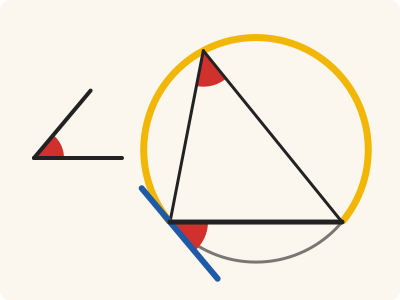
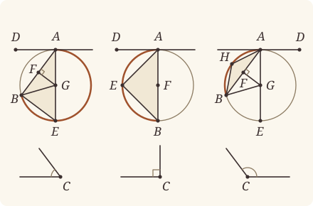

<!-- Generated by scripts/render.py. Do not edit by hand. -->

[Book III](index.md) · [← III.32](32.md) · [III.34 →](34.md)

# Book III, Proposition 33

*A segment admitting a given angle, on a given straight line*

[Euclid's proof](#euclids-proof) · [In Lean](#in-lean) · [What it rests on](#what-it-rests-on) · [Mishnah](#mishnah)

> On a given straight line to describe a segment of a circle admitting an angle equal to a given rectilineal angle.

**In Lean:** ✅ proved, as Euclid states it · Euclid's argument

<p align="center"></p>

<p align="center"><em>Lay the given angle at C (red), here acute, on AB at A, as BAD. The circle that touches AD (blue) at A and passes through B cuts off a segment AEB (yellow) whose angles all equal it.</em></p>

## Euclid's proof

<p align="center"></p>

<p align="center"><em>Drawn for every case: acute, right and obtuse given angles, from left to right; the figure at a glance shows the acute case.</em></p>

Let AB be the given straight line, and the angle at C the given rectilineal angle;

thus it is required to describe on the given straight line AB a segment of a circle admitting an angle equal to the angle at C.

The angle at C is then acute, or right, or obtuse.

First let it be acute,

and, as in the first figure, on the straight line AB, and at the point A, let the angle BAD be constructed equal to the angle at C;

therefore the angle BAD is also acute.

Let AE be drawn at right angles to DA, let AB be bisected at F, let FG be drawn from the point F at right angles to AB, and let GB be joined.

Then, since AF is equal to FB,

and FG is common,

the two sides AF, FG are equal to the two sides BF, FG;

and the angle AFG is equal to the angle BFG;

therefore the base AG is equal to the base BG. [I. 4]

Therefore the circle described with centre G and distance GA will pass through B also.

Let it be drawn, and let it be ABE;

let EB be joined.

Now, since AD is drawn from A, the extremity of the diameter AE, at right angles to AE,

therefore AD touches the circle ABE. [III. 16, Por.]

Since then a straight line AD touches the circle ABE,

and from the point of contact at A a straight line AB is drawn across in the circle ABE,

the angle DAB is equal to the angle AEB in the alternate segment of the circle. [III. 32]

But the angle DAB is equal to the angle at C;

therefore the angle at C is also equal to the angle AEB.

Therefore on the given straight line AB the segment AEB of a circle has been described admitting the angle AEB equal to the given angle, the angle at C.

Next let the angle at C be right;

and let it be again required to describe on AB a segment of a circle admitting an angle equal to the right angle at C.

Let the angle BAD be constructed equal to the right angle at C, as is the case in the second figure;

let AB be bisected at F, and with centre F and distance either FA or FB let the circle AEB be described.

Therefore the straight line AD touches the circle ABE, because the angle at A is right. [III. 16, Por.]

And the angle BAD is equal to the angle in the segment AEB, for the latter too is itself a right angle, being an angle in a semicircle. [III. 31]

But the angle BAD is also equal to the angle at C.

Therefore the angle AEB is also equal to the angle at C.

Therefore again the segment AEB of a circle has been described on AB admitting an angle equal to the angle at C.

Next, let the angle at C be obtuse;

and on the straight line AB, and at the point A, let the angle BAD be constructed equal to it, as is the case in the third figure;

let AE be drawn at right angles to AD, let AB be again bisected at F, let FG be drawn at right angles to AB, and let GB be joined.

Then, since AF is again equal to FB,

and FG is common,

the two sides AF, FG are equal to the two sides BF, FG;

and the angle AFG is equal to the angle BFG;

therefore the base AG is equal to the base BG. [I. 4]

Therefore the circle described with centre G and distance GA will pass through B also; let it so pass, as AEB.

Now, since AD is drawn at right angles to the diameter AE from its extremity,

AD touches the circle AEB. [III. 16, Por.]

And AB has been drawn across from the point of contact at A;

therefore the angle BAD is equal to the angle constructed in the alternate segment AHB of the circle. [III. 32]

But the angle BAD is equal to the angle at C.

Therefore the angle in the segment AHB is also equal to the angle at C.

Therefore on the given straight line AB the segment AHB of a circle has been described admitting an angle equal to the angle at C.

Q. E. F.

## In Lean

| | |
|---|---|
| Proof | ✅ Proved |
| Statement | The whole enunciation. Describes on AB a circle and a point E off AB at which the segment admits the given angle, acute, right or obtuse. |
| Argument | Euclid's. Euclid assumes that AE and FG meet, as Heath notes (vol. 2, p. 70); Postulate 5 gives it, the angles EAF and AFG being less than two right angles. The obtuse case is the same. |
| Representation | The segment is returned as its circle AEB and a point E off AB naming its side; the angle it admits is the angle AEB. |
| Reviewed | The statement and every passage of the argument read against Heath's text, at commit [`95b0f2c5c`](https://github.com/jackChallis/stoicheia/commit/95b0f2c5c) ([the record](../../review/III/33.toml)) |

From [`Elements/BookIII/Prop33.lean`](../../Elements/BookIII/Prop33.lean). Euclid's sentences are the `--` comments, and our own notes are in `/- … -/`; the lines under each sentence are the Lean that carries it out. The list below marks where a lemma does a step Euclid takes for granted, where several sentences share one step, where the statement already gives a step and where a step needs a word of its own; the `/- … -/` notes in the listing explain smaller adjustments.

**How the Lean follows the text**

- **Done by `Tacit.lt_trichotomy`.** "The angle at C is then acute, or right, or obtuse." Euclid divides the given angle into acute, right and obtuse cases. The Lean obtains these alternatives from `Tacit.lt_trichotomy`, a rule we assume about magnitudes (System E §3.5).
- **Done by `BookI.Prop23`.** "and, as in the first figure…" Euclid copies the acute angle at A. The Lean uses I.23, for which Heath prints no reference here.
- **Done by `Postulate5`.** "Let AE be drawn at right angles to DA…" Euclid draws the perpendiculars and bisects AB without printed references from Heath; the Lean uses I.11 and I.10. For the meeting described above, `BookI.Prop24.within` puts AB within the right angle at A, `angle_add_of_within` and Common Notion 5 make EAF acute, and `crossbar` with `Tacit.pasch3` (System E, Pasch 3), proved in `Elements/Figure/RuleBase.lean`, puts AE across AB from D; `Postulate5` (System E §3.6, diagram-angle transfer rule 5) is a rule we assume.
- **Carried together, by `Tacit.on_circle_of_len_eq`.** "Therefore the circle described with centre G and distance GA will pass through B also." Euclid first says the circle will pass through B, then draws it. The Lean prepares GB equal to GA here and carries both sentences by Postulate 3 and `Tacit.on_circle_of_len_eq` (System E, Diagram-segment 3), proved in `Elements/Figure/RuleBase.lean`, beneath the next sentence.
- **Done by `Tacit.line_circle_beyond`.** "Let it be drawn, and let it be ABE…" Euclid's E is the other end of the diameter AE. The Lean takes E beyond G from A by `Tacit.line_circle_beyond` (System E, Intersections 5), a rule we assume, with G within the circle by `Tacit.centre_inside` (System E, Generalities 3), proved in `Elements/Figure/RuleBase.lean`.
- **Already given.** "let EB be joined." The angle AEB is named by its three points, so joining EB requires no further construction in the Lean.
- **Done by `BookI.Prop23`.** "Let the angle BAD be constructed equal to the right angle at C…" Euclid copies the right angle at A. The Lean again uses I.23, for which Heath prints no reference here.
- **Done by `BookI.Prop10`.** "let AB be bisected at F, and with centre F…" Euclid bisects AB and draws the circle; the Lean uses I.10, then Postulate 3 and `Tacit.on_circle_of_len_eq`, the proved rule named above, to put B on it. `Prop2.sameSide` chooses E on D's side of AB by III.2; Heath prints no reference to I.10 or III.2 here.
- **Carried.** "Therefore the straight line AD touches the circle ABE…" The Lean proves that AD touches the circle by III.16's porism; no later step uses this contact.
- **Done by `BookI.Prop23`.** "and on the straight line AB, and at the point A, let the angle BAD…" Euclid copies the obtuse angle at A. The Lean again uses I.23, for which Heath prints no reference here.
- **Done by `Postulate5`.** "let AE be drawn at right angles to AD…" Euclid draws the perpendiculars and bisects AB again; the Lean uses I.11 and I.10, for which Heath prints no references here, and `Postulate5`, a rule we assume, for their meeting. `BookI.Prop24.within` puts AE within BAD; after DA is produced beyond A, `crossbar`, the proved rule `Tacit.pasch3` (System E, Pasch 3) and `Tacit.same_side_or` (System E, Same side 5), proved in `Elements/Figure/Incidence.lean`, place AB within the adjacent right angle, so `angle_add_of_within` and Common Notion 5 make EAF acute.
- **Done by `Tacit.on_circle_of_len_eq`.** "Therefore the circle described with centre G and distance GA will pass through B also;…" Euclid draws the circle through A and B, with E again the other end of its diameter. The Lean uses Postulate 3 and the same rules as in the acute case: the proved rule `Tacit.on_circle_of_len_eq` for B, and the assumed rule `Tacit.line_circle_beyond` with the proved rule `Tacit.centre_inside` for E.
- **Done by `Prop2.oppositeSide`.** "therefore the angle BAD is equal to the angle constructed in the alternate segment AHB…" Euclid takes an angle in the alternate segment AHB. Beneath the preceding sentence the Lean chooses H across AB from D by `Prop2.oppositeSide` (III.2, for which Heath prints no reference here), then applies III.32 as printed.

```lean
/-- On a given straight line to describe a segment of a circle admitting an angle equal to a given
rectilineal angle. -/
theorem Prop33 {A B C₁ C C₂ : Point} (hAB : A ≠ B) (hC : Triangle C₁ C C₂) :
    ∃ (AEB : Circle) (E : Point), OnCircle A AEB ∧ OnCircle B AEB ∧ OnCircle E AEB ∧
      ¬ Collinear A B E ∧ ∠ A E B = ∠ C₁ C C₂ := by
  -- Let AB be the given straight line, and the angle at C the given rectilineal angle;
  -- thus it is required to describe on the given straight line AB a segment of a circle
  -- admitting an angle equal to the angle at C.
  obtain ⟨M, hA_M, hB_M⟩ := Postulate1 A B hAB
  -- The angle at C is then acute, or right, or obtuse.
  rcases lt_trichotomy (∠ C₁ C C₂) ∟ with h | h | h
  -- First let it be acute,
  -- and, as in the first figure, on the straight line AB, and at the point A, let the angle
  -- BAD be constructed equal to the angle at C;
  · obtain ⟨P, hP, -⟩ := exists_off_line hAB []
    obtain ⟨D, B', hB', hDP, hDAB'⟩ := BookI.Prop23 hAB hC hP
    have hD : Triangle A B D := hDP.triangle
    have hDA : D ≠ A := hD.ne₁₃.symm
    have hD_M : ¬ OnLine D M := hD.off_line hA_M hB_M
    have hBAD : ∠ B A D = ∠ C₁ C C₂ :=
      (angle_onRay_left hB' hDA).symm.trans ((angle_symm hB'.2.1 hDA).trans hDAB')
    -- therefore the angle BAD is also acute.
    have hacute : ∠ B A D < ∟ := hBAD ▸ h
    -- Let AE be drawn at right angles to DA, let AB be bisected at F, let FG be drawn from the
    -- point F at right angles to AB, and let GB be joined.
    obtain ⟨L, hD_L, hA_L⟩ := Postulate1 D A hDA
    obtain ⟨X, hXB, hX⟩ := BookI.Prop11 hDA ⟨L, hD_L, hA_L, hA_L⟩ hD.cab
    have hDAX : ∠ D A X = ∟ := hX D ⟨L, hD_L, hA_L, hD_L⟩ hDA
    have hXA : X ≠ A := fun e => (hXB.triangle) ⟨L, hD_L, hA_L, e ▸ hA_L⟩
    have hBA : B ≠ A := hAB.symm
    /- AB falls within the right angle DAX, for the angle BAD is acute. -/
    have hlt : ∠ D A B < ∠ D A X := by
      rw [angle_symm hDA hBA, hDAX]; exact hacute
    have hBD_AX : SameSideOf B D A X := BookI.Prop24.within hXB.swap hlt
    have hadd : ∠ D A X = ∠ D A B + ∠ B A X := angle_add_of_within hXB.symm.swap hBD_AX
    have hXAB : ∠ X A B < ∟ := by
      rw [angle_symm hXA hBA, ← hDAX, hadd, add_comm]
      exact CommonNotion5 hD.cab.angle_pos
    obtain ⟨Z, hDZX, hZ⟩ := crossbar hXB.symm.swap hBD_AX
    have hZ_M : OnLine Z M := hZ.onLine hA_M hB_M
    have hX_M : ¬ OnLine X M := fun hX_M =>
      hD_M (on_line_of_between (between_symm hDZX) hX_M hZ_M)
    have hXD : OppositeSidesOf X D A B :=
      (OppositeSidesOf.of_line hAB hA_M hB_M ⟨hD_M, hX_M, pasch3 hDZX hZ_M⟩).symm
    obtain ⟨F, hAFB, hAF⟩ := BookI.Prop10 hAB
    have hF_M : OnLine F M := on_line_of_between_ends hAFB hA_M hB_M
    have hFA : F ≠ A := (ne_of_between hAFB).symm
    have hFB : F ≠ B := (ne_of_between (between_symm hAFB)).symm
    obtain ⟨Y, hYX, hY⟩ := BookI.Prop11 hAB ⟨M, hA_M, hB_M, hF_M⟩ hXD.triangle
    have hY_M : ¬ OnLine Y M := not_on_line_of_same_side (hYX.sameSide hA_M hB_M)
    have hFY : F ≠ Y := fun e => hY_M (e ▸ hF_M)
    obtain ⟨LX, hX_LX, hA_LX⟩ := Postulate1 X A hXA
    obtain ⟨LY, hF_LY, hY_LY⟩ := Postulate1 F Y hFY
    have hAFY : ∠ A F Y = ∟ := hY A ⟨M, hA_M, hB_M, hA_M⟩ hFA.symm
    have hXAF : ∠ X A F = ∠ X A B := angle_onRay_right (OnRay.of_between hAFB) hXA
    /- AE and FG meet on this side: the two interior angles are less than
       two right angles. Postulate 5 supplies the point Euclid draws as G. -/
    obtain ⟨G, hG_LX, hG_LY, hGX⟩ := Postulate5 hX_LX hA_LX hA_M hF_M hF_LY hY_LY hFA.symm
      (same_side_symm (hYX.sameSide hA_M hB_M))
      (by rw [hXAF, hAFY]; exact add_lt_add_right ∟ hXAB)
    have hG_M : ¬ OnLine G M := not_on_line_of_same_side hGX
    have hGA : G ≠ A := fun e => hG_M (e ▸ hA_M)
    have hGX' : SameSideOf G X A B := SameSideOf.of_line hAB hA_M hB_M hGX
    have hGray : OnRay G A X := OnRay.of_sameSideOf hGX' ⟨LX, hA_LX, hX_LX, hG_LX⟩ hGA
    have hGY : OnRay G F Y := OnRay.of_sameSideOf
      (SameSideOf.of_line hFA hF_M hA_M (same_side_trans (same_side_symm hGX)
        (same_side_symm (hYX.sameSide hA_M hB_M)))) ⟨LY, hF_LY, hY_LY, hG_LY⟩
      (fun e => hG_M (e ▸ hF_M))
    -- Then, since AF is equal to FB,
    have hFA_FB : ‖F A‖ = ‖F B‖ := (len_symm F A).trans hAF
    -- and FG is common,
    have hFG : ‖F G‖ = ‖F G‖ := rfl
    -- the two sides AF, FG are equal to the two sides BF, FG;
    -- and the angle AFG is equal to the angle BFG;
    have hAFG : ∠ A F G = ∠ B F G := by
      rw [angle_onRay_right hGY hFA.symm, angle_onRay_right hGY hFB.symm, hAFY,
        hY B ⟨M, hA_M, hB_M, hB_M⟩ hFB.symm]
    -- therefore the base AG is equal to the base BG. [I. 4]
    have hAG : ‖A G‖ = ‖B G‖ :=
      (BookI.Prop4 (Triangle.of_line hF_M hA_M hFA hG_M) (Triangle.of_line hF_M hB_M hFB hG_M)
        hFA_FB hFG hAFG).1
    -- Therefore the circle described with centre G and distance GA will pass through B also.
    have hGB_GA : ‖G B‖ = ‖G A‖ := by
      rw [len_symm G B, ← hAG, len_symm A G]
    -- Let it be drawn, and let it be ABE;
    obtain ⟨ABE, hG, hA⟩ := Postulate3 G A hGA
    have hB : OnCircle B ABE := on_circle_of_len_eq hG hA hGB_GA
    obtain ⟨E, hE, -, hEGA⟩ := line_circle_beyond (centre_inside hG) hG_LX hA_LX hGA.symm
    -- let EB be joined.
    -- Now, since AD is drawn from A, the extremity of the diameter AE, at right angles to AE,
    have hGAD : ∠ G A D = ∟ := by
      rw [angle_onRay_left hGray hDA, angle_symm hXA hDA, hDAX]
    have hGside : SameSideOf G B A D := SameSideOf.of_onRay hGray hXB.swap
    -- therefore AD touches the circle ABE. [III. 16, Por.]
    have htouch : Touches A D ABE := Prop16.porism hG hA hGside.triangle.cab hGAD
    -- Since then a straight line AD touches the circle ABE,
    -- and from the point of contact at A a straight line AB is drawn across in the circle ABE,
    obtain ⟨D', hDAD'⟩ := produce hDA
    have hD'D : D' ≠ D := (ne_of_between_ends hDAD').symm
    have hcol : Collinear A D D' := ⟨L, hA_L, hD_L, on_line_of_between hDAD' hD_L hA_L⟩
    have htouch' : Touches D' D ABE :=
      htouch.of_collinear hcol ⟨L, hA_L, hD_L, hD_L⟩ hD'D
    have hEray : OnRay E A G := OnRay.of_beyond (between_symm hEGA)
    have hED : OppositeSidesOf E D A B := (SameSideOf.of_onRay hEray hGX').trans_opposite hXD
    -- the angle DAB is equal to the angle AEB in the alternate segment of the circle. [III. 32]
    have h32 := (Prop32 hA hB hAB htouch' (between_symm hDAD')).1 E hE hED
    -- But the angle DAB is equal to the angle at C;
    have hDAB : ∠ D A B = ∠ C₁ C C₂ := (angle_symm hDA hBA).trans hBAD
    -- therefore the angle at C is also equal to the angle AEB.
    have hCE : ∠ C₁ C C₂ = ∠ A E B := hDAB.symm.trans h32
    -- Therefore on the given straight line AB the segment AEB of a circle has been described
    -- admitting the angle AEB equal to the given angle, the angle at C.
    exact ⟨ABE, E, hA, hB, hE, hED.triangle, hCE.symm⟩
  -- Next let the angle at C be right;
  -- and let it be again required to describe on AB a segment of a circle admitting an angle
  -- equal to the right angle at C.
  -- Let the angle BAD be constructed equal to the right angle at C, as is the case in the
  -- second figure;
  · obtain ⟨P, hP, -⟩ := exists_off_line hAB []
    obtain ⟨D, B', hB', hDP, hDAB'⟩ := BookI.Prop23 hAB hC hP
    have hD : Triangle A B D := hDP.triangle
    have hDA : D ≠ A := hD.ne₁₃.symm
    have hD_M : ¬ OnLine D M := hD.off_line hA_M hB_M
    have hBAD : ∠ B A D = ∠ C₁ C C₂ :=
      (angle_onRay_left hB' hDA).symm.trans ((angle_symm hB'.2.1 hDA).trans hDAB')
    -- let AB be bisected at F, and with centre F and distance either FA or FB let the circle AEB
    -- be described.
    obtain ⟨F, hAFB, hAF⟩ := BookI.Prop10 hAB
    have hF_M : OnLine F M := on_line_of_between_ends hAFB hA_M hB_M
    have hFA : F ≠ A := (ne_of_between hAFB).symm
    obtain ⟨AEB, hF, hA⟩ := Postulate3 F A hFA
    have hB : OnCircle B AEB := on_circle_of_len_eq hF hA (by rw [← hAF, len_symm A F])
    obtain ⟨E, hE, hED⟩ := Prop2.sameSide hA hB hD
    -- Therefore the straight line AD touches the circle ABE, because the angle at A is
    -- right. [III. 16, Por.]
    have htouchR : Touches A D AEB := Prop16.porism hF hA (Triangle.of_line hF_M hA_M hFA hD_M)
      (by rw [angle_onRay_left (OnRay.of_between hAFB) hDA, hBAD, h])
    -- And the angle BAD is equal to the angle in the segment AEB, for the latter too is itself a
    -- right angle, being an angle in a semicircle. [III. 31]
    have hEt : Triangle A B E := hED.triangle
    have h31 := (Prop31 hF hE hA hB hAFB hEt.ne₁₃.symm hEt.ne₂₃.symm).1
    have hBAD_AEB : ∠ B A D = ∠ A E B := hBAD.trans (h.trans h31.symm)
    -- But the angle BAD is also equal to the angle at C.
    -- Therefore the angle AEB is also equal to the angle at C.
    have hEC : ∠ A E B = ∠ C₁ C C₂ := hBAD_AEB.symm.trans hBAD
    -- Therefore again the segment AEB of a circle has been described on AB admitting an angle
    -- equal to the angle at C.
    exact ⟨AEB, E, hA, hB, hE, hEt, hEC⟩
  -- Next, let the angle at C be obtuse;
  -- and on the straight line AB, and at the point A, let the angle BAD be constructed equal to
  -- it, as is the case in the third figure;
  · obtain ⟨P, hP, -⟩ := exists_off_line hAB []
    obtain ⟨D, B', hB', hDP, hDAB'⟩ := BookI.Prop23 hAB hC hP
    have hD : Triangle A B D := hDP.triangle
    have hDA : D ≠ A := hD.ne₁₃.symm
    have hBAD : ∠ B A D = ∠ C₁ C C₂ :=
      (angle_onRay_left hB' hDA).symm.trans ((angle_symm hB'.2.1 hDA).trans hDAB')
    have hobtuse : ∟ < ∠ B A D := hBAD ▸ h
    -- let AE be drawn at right angles to AD, let AB be again bisected at F, let FG be drawn at
    -- right angles to AB, and let GB be joined.
    obtain ⟨L, hD_L, hA_L⟩ := Postulate1 D A hDA
    obtain ⟨X, hXB, hX⟩ := BookI.Prop11 hDA ⟨L, hD_L, hA_L, hA_L⟩ hD.cab
    have hDAX : ∠ D A X = ∟ := hX D ⟨L, hD_L, hA_L, hD_L⟩ hDA
    have hXA : X ≠ A := fun e => (hXB.triangle) ⟨L, hD_L, hA_L, e ▸ hA_L⟩
    have hBA : B ≠ A := hAB.symm
    have hlt : ∠ D A X < ∠ D A B := by
      rw [angle_symm hDA hBA, hDAX]; exact hobtuse
    /- AE falls within the angle BAD, on D's side of AB. -/
    have hXD : SameSideOf X D A B := BookI.Prop24.within hXB.symm.swap hlt
    /- The angle XAB is less than a right angle: when DA is produced to D', AB falls
       within the right angle XAD'. -/
    obtain ⟨D', hDAD'⟩ := produce hDA
    have hD'_L : OnLine D' L := on_line_of_between hDAD' hD_L hA_L
    have hAD' : A ≠ D' := (ne_of_between (between_symm hDAD')).symm
    have hXAD' : ∠ D' A X = ∟ := hX D' ⟨L, hD_L, hA_L, hD'_L⟩ hAD'.symm
    obtain ⟨Z, hDZB, hZ⟩ := crossbar hXB.swap hXD
    obtain ⟨LX, hX_LX, hA_LX⟩ := Postulate1 X A hXA
    have hZ_LX : OnLine Z LX := hZ.onLine hA_LX hX_LX
    have hD_LX : ¬ OnLine D LX := fun hD_LX =>
      (hXB.triangle) ⟨LX, (line_unique hDA hD_L hA_L hD_LX hA_LX) ▸ hD_L, hA_LX, hX_LX⟩ |>.elim
    have hB_LX : ¬ OnLine B LX := fun hB_LX =>
      hD_LX (on_line_of_between (between_symm hDZB) hB_LX hZ_LX)
    have hD'_LX : ¬ OnLine D' LX := fun h' =>
      hD_LX (on_line_of_between (between_symm hDAD') h' hA_LX)
    have hBD' : SameSide B D' LX := same_side_of_opposite_sides
      ⟨hD_LX, hB_LX, pasch3 hDZB hZ_LX⟩ ⟨hD_LX, hD'_LX, pasch3 hDAD' hA_LX⟩
    have hBD'_AX : SameSideOf B D' A X := SameSideOf.of_line hXA.symm hA_LX hX_LX hBD'
    have hBX_AD' : SameSideOf B X A D' :=
      SameSideOf.of_line hAD' hA_L hD'_L (same_side_symm (hXB.sameSide hD_L hA_L))
    have hadd : ∠ X A D' = ∠ X A B + ∠ B A D' := angle_add_of_within hBD'_AX hBX_AD'
    have hXAB : ∠ X A B < ∟ := by
      rw [← hXAD', angle_symm hAD'.symm hXA, hadd]
      exact CommonNotion5 (hBX_AD'.triangle.cab.angle_pos)
    obtain ⟨F, hAFB, hAF⟩ := BookI.Prop10 hAB
    have hF_M : OnLine F M := on_line_of_between_ends hAFB hA_M hB_M
    have hFA : F ≠ A := (ne_of_between hAFB).symm
    have hFB : F ≠ B := (ne_of_between (between_symm hAFB)).symm
    obtain ⟨Y, hYX, hY⟩ := BookI.Prop11 hAB ⟨M, hA_M, hB_M, hF_M⟩ hXD.triangle
    have hY_M : ¬ OnLine Y M := not_on_line_of_same_side (hYX.sameSide hA_M hB_M)
    have hFY : F ≠ Y := fun e => hY_M (e ▸ hF_M)
    obtain ⟨LY, hF_LY, hY_LY⟩ := Postulate1 F Y hFY
    have hAFY : ∠ A F Y = ∟ := hY A ⟨M, hA_M, hB_M, hA_M⟩ hFA.symm
    have hXAF : ∠ X A F = ∠ X A B := angle_onRay_right (OnRay.of_between hAFB) hXA
    /- Again Postulate 5 makes AE and FG meet at G. -/
    obtain ⟨G, hG_LX, hG_LY, hGX⟩ := Postulate5 hX_LX hA_LX hA_M hF_M hF_LY hY_LY hFA.symm
      (same_side_symm (hYX.sameSide hA_M hB_M))
      (by rw [hXAF, hAFY]; exact add_lt_add_right ∟ hXAB)
    have hG_M : ¬ OnLine G M := not_on_line_of_same_side hGX
    have hGA : G ≠ A := fun e => hG_M (e ▸ hA_M)
    have hGX' : SameSideOf G X A B := SameSideOf.of_line hAB hA_M hB_M hGX
    have hGray : OnRay G A X := OnRay.of_sameSideOf hGX' ⟨LX, hA_LX, hX_LX, hG_LX⟩ hGA
    have hGY : OnRay G F Y := OnRay.of_sameSideOf
      (SameSideOf.of_line hFA hF_M hA_M (same_side_trans (same_side_symm hGX)
        (same_side_symm (hYX.sameSide hA_M hB_M)))) ⟨LY, hF_LY, hY_LY, hG_LY⟩
      (fun e => hG_M (e ▸ hF_M))
    -- Then, since AF is again equal to FB,
    have hFA_FB : ‖F A‖ = ‖F B‖ := (len_symm F A).trans hAF
    -- and FG is common,
    have hFG : ‖F G‖ = ‖F G‖ := rfl
    -- the two sides AF, FG are equal to the two sides BF, FG;
    -- and the angle AFG is equal to the angle BFG;
    have hAFG : ∠ A F G = ∠ B F G := by
      rw [angle_onRay_right hGY hFA.symm, angle_onRay_right hGY hFB.symm, hAFY,
        hY B ⟨M, hA_M, hB_M, hB_M⟩ hFB.symm]
    -- therefore the base AG is equal to the base BG. [I. 4]
    have hAG : ‖A G‖ = ‖B G‖ :=
      (BookI.Prop4 (Triangle.of_line hF_M hA_M hFA hG_M) (Triangle.of_line hF_M hB_M hFB hG_M)
        hFA_FB hFG hAFG).1
    -- Therefore the circle described with centre G and distance GA will pass through B also; let
    -- it so pass, as AEB.
    obtain ⟨AEB, hG, hA⟩ := Postulate3 G A hGA
    have hB : OnCircle B AEB := on_circle_of_len_eq hG hA (by
      rw [len_symm G B, ← hAG, len_symm A G])
    obtain ⟨E, hE, hE_LX, hEGA⟩ := line_circle_beyond (centre_inside hG) hG_LX hA_LX hGA.symm
    -- Now, since AD is drawn at right angles to the diameter AE from its extremity,
    have hGAD : ∠ G A D = ∟ := by
      rw [angle_onRay_left hGray hDA, angle_symm hXA hDA, hDAX]
    have hGside : SameSideOf G B A D := SameSideOf.of_onRay hGray hXB.swap
    -- AD touches the circle AEB. [III. 16, Por.]
    have htouch : Touches A D AEB := Prop16.porism hG hA hGside.triangle.cab hGAD
    -- And AB has been drawn across from the point of contact at A;
    have hcol : Collinear A D D' := ⟨L, hA_L, hD_L, hD'_L⟩
    have htouch' : Touches D' D AEB :=
      htouch.of_collinear hcol ⟨L, hA_L, hD_L, hD_L⟩ (ne_of_between_ends hDAD').symm
    obtain ⟨H, hH, hHD⟩ := Prop2.oppositeSide hA hB hD
    -- therefore the angle BAD is equal to the angle constructed in the alternate segment AHB of
    -- the circle. [III. 32]
    have h32 := (Prop32 hA hB hAB htouch' (between_symm hDAD')).1 H hH hHD
    have hBAD_AHB : ∠ B A D = ∠ A H B := (angle_symm hBA hDA).trans h32
    -- But the angle BAD is equal to the angle at C.
    -- Therefore the angle in the segment AHB is also equal to the angle at C.
    have hHC : ∠ A H B = ∠ C₁ C C₂ := hBAD_AHB.symm.trans hBAD
    -- Therefore on the given straight line AB the segment AHB of a circle has been described
    -- admitting an angle equal to the angle at C.
    exact ⟨AEB, H, hA, hB, hH, hHD.triangle, hHC⟩
  -- Q. E. F.
```

## What it rests on

| | |
|---|---|
| Heath's references | [I.4](../I/04.md), [III.16 Por.](16.md#porism), [III.31](31.md), [III.32](32.md) |
| Lean cites | [I.4](../I/04.md), [I.10](../I/10.md), [I.11](../I/11.md), [I.23](../I/23.md), [III.2](02.md), [III.16 Por.](16.md#porism), [III.31](31.md), [III.32](32.md) |
| Postulates | 1, 2, 3, 4, 5 |
| Definitions taken as axioms | Def. I.15 |
| Common Notions | 1, 2, 3, 4, 5 |
| Tacit rules | 38 (listed below) |
| Its own Lean calls | Postulates 1, 3 and 5; 10 tacit rules |
| Through lemmas | Postulate 2; Def. I.15; 21 tacit rules |

Some of these come in through lemmas [shared](../../CERTIFICATE.md#shared-steps) by many proofs: [`Prop2.oppositeSide`](../../Elements/BookIII/Prop02.lean#L152), [`Prop2.sameSide`](../../Elements/BookIII/Prop02.lean#L173) (III.2).

_Postulates, definitions, Common Notions and tacit rules: all that this proof rests on, counting those of the propositions it cites. The last two rows say which of the postulates, definitions and tacit rules its own Lean calls, in the proof or a helper written for it, and which it does not call but reaches through lemmas, of Book Zero or shared (a proposition it cites may rest on these too); the rest come in only through the propositions it cites or the Common Notions._

<details><summary>The 38 tacit rules beneath this proof, counting those of the propositions it cites</summary>

_(used here) marks a rule this proof's own Lean calls, in the proof or a helper written for it; (through …) marks one its own Lean does not call but reaches through the lemmas named, of [Book Zero](../../Elements/Figure) or shared, though a proposition it cites may rest on it too; and a rule with no mark comes in only through a proposition it cites or a Common Notion. The names in brackets are System E's: an Intersection rule says when straight lines and circles must meet, and an Intersections rule takes a point where they do (see [Book I's introduction](../I/index.md))._

**Reading the figure**

- [`between_cases`](../../Elements/Foundations/Tacit/Diagram.lean#L54) (through [`BookI.Prop24.within`](../../Elements/BookI/Prop24.lean#L35), [`Prop2.oppositeSide`](../../Elements/BookIII/Prop02.lean#L152), [`Prop2.sameSide`](../../Elements/BookIII/Prop02.lean#L173) and 4 other lemmas): Of three different points on a straight line, one is between the other two. (Between 6)
- [`between_symm`](../../Elements/Foundations/Tacit/Diagram.lean#L47) (used here): If B is between A and C, it is between C and A. (Between 1)
- [`circles_meet`](../../Elements/Foundations/Tacit/Diagram.lean#L91) (through [`BookI.Prop24.within`](../../Elements/BookI/Prop24.lean#L35), [`OnRay.of_between`](../../Elements/Figure/Rays.lean#L34), [`OnRay.of_beyond`](../../Elements/Figure/Rays.lean#L41) and 14 other lemmas): If each circle passes through a point inside the other, the circles cut one another. This is the step Euclid takes for granted in I.1. (Intersection 5)
- [`circles_meet_same_side`](../../Elements/Foundations/Tacit/Constructions.lean#L79) (through [`BookI.Prop24.within`](../../Elements/BookI/Prop24.lean#L35), [`OnRay.of_between`](../../Elements/Figure/Rays.lean#L34), [`OnRay.of_beyond`](../../Elements/Figure/Rays.lean#L41) and 14 other lemmas): Two circles that cut one another do so on each side of the straight line through their centres. (Intersections 8)
- [`exists_centre`](../../Elements/Foundations/Tacit/Constructions.lean#L57) (through [`Prop2.oppositeSide`](../../Elements/BookIII/Prop02.lean#L152) and [`Prop2.sameSide`](../../Elements/BookIII/Prop02.lean#L173)): Every circle has a centre. A rule of our own, not one of System E's: its content is Euclid's Definitions I.15 and I.16.
- [`exists_point`](../../Elements/Foundations/Tacit/Constructions.lean#L35) (through [`BookI.Prop24.within`](../../Elements/BookI/Prop24.lean#L35), [`Prop2.oppositeSide`](../../Elements/BookIII/Prop02.lean#L152), [`Prop2.sameSide`](../../Elements/BookIII/Prop02.lean#L173) and 4 other lemmas): Let a point be taken. (Points 1)
- [`exists_point_inside_circle`](../../Elements/Foundations/Tacit/Constructions.lean#L42) (through [`BookI.Prop24.within`](../../Elements/BookI/Prop24.lean#L35), [`OnRay.of_between`](../../Elements/Figure/Rays.lean#L34), [`OnRay.of_beyond`](../../Elements/Figure/Rays.lean#L41) and 16 other lemmas): Let a point be taken inside the circle α. (Points 8)
- [`exists_point_on_line`](../../Elements/Foundations/Tacit/Constructions.lean#L38) (through [`BookI.Prop24.within`](../../Elements/BookI/Prop24.lean#L35), [`OnRay.of_between`](../../Elements/Figure/Rays.lean#L34), [`OnRay.of_beyond`](../../Elements/Figure/Rays.lean#L41) and 14 other lemmas): Let a point be taken on the straight line L. (Points 2)
- [`line_circle_between`](../../Elements/Foundations/Tacit/Constructions.lean#L67) (through [`BookI.Prop24.within`](../../Elements/BookI/Prop24.lean#L35), [`OnRay.of_between`](../../Elements/Figure/Rays.lean#L34), [`OnRay.of_beyond`](../../Elements/Figure/Rays.lean#L41) and 16 other lemmas): A straight line through a point B inside a circle, heading out to a point C outside it, cuts the circle between B and C. (Intersections 4)
- [`line_circle_beyond`](../../Elements/Foundations/Tacit/Constructions.lean#L73) (used here): A straight line through a point B inside a circle, produced beyond B away from C, cuts the circle there. (Intersections 5)
- [`line_unique`](../../Elements/Foundations/Tacit/Diagram.lean#L41) (used here): Two points determine a straight line. (Generalities 1)
- [`lines_meet_of_opposite_sides`](../../Elements/Foundations/Tacit/Diagram.lean#L86) (through [`BookI.Prop24.within`](../../Elements/BookI/Prop24.lean#L35), [`Prop2.sameSide`](../../Elements/BookIII/Prop02.lean#L173), [`crossbar`](../../Elements/Figure/Angles.lean#L132) and 1 other lemma): A straight line joining points on opposite sides of L crosses L. (Intersection 1)
- [`not_between_of_between`](../../Elements/Foundations/Tacit/Diagram.lean#L50) (through [`BookI.Prop24.within`](../../Elements/BookI/Prop24.lean#L35), [`OnRay.of_between`](../../Elements/Figure/Rays.lean#L34), [`OnRay.of_beyond`](../../Elements/Figure/Rays.lean#L41) and 20 other lemmas): If B is between A and C, then A is not between B and C. (Between 1)
- [`not_on_line_of_same_side`](../../Elements/Foundations/Tacit/Diagram.lean#L60) (used here): Points on one side of a straight line are not on it. (Same side 3)
- [`pasch2`](../../Elements/Foundations/Tacit/Diagram.lean#L71) (through [`BookI.Prop24.within`](../../Elements/BookI/Prop24.lean#L35), [`OnRay.of_between`](../../Elements/Figure/Rays.lean#L34), [`OnRay.of_beyond`](../../Elements/Figure/Rays.lean#L41) and 10 other lemmas): If B is between A and C, A is on L and B is off it, then B and C are on the same side of L: a straight line that leaves L at A does not cross it again. (Pasch 2)
- [`same_side_trans`](../../Elements/Foundations/Tacit/Diagram.lean#L64) (used here): Two points on the same side of a straight line as a third point are on the same side as each other. (Same side 4)

**Lengths, angles and areas**

- [`angle_add_of_inside`](../../Elements/Foundations/Tacit/Transfer.lean#L47) (through [`BookI.Prop24.within`](../../Elements/BookI/Prop24.lean#L35), [`OnRay.of_sameSideOf`](../../Elements/Figure/Angles.lean#L188), [`Prop2.oppositeSide`](../../Elements/BookIII/Prop02.lean#L152) and 5 other lemmas): If D lies within the angle BAC, then BAC is made up of BAD and DAC. (Diagram-angle 2)
- [`angle_eq_of_same_rays`](../../Elements/Foundations/Tacit/Transfer.lean#L54) (through [`BookI.Prop24.within`](../../Elements/BookI/Prop24.lean#L35), [`angle_onRay_left`](../../Elements/Figure/Angles.lean#L42) and [`angle_onRay_right`](../../Elements/Figure/Angles.lean#L49)): The angle doesn't change if its arms are traced through other points on the same rays. (Diagram-angle 4)
- [`angle_symm`](../../Elements/Foundations/Tacit/Metric.lean#L30) (used here): The angle ABC is the angle CBA. (Metric 4)
- [`area_add_of_between`](../../Elements/Foundations/Tacit/Transfer.lean#L70): Cutting a triangle in two from a vertex adds up. (Diagram-area 2)
- [`area_congruent`](../../Elements/Foundations/Tacit/Metric.lean#L44): Triangles equal in all their sides and angles are equal in area. Euclid uses this without comment once he has shown two triangles congruent. (Metric 9)
- [`area_degenerate`](../../Elements/Foundations/Tacit/Metric.lean#L36): A "triangle" with a repeated corner has no area. (Metric 6)
- [`area_eq_zero_of_on_line`](../../Elements/Foundations/Tacit/Transfer.lean#L62): A "triangle" whose corners lie on one straight line has no area. (Diagram-area 1)
- [`area_rotate`](../../Elements/Foundations/Tacit/Metric.lean#L39): The triangle ABC is the triangle CAB. (Metric 8)
- [`len_add_of_between`](../../Elements/Foundations/Tacit/Transfer.lean#L27) (through [`BookI.Prop24.within`](../../Elements/BookI/Prop24.lean#L35), [`OnRay.of_between`](../../Elements/Figure/Rays.lean#L34), [`OnRay.of_beyond`](../../Elements/Figure/Rays.lean#L41) and 19 other lemmas): If B is between A and C, then AB and BC together make up AC. (Diagram-segment 1)
- [`len_self`](../../Elements/Foundations/Tacit/Metric.lean#L24) (through [`BookI.Prop24.within`](../../Elements/BookI/Prop24.lean#L35), [`OnRay.of_between`](../../Elements/Figure/Rays.lean#L34), [`OnRay.of_beyond`](../../Elements/Figure/Rays.lean#L41) and 19 other lemmas): The "straight line" from a point to itself has no length. (Metric 1)
- [`len_symm`](../../Elements/Foundations/Tacit/Metric.lean#L27) (used here): The straight line AB is the straight line BA. (Metric 3)
- [`radius_ne_zero`](../../Elements/Foundations/Tacit/Metric.lean#L62) (through [`BookI.Prop24.within`](../../Elements/BookI/Prop24.lean#L35), [`OnRay.of_between`](../../Elements/Figure/Rays.lean#L34), [`OnRay.of_beyond`](../../Elements/Figure/Rays.lean#L41) and 19 other lemmas): A circle's radius is not nothing: the straight line from the centre to a point on the circle has some length. A rule of our own, not one of System E's: every circle is drawn with a centre and a distance (Postulate 3).
- [`same_ray_of_angle_eq_zero`](../../Elements/Foundations/Tacit/Transfer.lean#L42) (through [`BookI.Prop24.within`](../../Elements/BookI/Prop24.lean#L35), [`OnRay.of_sameSideOf`](../../Elements/Figure/Angles.lean#L188), [`Prop2.oppositeSide`](../../Elements/BookIII/Prop02.lean#L152) and 5 other lemmas): If the angle BAC is nothing, C lies on the ray from A through B. (Diagram-angle 1)

**Superposition**

- [`superposition`](../../Elements/Foundations/Tacit/Superposition.lean#L52): **Superposition.** A hypothetical placement of a triangle on a given ray and side permits a restricted derivation of metric equalities about the figure already given. The derivation introduces no further objects, cites each geometric law it uses, and exports no symbol of the placement.

**Laws of magnitude**

- [`add_assoc`](../../Elements/Foundations/Tacit/Magnitudes.lean#L23) (through [`Prop2.oppositeSide`](../../Elements/BookIII/Prop02.lean#L152) and [`Prop2.sameSide`](../../Elements/BookIII/Prop02.lean#L173)): Adding three magnitudes in a row, it makes no difference whether the first two or the last two are added first. (System E §3.5)
- [`add_comm`](../../Elements/Foundations/Tacit/Magnitudes.lean#L26) (used here): The order of adding does not matter. (System E §3.5)
- [`add_lt_add_right`](../../Elements/Foundations/Tacit/Magnitudes.lean#L45) (used here): Adding the same thing to both sides keeps "less than". (System E §3.5)
- [`add_zero`](../../Elements/Foundations/Tacit/Magnitudes.lean#L29): Adding nothing changes nothing. (System E §3.5)
- [`lt_irrefl`](../../Elements/Foundations/Tacit/Magnitudes.lean#L32) (through [`BookI.Prop24.within`](../../Elements/BookI/Prop24.lean#L35), [`OnRay.of_between`](../../Elements/Figure/Rays.lean#L34), [`OnRay.of_beyond`](../../Elements/Figure/Rays.lean#L41) and 16 other lemmas): No magnitude is less than itself. (System E §3.5)
- [`lt_trans`](../../Elements/Foundations/Tacit/Magnitudes.lean#L35) (through [`BookI.Prop24.within`](../../Elements/BookI/Prop24.lean#L35), [`OnRay.of_between`](../../Elements/Figure/Rays.lean#L34), [`OnRay.of_beyond`](../../Elements/Figure/Rays.lean#L41) and 16 other lemmas): What is less than the less is less still. (System E §3.5)
- [`lt_trichotomy`](../../Elements/Foundations/Tacit/Magnitudes.lean#L39) (used here): Of two magnitudes, one is less, or they are equal, or the other is less. (System E §3.5)
- [`not_lt_zero`](../../Elements/Foundations/Tacit/Magnitudes.lean#L42) (through [`BookI.Prop24.within`](../../Elements/BookI/Prop24.lean#L35), [`OnRay.of_between`](../../Elements/Figure/Rays.lean#L34), [`OnRay.of_beyond`](../../Elements/Figure/Rays.lean#L41) and 20 other lemmas): Nothing is less than zero. (System E §3.5)

</details>

## Mishnah

_Our commentary: what Euclid assumes, what Lean made us say out loud, and how the result looks by modern means._

Euclid copies the given angle at A as BAD, and wants the circle that AD touches at A and that passes through B. Its centre lies on the straight line from A at right angles to AD, and on the one from F, the middle point of AB, at right angles to AB; when the angle is right, the first is AB itself, and the centre is F. Robert Simson treats the acute and obtuse cases as one, and Christopher Clavius draws a semicircle on AB for the right angle, as Heath reports (vol. 2, p. 70).

**Why draw AD in the middle figure?** Heath writes: "A glance at Euclid's figure and proof will however show a more curious fact, namely that he does not, in the proof of the second case, use the *angle in the alternate segment*, as he does in the other two cases. He might have done so after proving that AD touches the circle; this would only have required his point E to be placed on the side of AB opposite to D" (vol. 2, p. 70). His reason, on the same page: III.32 never singles out the case where the alternate segments are semicircles. Our E stays on D's side, as in Euclid's figure.

Heath adds: "It is assumed in Euclid's proof of the first and third cases that AE and FG will meet; but of course there is no difficulty in satisfying ourselves of this" (vol. 2, p. 70). Postulate 5 is how we satisfy ourselves: the angle EAF is less than a right angle and the angle AFG is right, so together they are less than two right angles. They meet across AB from D when the angle is acute, and on D's side when it is obtuse, and we prove each.

**The modern way.** Put $\mathrm{A} = (0, 0)$ and $\mathrm{B} = (c, 0)$, with $c \gt 0$. The segment above AB that admits the angle $\theta$, with $0 \lt \theta \lt \pi$, has its centre on the straight line $x = c/2$, at the height $\frac{1}{2}c\cot\theta$, and its radius is $c/(2\sin\theta)$. So the centre is above AB for an acute angle, at F, the middle point, for a right one, and below AB for an obtuse one.

## Further reading

- Robert Simson's note on III.33 (p. 367) explains why he takes the acute and obtuse cases as one, and does the right angle more simply, "as was done by Clavius": [*The Elements of Euclid*](https://archive.org/details/bim_eighteenth-century_elements-english-sele_euclid_1756_0) (1756, free online) (also on [III.1](01.md)).
- A segment admitting a given angle is put to use at sea in the "horizontal danger angle", by which a ship passing two lighthouses keeps outside a circle round the rocks: David Eugene Smith's [*The Teaching of Geometry*](https://www.gutenberg.org/ebooks/37681) (1911, free online), ch. XV (p. 209) (also on [III.14](14.md)).
- Hippocrates of Chios describes on a straight line a segment similar to given ones, which, Ivor Thomas notes after Simplicius, "is the problem of Eucl. iii. 33". The passage is in ch. VIII, "Hippocrates of Chios", (b), "Quadrature of lunes" (pp. 234–253), of Thomas's [*Selections Illustrating the History of Greek Mathematics*, vol. I](https://www.hup.harvard.edu/books/9780674993693) (1939), the first of two volumes of the ancient witnesses in Greek and English, whose second is on [III.22](22.md).

[Book III](index.md) · [← III.32](32.md) · [III.34 →](34.md)

---

<sub>Euclid's text: T. L. Heath, *The Thirteen Books of Euclid's Elements*, vol. 2 (Cambridge, 1908), pp. 67–70; [scan leaves n79–n82](https://archive.org/details/thirteenbookseu00heibgoog/page/n79); figures on [n79](https://archive.org/details/thirteenbookseu00heibgoog/page/n79), [n80](https://archive.org/details/thirteenbookseu00heibgoog/page/n80) and [n81](https://archive.org/details/thirteenbookseu00heibgoog/page/n81). Public domain.</sub>

<sub>The tacit rules follow the System E of Jeremy Avigad, Edward Dean and John Mumma, read alongside LeanEuclid (Logan Murphy, Kaiyu Yang, Jialiang Sun, Zhaoyu Li, Anima Anandkumar and Xujie Si).</sub>
