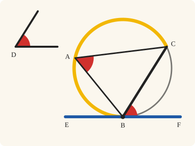
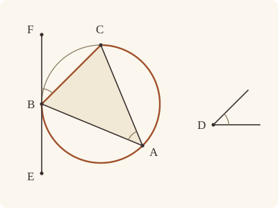

<!-- Generated by scripts/render.py. Do not edit by hand. -->

[Book III](index.md) · [← III.33](33.md) · [III.35 →](35.md)

# Book III, Proposition 34

*A segment admitting a given angle, cut off from a given circle*

[Euclid's proof](#euclids-proof) · [In Lean](#in-lean) · [What it rests on](#what-it-rests-on) · [Mishnah](#mishnah)

> From a given circle to cut off a segment admitting an angle equal to a given rectilineal angle.

**In Lean:** ✅ proved, as Euclid states it · Euclid's argument

<p align="center"></p>

<p align="center"><em>Draw EF (blue) touching the circle at B and lay the given angle at D (red) against it there, as FBC: BC cuts off a segment BAC (yellow) whose angles all equal the angle at D.</em></p>

## Euclid's proof

<p align="center"></p>

<p align="center"><em>Drawn for one case: an acute given angle, with BAC the greater segment.</em></p>

Let ABC be the given circle, and the angle at D the given rectilineal angle;

thus it is required to cut off from the circle ABC a segment admitting an angle equal to the given rectilineal angle, the angle at D.

Let EF be drawn touching ABC at the point B, and on the straight line FB, and at the point B on it, let the angle FBC be constructed equal to the angle at D. [I. 23]

Then, since a straight line EF touches the circle ABC,

and BC has been drawn across from the point of contact at B,

the angle FBC is equal to the angle constructed in the alternate segment BAC. [III. 32]

But the angle FBC is equal to the angle at D;

therefore the angle in the segment BAC is equal to the angle at D.

Therefore from the given circle ABC the segment BAC has been cut off admitting an angle equal to the given rectilineal angle, the angle at D.

Q. E. F.

## In Lean

| | |
|---|---|
| Proof | ✅ Proved |
| Statement | The whole enunciation. Cuts off from the given circle a segment BAC admitting the given angle at A. |
| Argument | Euclid's. Euclid reads C off his figure. The Lean finds it: by III.16 the straight line BC passes within the circle, so it meets the circle again, on the centre's side of EF. |
| Representation | The segment cut off from the given circle is named by its points B, A and C. To draw EF touching the circle by III.16's porism, the proof takes a centre from `exists_centre`. |
| Reviewed | The statement and every passage of the argument read against Heath's text, at commit [`7b71d1782`](https://github.com/jackChallis/stoicheia/commit/7b71d1782) ([the record](../../review/III/34.toml)) |

From [`Elements/BookIII/Prop34.lean`](../../Elements/BookIII/Prop34.lean). Euclid's sentences are the `--` comments, and our own notes are in `/- … -/`; the lines under each sentence are the Lean that carries it out. The list below marks where a lemma does a step Euclid takes for granted; the `/- … -/` notes in the listing explain smaller adjustments.

**How the Lean follows the text**

- **Done by `Prop16.porism`.** "Let EF be drawn touching ABC at the point B…" The Lean takes the centre from `Tacit.exists_centre`, as the [introduction](index.md) explains, and B from `Tacit.exists_point_on_circle`. I.11 draws the perpendicular at B and III.16's porism makes EF touch, neither with a reference from Heath here.
- **Done by `Prop16`.** "and on the straight line FB…" Heath gives I.23 for copying the angle, but no reference to III.16, which supplies a point of BC within the circle. `Tacit.line_circle_beyond`, a rule we assume, finds the other end of the diameter needed for III.16, then C beyond the interior point.
- **Done by `Prop2.oppositeSide`.** "the angle FBC is equal to the angle constructed in the alternate segment BAC." Euclid takes an angle in the alternate segment BAC. The Lean first chooses A across BC from F by `Prop2.oppositeSide` (III.2, for which Heath prints no reference here), then applies III.32 as printed.
- **Done by `OnRay.of_sameSideOf`.** "But the angle FBC is equal to the angle at D…" The Lean puts C on the centre's side of EF: otherwise `OppositeSides.exists_between` would give a crossing of OC with EF within the circle by `InsideCircle.of_between_centre`, contrary to `Touches.not_inside`. `OnRay.of_sameSideOf` then puts C on the ray where the angle was copied, so `angle_onRay_right` gives the copied angle.

```lean
/-- From a given circle to cut off a segment admitting an angle equal to a given rectilineal angle. -/
theorem Prop34 {D₁ D D₂ : Point} (ABC : Circle) (hD : Triangle D₁ D D₂) :
    ∃ A B C : Point, OnCircle A ABC ∧ OnCircle B ABC ∧ OnCircle C ABC ∧ Triangle B A C ∧
      ∠ B A C = ∠ D₁ D D₂ := by
  -- Let ABC be the given circle, and the angle at D the given rectilineal angle;
  obtain ⟨O, hO⟩ := exists_centre ABC
  -- thus it is required to cut off from the circle ABC a segment admitting an angle equal to
  -- the given rectilineal angle, the angle at D.
  -- Let EF be drawn touching ABC at the point B,
  /- The straight line at right angles to the radius at B touches the circle
     (I.11 and III.16, Porism). -/
  obtain ⟨B, hB, -⟩ := exists_point_on_circle ABC []
  have hOB : O ≠ B := (ne_of_centre_of_on hO hB).symm
  obtain ⟨LO, hO_LO, hB_LO⟩ := Postulate1 O B hOB
  obtain ⟨Q, hQ, -⟩ := exists_off_line hOB []
  obtain ⟨F, hFQ, hF⟩ := BookI.Prop11 hOB ⟨LO, hO_LO, hB_LO, hB_LO⟩ hQ
  have hOBF : ∠ O B F = ∟ := hF O ⟨LO, hO_LO, hB_LO, hO_LO⟩ hOB
  have hOBF' : Triangle O B F := hFQ.triangle
  have htouch : Touches B F ABC := Prop16.porism hO hB hOBF' hOBF
  have hBF : B ≠ F := htouch.1
  obtain ⟨E, hFBE⟩ := produce hBF.symm
  obtain ⟨L, hB_L, hF_L⟩ := Postulate1 B F hBF
  have hE_L : OnLine E L := on_line_of_between hFBE hF_L hB_L
  have hEF : Touches E F ABC :=
    htouch.of_collinear ⟨L, hB_L, hF_L, hE_L⟩ ⟨L, hB_L, hF_L, hF_L⟩
      (ne_of_between_ends hFBE).symm
  have hEBF : Between E B F := between_symm hFBE
  have hO_L : ¬ OnLine O L := hOBF'.bca.off_line hB_L hF_L
  -- and on the straight line FB, and at the point B on it, let the angle FBC be constructed
  -- equal to the angle at D. [I. 23]
  /- We copy the given angle on the centre's side of EF. -/
  obtain ⟨C', F', hF', hC'O, hC'BF'⟩ := BookI.Prop23 hBF hD hOBF'.bca
  have hC'B : C' ≠ B := hC'O.triangle.ne₁₃.symm
  have hcopy : ∠ F B C' = ∠ D₁ D D₂ :=
    (angle_onRay_left hF' hC'B).symm.trans ((angle_symm hF'.2.1 hC'B).trans hC'BF')
  /- Euclid reads C off the figure. The straight line BC' passes within the circle
     by III.16, so it meets the circle again. -/
  obtain ⟨B', -, -, hB'OB⟩ :=
    line_circle_beyond (centre_inside hO) hO_LO hB_LO hOB.symm
  have hBOB' : Between B O B' := between_symm hB'OB
  have hB'ray : OnRay B' B O := OnRay.of_beyond hBOB'
  have hB'BF : ∠ B' B F = ∟ := by
    rw [angle_onRay_left hB'ray hBF.symm, hOBF]
  have hBB'F : Triangle B B' F := by
    rintro ⟨K, hB_K, hB'_K, hF_K⟩
    exact hOBF' ⟨K, on_line_of_between_ends hBOB' hB_K hB'_K, hB_K, hF_K⟩
  obtain ⟨Z, hZcol, hZin⟩ :=
    (Prop16 hO hB hBOB' hBB'F hB'BF).2 C' hC'O.triangle
  have hZB : Z ≠ B := fun e => inside_not_on hZin (e ▸ hB)
  obtain ⟨N, hB_N, hC'_N⟩ := Postulate1 B C' hC'B.symm
  have hZ_N : OnLine Z N := by
    obtain ⟨K, hB_K, hC'_K, hZ_K⟩ := hZcol
    exact (line_unique hC'B.symm hB_K hC'_K hB_N hC'_N) ▸ hZ_K
  obtain ⟨C, hC, hC_N, hCZB⟩ := line_circle_beyond hZin hZ_N hB_N hZB.symm
  have hCB : C ≠ B := ne_of_between_ends hCZB
  /- C lies on the centre's side of EF, as in III.32: otherwise the straight line OC
     would cross EF within the circle, although EF touches it. -/
  have hCO : SameSide C O L := by
    have hC_L : ¬ OnLine C L := fun h =>
      (hEF.2 L hE_L hF_L).2 ⟨B, C, hCB.symm, hB_L, hB, h, hC⟩
    refine Classical.byContradiction fun hs => ?_
    obtain ⟨W, hW_L, hCWO⟩ := OppositeSides.exists_between ⟨hC_L, hO_L, hs⟩
    exact htouch.not_inside ⟨L, hB_L, hF_L, hW_L⟩
      (InsideCircle.of_between_centre hO hC (between_symm hCWO))
  have hCC' : SameSideOf C C' B F :=
    SameSideOf.of_line hBF hB_L hF_L (same_side_trans (same_side_symm hCO)
      (same_side_symm (hC'O.sameSide hB_L hF_L)))
  have hCray : OnRay C B C' :=
    OnRay.of_sameSideOf hCC' ⟨N, hB_N, hC'_N, hC_N⟩ hCB
  -- Then, since a straight line EF touches the circle ABC,
  -- and BC has been drawn across from the point of contact at B,
  have hBCF : Triangle B C F := hCC'.triangle.acb
  -- the angle FBC is equal to the angle constructed in the alternate segment BAC. [III. 32]
  obtain ⟨A, hA, hAF⟩ := Prop2.oppositeSide hB hC hBCF
  have h32 : ∠ F B C = ∠ B A C :=
    (Prop32 hB hC hCB.symm hEF hEBF).1 A hA hAF
  -- But the angle FBC is equal to the angle at D;
  have hFBC : ∠ F B C = ∠ D₁ D D₂ := by
    rw [angle_onRay_right hCray hBF.symm, hcopy]
  -- therefore the angle in the segment BAC is equal to the angle at D.
  have hBAC : ∠ B A C = ∠ D₁ D D₂ := h32.symm.trans hFBC
  -- Therefore from the given circle ABC the segment BAC has been cut off admitting an angle
  -- equal to the given rectilineal angle, the angle at D.
  exact ⟨A, B, C, hA, hB, hC, hAF.triangle.acb, hBAC⟩
  -- Q. E. F.
```

## What it rests on

| | |
|---|---|
| Heath's references | [I.23](../I/23.md), [III.32](32.md) |
| Lean cites | [I.11](../I/11.md), [I.23](../I/23.md), [III.2](02.md), [III.16](16.md), [III.16 Por.](16.md#porism), [III.32](32.md) |
| Postulates | 1, 2, 3, 4, 5 |
| Definitions taken as axioms | Def. I.15 |
| Common Notions | 1, 2, 3, 4, 5 |
| Tacit rules | 39 (listed below) |
| Its own Lean calls | Postulate 1; 6 tacit rules |
| Through lemmas | Postulates 2 and 3; Def. I.15; 25 tacit rules |

Some of these come in through lemmas [shared](../../CERTIFICATE.md#shared-steps) by many proofs: [`Prop2.oppositeSide`](../../Elements/BookIII/Prop02.lean#L150) (III.2).

_Postulates, definitions, Common Notions and tacit rules: all that this proof rests on, counting those of the propositions it cites. The last two rows say which of the postulates, definitions and tacit rules its own Lean calls, in the proof or a helper written for it, and which it does not call but reaches through lemmas, of Book Zero or shared (a proposition it cites may rest on these too); the rest come in only through the propositions it cites or the Common Notions._

<details><summary>The 39 tacit rules beneath this proof, counting those of the propositions it cites</summary>

_(used here) marks a rule this proof's own Lean calls, in the proof or a helper written for it; (through …) marks one its own Lean does not call but reaches through the lemmas named, of [Book Zero](../../Elements/Figure) or shared, though a proposition it cites may rest on it too; and a rule with no mark comes in only through a proposition it cites or a Common Notion. The names in brackets are System E's: an Intersection rule says when straight lines and circles must meet, and an Intersections rule takes a point where they do (see [Book I's introduction](../I/index.md))._

**Reading the figure**

- [`between_cases`](../../Elements/Foundations/Tacit/Diagram.lean#L54) (through [`OppositeSides.exists_between`](../../Elements/Figure/Sides.lean#L119), [`Prop2.oppositeSide`](../../Elements/BookIII/Prop02.lean#L150), [`Tacit.exists_point_on_circle`](../../Elements/Figure/CirclePoints.lean#L84) and 1 other lemma): Of three different points on a straight line, one is between the other two. (Between 6)
- [`between_of_inside_chord`](../../Elements/Foundations/Tacit/Diagram.lean#L81) (through [`InsideCircle.of_between_centre`](../../Elements/Figure/Circles.lean#L164), [`OnRay.of_beyond`](../../Elements/Figure/Rays.lean#L41), [`OnRay.of_sameSideOf`](../../Elements/Figure/Angles.lean#L188) and 14 other lemmas): A straight line through a point inside a circle has that point between the points where it meets the circle. (Circle 1)
- [`between_symm`](../../Elements/Foundations/Tacit/Diagram.lean#L47) (used here): If B is between A and C, it is between C and A. (Between 1)
- [`circles_meet`](../../Elements/Foundations/Tacit/Diagram.lean#L94) (through [`OnRay.of_beyond`](../../Elements/Figure/Rays.lean#L41), [`OnRay.of_sameSideOf`](../../Elements/Figure/Angles.lean#L188), [`OppositeSides.exists_between`](../../Elements/Figure/Sides.lean#L119) and 6 other lemmas): If each circle passes through a point inside the other, the circles cut one another. This is the step Euclid takes for granted in I.1. (Intersection 5)
- [`circles_meet_same_side`](../../Elements/Foundations/Tacit/Constructions.lean#L79) (through [`OnRay.of_beyond`](../../Elements/Figure/Rays.lean#L41), [`OnRay.of_sameSideOf`](../../Elements/Figure/Angles.lean#L188), [`OppositeSides.exists_between`](../../Elements/Figure/Sides.lean#L119) and 6 other lemmas): Two circles that cut one another do so on each side of the straight line through their centres. (Intersections 8)
- [`exists_centre`](../../Elements/Foundations/Tacit/Constructions.lean#L57) (used here): Every circle has a centre. A rule of our own, not one of System E's: its content is Euclid's Definitions I.15 and I.16.
- [`exists_point`](../../Elements/Foundations/Tacit/Constructions.lean#L35) (through [`InsideCircle.of_between_centre`](../../Elements/Figure/Circles.lean#L164), [`OnRay.of_beyond`](../../Elements/Figure/Rays.lean#L41), [`Prop2.oppositeSide`](../../Elements/BookIII/Prop02.lean#L150) and 10 other lemmas): Let a point be taken. (Points 1)
- [`exists_point_inside_circle`](../../Elements/Foundations/Tacit/Constructions.lean#L42) (through [`InsideCircle.of_between_centre`](../../Elements/Figure/Circles.lean#L164), [`OnRay.of_beyond`](../../Elements/Figure/Rays.lean#L41), [`OnRay.of_sameSideOf`](../../Elements/Figure/Angles.lean#L188) and 13 other lemmas): Let a point be taken inside the circle α. (Points 8)
- [`exists_point_on_line`](../../Elements/Foundations/Tacit/Constructions.lean#L38) (through [`OnRay.of_beyond`](../../Elements/Figure/Rays.lean#L41), [`OnRay.of_sameSideOf`](../../Elements/Figure/Angles.lean#L188), [`OppositeSides.exists_between`](../../Elements/Figure/Sides.lean#L119) and 7 other lemmas): Let a point be taken on the straight line L. (Points 2)
- [`line_circle_between`](../../Elements/Foundations/Tacit/Constructions.lean#L67) (through [`InsideCircle.of_between_centre`](../../Elements/Figure/Circles.lean#L164), [`OnRay.of_beyond`](../../Elements/Figure/Rays.lean#L41), [`OnRay.of_sameSideOf`](../../Elements/Figure/Angles.lean#L188) and 13 other lemmas): A straight line through a point B inside a circle, heading out to a point C outside it, cuts the circle between B and C. (Intersections 4)
- [`line_circle_beyond`](../../Elements/Foundations/Tacit/Constructions.lean#L73) (used here): A straight line through a point B inside a circle, produced beyond B away from C, cuts the circle there. (Intersections 5)
- [`line_unique`](../../Elements/Foundations/Tacit/Diagram.lean#L41) (used here): Two points determine a straight line. (Generalities 1)
- [`lines_meet_of_opposite_sides`](../../Elements/Foundations/Tacit/Diagram.lean#L89) (through [`OppositeSides.exists_between`](../../Elements/Figure/Sides.lean#L119)): A straight line joining points on opposite sides of L crosses L. (Intersection 1)
- [`not_between_of_between`](../../Elements/Foundations/Tacit/Diagram.lean#L50) (through [`InsideCircle.of_between_centre`](../../Elements/Figure/Circles.lean#L164), [`OnRay.of_beyond`](../../Elements/Figure/Rays.lean#L41), [`OnRay.of_sameSideOf`](../../Elements/Figure/Angles.lean#L188) and 14 other lemmas): If B is between A and C, then A is not between B and C. (Between 1)
- [`not_on_line_of_same_side`](../../Elements/Foundations/Tacit/Diagram.lean#L60) (through [`OnRay.of_beyond`](../../Elements/Figure/Rays.lean#L41), [`OnRay.of_sameSideOf`](../../Elements/Figure/Angles.lean#L188), [`OppositeSides.exists_between`](../../Elements/Figure/Sides.lean#L119) and 7 other lemmas): Points on one side of a straight line are not on it. (Same side 3)
- [`pasch2`](../../Elements/Foundations/Tacit/Diagram.lean#L71) (through [`OnRay.of_beyond`](../../Elements/Figure/Rays.lean#L41), [`OnRay.of_sameSideOf`](../../Elements/Figure/Angles.lean#L188), [`OppositeSides.exists_between`](../../Elements/Figure/Sides.lean#L119) and 5 other lemmas): If B is between A and C, A is on L and B is off it, then B and C are on the same side of L: a straight line that leaves L at A does not cross it again. (Pasch 2)
- [`same_side_trans`](../../Elements/Foundations/Tacit/Diagram.lean#L64) (used here): Two points on the same side of a straight line as a third point are on the same side as each other. (Same side 4)

**Lengths, angles and areas**

- [`angle_add_of_inside`](../../Elements/Foundations/Tacit/Transfer.lean#L47) (through [`OnRay.of_sameSideOf`](../../Elements/Figure/Angles.lean#L188) and [`Prop2.oppositeSide`](../../Elements/BookIII/Prop02.lean#L150)): If D lies within the angle BAC, then BAC is made up of BAD and DAC. (Diagram-angle 2)
- [`angle_eq_of_same_rays`](../../Elements/Foundations/Tacit/Transfer.lean#L54) (through [`angle_onRay_left`](../../Elements/Figure/Angles.lean#L42) and [`angle_onRay_right`](../../Elements/Figure/Angles.lean#L49)): The angle doesn't change if its arms are traced through other points on the same rays. (Diagram-angle 4)
- [`angle_symm`](../../Elements/Foundations/Tacit/Metric.lean#L30) (used here): The angle ABC is the angle CBA. (Metric 4)
- [`area_add_of_between`](../../Elements/Foundations/Tacit/Transfer.lean#L70): Cutting a triangle in two from a vertex adds up. (Diagram-area 2)
- [`area_congruent`](../../Elements/Foundations/Tacit/Metric.lean#L44): Triangles equal in all their sides and angles are equal in area. Euclid uses this without comment once he has shown two triangles congruent. (Metric 9)
- [`area_degenerate`](../../Elements/Foundations/Tacit/Metric.lean#L36): A "triangle" with a repeated corner has no area. (Metric 6)
- [`area_eq_zero_of_on_line`](../../Elements/Foundations/Tacit/Transfer.lean#L62): A "triangle" whose corners lie on one straight line has no area. (Diagram-area 1)
- [`area_rotate`](../../Elements/Foundations/Tacit/Metric.lean#L39): The triangle ABC is the triangle CAB. (Metric 8)
- [`circle_eq`](../../Elements/Foundations/Tacit/Transfer.lean#L30) (through [`InsideCircle.of_between_centre`](../../Elements/Figure/Circles.lean#L164), [`OnRay.of_beyond`](../../Elements/Figure/Rays.lean#L41), [`OnRay.of_sameSideOf`](../../Elements/Figure/Angles.lean#L188) and 13 other lemmas): A circle is fixed by its centre and its radius. (Diagram-segment 2)
- [`len_add_of_between`](../../Elements/Foundations/Tacit/Transfer.lean#L27) (through [`InsideCircle.of_between_centre`](../../Elements/Figure/Circles.lean#L164), [`OnRay.of_beyond`](../../Elements/Figure/Rays.lean#L41), [`OnRay.of_sameSideOf`](../../Elements/Figure/Angles.lean#L188) and 13 other lemmas): If B is between A and C, then AB and BC together make up AC. (Diagram-segment 1)
- [`len_self`](../../Elements/Foundations/Tacit/Metric.lean#L24) (through [`InsideCircle.of_between_centre`](../../Elements/Figure/Circles.lean#L164), [`OnRay.of_beyond`](../../Elements/Figure/Rays.lean#L41), [`OnRay.of_sameSideOf`](../../Elements/Figure/Angles.lean#L188) and 13 other lemmas): The "straight line" from a point to itself has no length. (Metric 1)
- [`len_symm`](../../Elements/Foundations/Tacit/Metric.lean#L27) (through [`InsideCircle.of_between_centre`](../../Elements/Figure/Circles.lean#L164), [`OnRay.of_beyond`](../../Elements/Figure/Rays.lean#L41), [`OnRay.of_sameSideOf`](../../Elements/Figure/Angles.lean#L188) and 13 other lemmas): The straight line AB is the straight line BA. (Metric 3)
- [`same_ray_of_angle_eq_zero`](../../Elements/Foundations/Tacit/Transfer.lean#L42) (through [`OnRay.of_sameSideOf`](../../Elements/Figure/Angles.lean#L188) and [`Prop2.oppositeSide`](../../Elements/BookIII/Prop02.lean#L150)): If the angle BAC is nothing, C lies on the ray from A through B. (Diagram-angle 1)

**Superposition**

- [`superposition`](../../Elements/Foundations/Tacit/Superposition.lean#L48): **Superposition.** A hypothetical placement of a triangle on a given ray and side permits a restricted derivation of metric equalities about the figure already given. The derivation introduces no further objects, cites each geometric law it uses, and exports no symbol of the placement.

**Laws of magnitude**

- [`add_assoc`](../../Elements/Foundations/Tacit/Magnitudes.lean#L23) (through [`Prop2.oppositeSide`](../../Elements/BookIII/Prop02.lean#L150)): Adding three magnitudes in a row, it makes no difference whether the first two or the last two are added first. (System E §3.5)
- [`add_comm`](../../Elements/Foundations/Tacit/Magnitudes.lean#L26) (through [`InsideCircle.of_between_centre`](../../Elements/Figure/Circles.lean#L164), [`OnRay.of_beyond`](../../Elements/Figure/Rays.lean#L41), [`OnRay.of_sameSideOf`](../../Elements/Figure/Angles.lean#L188) and 13 other lemmas): The order of adding does not matter. (System E §3.5)
- [`add_lt_add_right`](../../Elements/Foundations/Tacit/Magnitudes.lean#L45): Adding the same thing to both sides keeps "less than". (System E §3.5)
- [`add_zero`](../../Elements/Foundations/Tacit/Magnitudes.lean#L29): Adding nothing changes nothing. (System E §3.5)
- [`lt_irrefl`](../../Elements/Foundations/Tacit/Magnitudes.lean#L32) (through [`InsideCircle.of_between_centre`](../../Elements/Figure/Circles.lean#L164), [`OnRay.of_beyond`](../../Elements/Figure/Rays.lean#L41), [`OnRay.of_sameSideOf`](../../Elements/Figure/Angles.lean#L188) and 13 other lemmas): No magnitude is less than itself. (System E §3.5)
- [`lt_trans`](../../Elements/Foundations/Tacit/Magnitudes.lean#L35) (through [`InsideCircle.of_between_centre`](../../Elements/Figure/Circles.lean#L164), [`OnRay.of_beyond`](../../Elements/Figure/Rays.lean#L41), [`OnRay.of_sameSideOf`](../../Elements/Figure/Angles.lean#L188) and 13 other lemmas): What is less than the less is less still. (System E §3.5)
- [`lt_trichotomy`](../../Elements/Foundations/Tacit/Magnitudes.lean#L39) (through [`InsideCircle.of_between_centre`](../../Elements/Figure/Circles.lean#L164), [`OnRay.of_beyond`](../../Elements/Figure/Rays.lean#L41), [`OnRay.of_sameSideOf`](../../Elements/Figure/Angles.lean#L188) and 13 other lemmas): Of two magnitudes, one is less, or they are equal, or the other is less. (System E §3.5)
- [`not_lt_zero`](../../Elements/Foundations/Tacit/Magnitudes.lean#L42) (through [`InsideCircle.of_between_centre`](../../Elements/Figure/Circles.lean#L164), [`OnRay.of_beyond`](../../Elements/Figure/Rays.lean#L41), [`OnRay.of_sameSideOf`](../../Elements/Figure/Angles.lean#L188) and 13 other lemmas): Nothing is less than zero. (System E §3.5)

</details>

## Mishnah

_Our commentary: what Euclid assumes, what Lean made us say out loud, and how the result looks by modern means._

**The circle given, the straight line found.** III.33 had the straight line and found the circle; here the circle is given, and Euclid must find the straight line. He draws EF touching the circle at B, copies the given angle at B as the angle FBC (I.23), and III.32 carries it across into the segment BAC. The angle FBC chooses the straight line BC. Where A falls on its circumference does not matter, so long as it is on the other side of BC from F.

Heath offers another route: "An alternative construction here would be to make an 'angle at the centre' (in the extended sense, if necessary) double of the given angle; and, if the given angle is right, it is only necessary to draw a diameter of the circle" (vol. 2, p. 71). The extended sense is the one Heath discusses under III.20: an obtuse given angle needs an angle at the centre greater than two right angles. Euclid's straight line touching the circle serves acute, right and obtuse angles alike, with no extended sense at all.

To draw EF, our proof takes III.16's porism, at right angles to the radius at B (I.11), and for that it takes a centre from `exists_centre`, the rule that every circle has a centre. We copy the angle on the centre's side of EF. Then III.16 puts a point of the new straight line within the circle, so it meets the circle again at C, and on the centre's side of EF, for the reason found in III.32.

**The modern way.** Put the centre at 0 in the complex plane, and turn B through $2\theta$, twice the given angle, with $0 \lt \theta \lt \pi$, to $\mathrm{C} = \mathrm{B}e^{2i\theta}$. Every angle at the circumference standing on the arc so swept is $\theta$, so the segment on the other side of BC admits $\theta$. This is Heath's doubled angle at the centre, in the extended sense when $\theta \gt \pi/2$, rather than Euclid's straight line touching at B.

## Further reading

- Robert Simson draws the straight line touching at B by I.11, at right angles to the diameter, as our proof does, rather than by III.17, and his note on III.34 (p. 367) says why: [*The Elements of Euclid*](https://archive.org/details/bim_eighteenth-century_elements-english-sele_euclid_1756_0) (1756, free online) (also on [III.1](01.md)).
- How long is the straight line III.34 cuts off? The extended law of sines, BC = 2R sin A, answers, and Kiran S. Kedlaya's lively [*Geometry Unbound*](https://kskedlaya.org/geometryunbound/) (2006, free online), which sets trigonometry, vectors and complex numbers beside classical proofs, gives it as Fact 2.1.2 in ch. 2, "Algebraic methods".

[Book III](index.md) · [← III.33](33.md) · [III.35 →](35.md)

---

<sub>Euclid's text: T. L. Heath, *The Thirteen Books of Euclid's Elements*, vol. 2 (Cambridge, 1908), pp. 70–71; [scan leaves n82–n83](https://archive.org/details/thirteenbookseu00heibgoog/page/n82); [figure on n83](https://archive.org/details/thirteenbookseu00heibgoog/page/n83). Public domain.</sub>

<sub>The tacit rules follow the System E of Jeremy Avigad, Edward Dean and John Mumma, read alongside LeanEuclid (Logan Murphy, Kaiyu Yang, Jialiang Sun, Zhaoyu Li, Anima Anandkumar and Xujie Si).</sub>
