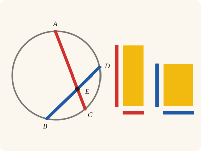
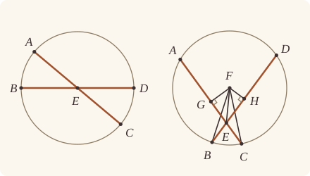

<!-- Generated by scripts/render.py. Do not edit by hand. -->

[Book III](index.md) · [← III.34](34.md) · [III.36 →](36.md)

# Book III, Proposition 35

*The rectangles contained by the segments are equal*

[Euclid's proof](#euclids-proof) · [In Lean](#in-lean) · [What it rests on](#what-it-rests-on) · [Mishnah](#mishnah)

> If in a circle two straight lines cut one another, the rectangle contained by the segments of the one is equal to the rectangle contained by the segments of the other.

**In Lean:** ✅ proved, as Euclid states it · Euclid's argument

<p align="center"></p>

<p align="center"><em>Cross AC and BD (red, blue) at E in a circle: the rectangle contained by AE, EC equals the rectangle contained by DE, EB (both yellow).</em></p>

## Euclid's proof

<p align="center"></p>

<p align="center"><em>Drawn for one case: both straight lines through the centre E (left), and neither through F with E distinct from G and H (right).</em></p>

For in the circle ABCD let the two straight lines AC, BD cut one another at the point E;

I say that the rectangle contained by AE, EC is equal to the rectangle contained by DE, EB.

If now AC, BD are through the centre, so that E is the centre of the circle ABCD,

it is manifest that, AE, EC, DE, EB being equal,

the rectangle contained by AE, EC is also equal to the rectangle contained by DE, EB.

Next let AC, DB not be through the centre;

let the centre of ABCD be taken, and let it be F;

from F let FG, FH be drawn perpendicular to the straight lines AC, DB, and let FB, FC, FE be joined.

Then, since a straight line GF through the centre cuts a straight line AC not through the centre at right angles,

it also bisects it; [III. 3]

therefore AG is equal to GC.

Since, then, the straight line AC has been cut into equal parts at G and into unequal parts at E,

the rectangle contained by AE, EC together with the square on EG is equal to the square on GC; [II. 5]

Let the square on GF be added;

therefore the rectangle AE, EC together with the squares on GE, GF is equal to the squares on CG, GF.

But the square on FE is equal to the squares on EG, GF,

and the square on FC is equal to the squares on CG, GF; [I. 47]

therefore the rectangle AE, EC together with the square on FE is equal to the square on FC.

And FC is equal to FB;

therefore the rectangle AE, EC together with the square on EF is equal to the square on FB.

For the same reason, also,

the rectangle DE, EB together with the square on FE is equal to the square on FB.

But the rectangle AE, EC together with the square on FE was also proved equal to the square on FB;

therefore the rectangle AE, EC together with the square on FE is equal to the rectangle DE, EB together with the square on FE.

Let the square on FE be subtracted from each;

therefore the rectangle contained by AE, EC which remains is equal to the rectangle contained by DE, EB.

Therefore etc.

Q. E. D.

## In Lean

| | |
|---|---|
| Proof | ✅ Proved |
| Statement | The whole enunciation. The rectangles AE, EC and DE, EB are equal wherever the two straight lines cut within the circle. |
| Argument | Euclid's. Where Heath cites I.47, `BookI.Prop47.sq` describes the squares by I.46 and identifies their areas through `Square.described` (I.4, I.28 and I.34); Heath prints no references to these four propositions there. |
| Reviewed | The statement and every passage of the argument read against Heath's text, at commit [`689ab169f`](https://github.com/jackChallis/stoicheia/commit/689ab169f) ([the record](../../review/III/35.toml)) |

From [`Elements/BookIII/Prop35.lean`](../../Elements/BookIII/Prop35.lean). Euclid's sentences are the `--` comments, and our own notes are in `/- … -/`; the lines under each sentence are the Lean that carries it out. The list below marks where a lemma does a step Euclid takes for granted, where several sentences share one step and where the Lean takes a case Euclid's figure leaves aside; the `/- … -/` notes in the listing explain smaller adjustments.

**How the Lean follows the text**

- **Done by `Definition15`.** "it is manifest that, AE, EC, DE, EB being equal…" Euclid takes AE, EC, DE and EB to be equal without giving a reason. The Lean obtains the equalities from `Definition15`, Euclid's definition of a circle, which we assume as a rule.
- **A further case, by `Prop35.cut`.** "Next let AC, DB not be through the centre…" Euclid next takes neither straight line through the centre; the Lean also takes AC through F with E distinct from F, covering both of Simson's intermediate cases, according as AC cuts DB at right angles or not. In that branch `Prop35.cut` applies II.5, for which Heath prints no reference at this transition, after `Tacit.centre_inside` (System E, Generalities 3), proved in `Elements/Figure/RuleBase.lean`, and `Tacit.between_of_inside_chord` (System E, Circle 1), proved after III.2, put F between A and C; `Definition15`, the assumed rule for equal radii, gives the equal halves.
- **Done by `Tacit.exists_centre`.** "let the centre of ABCD be taken, and let it be F…" Euclid takes the centre without a reference in Heath. The Lean obtains F from `Tacit.exists_centre`, a rule we assume that every circle has a centre, with no System E number.
- **Done by `BookI.Prop12`.** "from F let FG, FH be drawn perpendicular…" Euclid draws FG and FH perpendicular to AC and DB; the Lean draws FG by I.12, for which Heath prints no reference here. It draws FH later inside `Prop35.cut`, at the passage for DB; FB, FC and FE are named by their ends.
- **Done by `foot_between`.** "Then, since a straight line GF through the centre…" Euclid reads G between A and C from the figure. The Lean uses `foot_between`: I.17 and I.19, for which Heath prints no reference here, make FG shorter than a radius, and `Tacit.inside_of_len_lt` (System E, Diagram-segment 4), proved in `Elements/Figure/Incidence.lean`, and `Tacit.between_of_inside_chord` (System E, Circle 1), proved after III.2, put G within the circle and between the ends.
- **A further case.** "Since, then, the straight line AC has been cut into equal parts at G…" Euclid takes E distinct from G for the unequal cut in II.5. When E is G, the Lean uses `sq_self` to make the square on EG nothing and `rect_congr` to identify the rectangle of the equal halves with the square on GC.
- **A further case.** "But the square on FE is equal to the squares on EG, GF…" Euclid uses I.47 for the right triangle FGE. When E is G, the Lean again uses `sq_self`: the square on EG is nothing, and the squares on FE and GF are the same.
- **Done by `Definition15`.** "And FC is equal to FB…" Euclid uses the equality of the radii FC and FB without giving a reason. The Lean obtains it from `Definition15`, Euclid's definition of a circle, which we assume as a rule.
- **Carried together, by `Prop35.cut`.** "For the same reason, also…" Euclid leaves DB to the same argument without writing it out; the Lean applies `Prop35.cut`, proved once over any letters, with D and B as the ends. It uses I.12, `foot_between` (I.17 and I.19), III.3, II.5 and I.47 as above, including DB through F and E at the perpendicular's foot; Heath prints no further references here.

<details><summary>Before the theorem, one lemma: <code>Prop35.cut</code> (61 lines)</summary>

```lean
/-- This is Euclid's argument for one straight line AC through a point E other than the
centre F: the rectangle contained by AE, EC, together with the square on FE, is equal to the
square on FC. It serves as his "For the same reason" for DB, and covers the intermediate
cases, where one straight line passes through the centre or E is the foot of the
perpendicular. -/
theorem Prop35.cut {A C E F : Point} {α : Circle} (hF : Centre F α) (hA : OnCircle A α)
    (hC : OnCircle C α) (hAEC : Between A E C) (hEF : E ≠ F) :
    rect A E E C + sq F E = sq F C := by
  have hAC : A ≠ C := ne_of_between_ends hAEC
  obtain ⟨L, hA_L, hC_L⟩ := Postulate1 A C hAC
  have hE_L : OnLine E L := on_line_of_between_ends hAEC hA_L hC_L
  by_cases hF_AC : Collinear A C F
  · /- When AC passes through the centre, F bisects it, and II.5 applies there. -/
    obtain ⟨M, hA_M, hC_M, hF_M⟩ := hF_AC
    have hAFC : Between A F C :=
      between_of_inside_chord hF_M hA_M hC_M (centre_inside hF) hA hC hAC
    have hAF : ‖A F‖ = ‖F C‖ := by
      rw [len_symm A F]
      exact Definition15 hF hA hC
    exact BookII.Prop5 hAFC hAF hAEC hEF
  · /- The perpendicular from F, drawn by I.12, falls within AC (`foot_between`). -/
    obtain ⟨G, hG, hFG⟩ := BookI.Prop12 hAC hF_AC
    have hAGC : Between A G C := foot_between hF hA hC hF_AC hG hFG
    have hG_L : OnLine G L := on_line_of_between_ends hAGC hA_L hC_L
    have hF_L : ¬ OnLine F L := Triangle.off_line hF_AC hA_L hC_L
    have hFG' : F ≠ G := fun e => hF_L (e ▸ hG_L)
    have hAGF : ∠ A G F = ∟ := by
      rw [angle_symm (ne_of_between hAGC) hFG']
      exact hFG A ⟨L, hA_L, hC_L, hA_L⟩ (ne_of_between hAGC)
    /- It bisects AC [III. 3]. -/
    have hAG : ‖A G‖ = ‖G C‖ := (Prop3 hF hA hC hAGC hF_AC).2 hAGF
    /- AC is cut into equal parts at G and unequal parts at E [II. 5]; if E is G, the
       square on EG is nothing. -/
    have h5 : rect A E E C + sq E G = sq G C := by
      by_cases hEG : E = G
      · subst hEG
        rw [sq_self, add_zero]
        exact rect_congr hAG rfl
      · rw [sq_symm E G]
        exact BookII.Prop5 hAGC hAG hAEC hEG
    /- The square on GF is added to each. -/
    have hadd : rect A E E C + sq E G + sq G F = sq G C + sq G F :=
      CommonNotion2 h5 rfl
    /- The two right triangles replace the pairs of squares [I. 47]. -/
    have hFE : sq F E = sq E G + sq G F := by
      by_cases hEG : E = G
      · subst hEG
        rw [sq_self, add_comm, add_zero, sq_symm]
      · have t : Triangle G F E :=
          (Triangle.of_line hG_L hE_L (Ne.symm hEG) hF_L).acb
        rw [BookI.Prop47.sq t (hFG E ⟨L, hA_L, hC_L, hE_L⟩ hEG),
          sq_symm G E, sq_symm F G]
        ac_rfl
    have hFC : sq F C = sq G C + sq G F := by
      have hCG : C ≠ G := ne_of_between (between_symm hAGC)
      have t : Triangle G F C :=
        (Triangle.of_line hG_L hC_L (Ne.symm hCG) hF_L).acb
      rw [BookI.Prop47.sq t (hFG C ⟨L, hA_L, hC_L, hC_L⟩ hCG), sq_symm F G]
      ac_rfl
    rw [hFE, hFC, ← add_assoc]
    exact hadd
```

</details>

```lean
/-- If in a circle two straight lines cut one another, the rectangle contained by the segments of
the one is equal to the rectangle contained by the segments of the other. -/
theorem Prop35 {A B C D E : Point} {ABCD : Circle} (hA : OnCircle A ABCD)
    (hB : OnCircle B ABCD) (hC : OnCircle C ABCD) (hD : OnCircle D ABCD)
    (hAEC : Between A E C) (hBED : Between B E D) :
    rect A E E C = rect D E E B := by
  -- For in the circle ABCD let the two straight lines AC, BD cut one another at the point E;
  -- I say that the rectangle contained by AE, EC is equal to the rectangle contained by DE,
  -- EB.
  -- If now AC, BD are through the centre, so that E is the centre of the circle ABCD,
  by_cases hE : Centre E ABCD
  -- it is manifest that, AE, EC, DE, EB being equal,
  · have h₁ : ‖A E‖ = ‖D E‖ := by
      rw [len_symm A E, Definition15 hE hA hD, len_symm]
    have h₂ : ‖E C‖ = ‖E B‖ := Definition15 hE hC hB
    -- the rectangle contained by AE, EC is also equal to the rectangle contained by DE, EB.
    exact rect_congr h₁ h₂
  -- Next let AC, DB not be through the centre;
  -- let the centre of ABCD be taken, and let it be F;
  obtain ⟨F, hF⟩ := exists_centre ABCD
  have hEF : E ≠ F := fun e => hE (e ▸ hF)
  have hAC : rect A E E C + sq F E = sq F C := by
    by_cases hF_AC : Collinear A C F
    · /- Robert Simson adds the intermediate cases, where AC passes through the centre
         and E does not. Then F bisects AC, and `Prop35.cut` gives the squares by II.5 at
         once. -/
      exact Prop35.cut hF hA hC hAEC hEF
    have hAC' : A ≠ C := ne_of_between_ends hAEC
    obtain ⟨L, hA_L, hC_L⟩ := Postulate1 A C hAC'
    have hE_L : OnLine E L := on_line_of_between_ends hAEC hA_L hC_L
    -- from F let FG, FH be drawn perpendicular to the straight lines AC, DB, and let FB, FC, FE
    -- be joined.
    obtain ⟨G, hG, hFG⟩ := BookI.Prop12 hAC' hF_AC
    /- FH is drawn in `Prop35.cut`, applied to DB below. The straight lines joined need
       no construction in Lean. -/
    -- Then, since a straight line GF through the centre cuts a straight line AC not through the
    -- centre at right angles,
    have hAGC : Between A G C := foot_between hF hA hC hF_AC hG hFG
    have hG_L : OnLine G L := on_line_of_between_ends hAGC hA_L hC_L
    have hF_L : ¬ OnLine F L := Triangle.off_line hF_AC hA_L hC_L
    have hFG' : F ≠ G := fun e => hF_L (e ▸ hG_L)
    have hAGF : ∠ A G F = ∟ := by
      rw [angle_symm (ne_of_between hAGC) hFG']
      exact hFG A ⟨L, hA_L, hC_L, hA_L⟩ (ne_of_between hAGC)
    -- it also bisects it; [III. 3]
    have hbisect := (Prop3 hF hA hC hAGC hF_AC).2 hAGF
    -- therefore AG is equal to GC.
    have hAG : ‖A G‖ = ‖G C‖ := hbisect
    -- Since, then, the straight line AC has been cut into equal parts at G and into unequal
    -- parts at E,
    -- the rectangle contained by AE, EC together with the square on EG is equal to the square on
    -- GC; [II. 5]
    have h5 : rect A E E C + sq E G = sq G C := by
      by_cases hEG : E = G
      · /- If E is G, the square on EG is nothing, as in `Prop35.cut`. -/
        subst hEG
        rw [sq_self, add_zero]
        exact rect_congr hAG rfl
      · rw [sq_symm E G]
        exact BookII.Prop5 hAGC hAG hAEC hEG
    -- Let the square on GF be added;
    have hadd := CommonNotion2 h5 (rfl : sq G F = sq G F)
    -- therefore the rectangle AE, EC together with the squares on GE, GF is equal to the squares
    -- on CG, GF.
    have hsum : rect A E E C + (sq G E + sq G F) = sq C G + sq G F := by
      rw [sq_symm G E, sq_symm C G, ← add_assoc]
      exact hadd
    -- But the square on FE is equal to the squares on EG, GF,
    have hFE : sq F E = sq E G + sq G F := by
      by_cases hEG : E = G
      · subst hEG
        rw [sq_self, add_comm, add_zero, sq_symm]
      · have t : Triangle G F E :=
          (Triangle.of_line hG_L hE_L (Ne.symm hEG) hF_L).acb
        rw [BookI.Prop47.sq t (hFG E ⟨L, hA_L, hC_L, hE_L⟩ hEG),
          sq_symm G E, sq_symm F G]
        ac_rfl
    -- and the square on FC is equal to the squares on CG, GF; [I. 47]
    have hFC : sq F C = sq C G + sq G F := by
      have hCG : C ≠ G := ne_of_between (between_symm hAGC)
      have t : Triangle G F C :=
        (Triangle.of_line hG_L hC_L (Ne.symm hCG) hF_L).acb
      rw [BookI.Prop47.sq t (hFG C ⟨L, hA_L, hC_L, hC_L⟩ hCG),
        sq_symm F G, sq_symm G C]
      ac_rfl
    -- therefore the rectangle AE, EC together with the square on FE is equal to the square on
    -- FC.
    rw [hFE, hFC, sq_symm E G]
    exact hsum
  -- And FC is equal to FB;
  have hFC_FB : ‖F C‖ = ‖F B‖ := Definition15 hF hC hB
  -- therefore the rectangle AE, EC together with the square on EF is equal to the square on
  -- FB.
  rw [sq_congr hFC_FB] at hAC
  -- For the same reason, also,
  -- the rectangle DE, EB together with the square on FE is equal to the square on FB.
  have hDB : rect D E E B + sq F E = sq F B :=
    Prop35.cut hF hD hB (between_symm hBED) hEF
  -- But the rectangle AE, EC together with the square on FE was also proved equal to the
  -- square on FB;
  -- therefore the rectangle AE, EC together with the square on FE is equal to the rectangle
  -- DE, EB together with the square on FE.
  have hboth : rect A E E C + sq F E = rect D E E B + sq F E := hAC.trans hDB.symm
  -- Let the square on FE be subtracted from each;
  -- therefore the rectangle contained by AE, EC which remains is equal to the rectangle
  -- contained by DE, EB.
  exact CommonNotion3 hboth rfl
  -- Therefore etc.
  -- Q. E. D.
```

## What it rests on

| | |
|---|---|
| Heath's references | [I.47](../I/47.md), [II.5](../II/05.md), [III.3](03.md) |
| Lean cites | [I.4](../I/04.md), [I.12](../I/12.md), [I.17](../I/17.md), [I.19](../I/19.md), [I.28](../I/28.md), [I.34](../I/34.md), [I.46](../I/46.md), [I.47](../I/47.md), [II.5](../II/05.md), [III.2](02.md), [III.3](03.md) |
| Postulates | 1, 2, 3, 4, 5 |
| Definitions taken as axioms | Def. I.15 |
| Common Notions | 1, 2, 3, 4, 5 |
| Tacit rules | 39 (listed below) |
| Its own Lean calls | Postulate 1; Def. I.15; 7 tacit rules |
| Through lemmas | Postulates 2 and 3; 28 tacit rules |

Some of these come in through lemmas [shared](../../CERTIFICATE.md#shared-steps) by many proofs: [`BookI.Prop47.sq`](../../Elements/BookII/Rectangles.lean#L411) (I.4, I.28, I.34, I.46, I.47); [`foot_between`](../../Elements/BookIII/Feet.lean#L39) (I.17, I.19, III.2); [`Tacit.between_of_inside_chord`](../../Elements/BookIII/Prop02.lean#L192) (III.2).

_Postulates, definitions, Common Notions and tacit rules: all that this proof rests on, counting those of the propositions it cites. The last two rows say which of the postulates, definitions and tacit rules its own Lean calls, in the proof or a helper written for it, and which it does not call but reaches through lemmas, of Book Zero or shared (a proposition it cites may rest on these too); the rest come in only through the propositions it cites or the Common Notions._

<details><summary>The 39 tacit rules beneath this proof, counting those of the propositions it cites</summary>

_(used here) marks a rule this proof's own Lean calls, in the proof or a helper written for it; (through …) marks one its own Lean does not call but reaches through the lemmas named, of [Book Zero](../../Elements/Figure) or shared, though a proposition it cites may rest on it too; and a rule with no mark comes in only through a proposition it cites or a Common Notion. The names in brackets are System E's: an Intersection rule says when straight lines and circles must meet, and an Intersections rule takes a point where they do (see [Book I's introduction](../I/index.md))._

**Reading the figure**

- [`between_cases`](../../Elements/Foundations/Tacit/Diagram.lean#L54) (through [`BookI.Prop47.sq`](../../Elements/BookII/Rectangles.lean#L411), [`Tacit.between_of_inside_chord`](../../Elements/BookIII/Prop02.lean#L192) and [`foot_between`](../../Elements/BookIII/Feet.lean#L39)): Of three different points on a straight line, one is between the other two. (Between 6)
- [`between_symm`](../../Elements/Foundations/Tacit/Diagram.lean#L47) (used here): If B is between A and C, it is between C and A. (Between 1)
- [`circles_meet`](../../Elements/Foundations/Tacit/Diagram.lean#L91) (through [`BookI.Prop47.sq`](../../Elements/BookII/Rectangles.lean#L411), [`Tacit.between_of_inside_chord`](../../Elements/BookIII/Prop02.lean#L192), [`Tacit.on_line_of_between_ends`](../../Elements/Figure/RuleBase.lean#L142) and 1 other lemma): If each circle passes through a point inside the other, the circles cut one another. This is the step Euclid takes for granted in I.1. (Intersection 5)
- [`circles_meet_same_side`](../../Elements/Foundations/Tacit/Constructions.lean#L79) (through [`BookI.Prop47.sq`](../../Elements/BookII/Rectangles.lean#L411), [`Tacit.between_of_inside_chord`](../../Elements/BookIII/Prop02.lean#L192), [`Tacit.on_line_of_between_ends`](../../Elements/Figure/RuleBase.lean#L142) and 1 other lemma): Two circles that cut one another do so on each side of the straight line through their centres. (Intersections 8)
- [`exists_centre`](../../Elements/Foundations/Tacit/Constructions.lean#L57) (used here): Every circle has a centre. A rule of our own, not one of System E's: its content is Euclid's Definitions I.15 and I.16.
- [`exists_point`](../../Elements/Foundations/Tacit/Constructions.lean#L35) (through [`BookI.Prop47.sq`](../../Elements/BookII/Rectangles.lean#L411) and [`foot_between`](../../Elements/BookIII/Feet.lean#L39)): Let a point be taken. (Points 1)
- [`exists_point_inside_circle`](../../Elements/Foundations/Tacit/Constructions.lean#L42) (through [`BookI.Prop47.sq`](../../Elements/BookII/Rectangles.lean#L411), [`Tacit.between_of_inside_chord`](../../Elements/BookIII/Prop02.lean#L192), [`Tacit.centre_inside`](../../Elements/Figure/RuleBase.lean#L56) and 2 other lemmas): Let a point be taken inside the circle α. (Points 8)
- [`exists_point_on_line`](../../Elements/Foundations/Tacit/Constructions.lean#L38) (through [`BookI.Prop47.sq`](../../Elements/BookII/Rectangles.lean#L411), [`Tacit.between_of_inside_chord`](../../Elements/BookIII/Prop02.lean#L192), [`Tacit.on_line_of_between_ends`](../../Elements/Figure/RuleBase.lean#L142) and 1 other lemma): Let a point be taken on the straight line L. (Points 2)
- [`line_circle_between`](../../Elements/Foundations/Tacit/Constructions.lean#L67) (through [`BookI.Prop47.sq`](../../Elements/BookII/Rectangles.lean#L411), [`Tacit.between_of_inside_chord`](../../Elements/BookIII/Prop02.lean#L192), [`Tacit.centre_inside`](../../Elements/Figure/RuleBase.lean#L56) and 2 other lemmas): A straight line through a point B inside a circle, heading out to a point C outside it, cuts the circle between B and C. (Intersections 4)
- [`line_circle_beyond`](../../Elements/Foundations/Tacit/Constructions.lean#L73) (through [`BookI.Prop47.sq`](../../Elements/BookII/Rectangles.lean#L411), [`Tacit.between_of_inside_chord`](../../Elements/BookIII/Prop02.lean#L192), [`Tacit.centre_inside`](../../Elements/Figure/RuleBase.lean#L56) and 2 other lemmas): A straight line through a point B inside a circle, produced beyond B away from C, cuts the circle there. (Intersections 5)
- [`line_unique`](../../Elements/Foundations/Tacit/Diagram.lean#L41) (through [`BookI.Prop47.sq`](../../Elements/BookII/Rectangles.lean#L411), [`Triangle.of_line`](../../Elements/Figure/Triangles.lean#L82) and [`foot_between`](../../Elements/BookIII/Feet.lean#L39)): Two points determine a straight line. (Generalities 1)
- [`lines_meet_of_opposite_sides`](../../Elements/Foundations/Tacit/Diagram.lean#L86) (through [`BookI.Prop47.sq`](../../Elements/BookII/Rectangles.lean#L411)): A straight line joining points on opposite sides of L crosses L. (Intersection 1)
- [`not_between_of_between`](../../Elements/Foundations/Tacit/Diagram.lean#L50) (through [`BookI.Prop47.sq`](../../Elements/BookII/Rectangles.lean#L411), [`Tacit.between_of_inside_chord`](../../Elements/BookIII/Prop02.lean#L192), [`Tacit.centre_inside`](../../Elements/Figure/RuleBase.lean#L56) and 4 other lemmas): If B is between A and C, then A is not between B and C. (Between 1)
- [`not_on_line_of_same_side`](../../Elements/Foundations/Tacit/Diagram.lean#L60) (through [`BookI.Prop47.sq`](../../Elements/BookII/Rectangles.lean#L411), [`Tacit.between_of_inside_chord`](../../Elements/BookIII/Prop02.lean#L192), [`Tacit.on_line_of_between_ends`](../../Elements/Figure/RuleBase.lean#L142) and 1 other lemma): Points on one side of a straight line are not on it. (Same side 3)
- [`pasch2`](../../Elements/Foundations/Tacit/Diagram.lean#L71) (through [`BookI.Prop47.sq`](../../Elements/BookII/Rectangles.lean#L411), [`Tacit.between_of_inside_chord`](../../Elements/BookIII/Prop02.lean#L192), [`Tacit.on_line_of_between_ends`](../../Elements/Figure/RuleBase.lean#L142) and 1 other lemma): If B is between A and C, A is on L and B is off it, then B and C are on the same side of L: a straight line that leaves L at A does not cross it again. (Pasch 2)
- [`same_side_trans`](../../Elements/Foundations/Tacit/Diagram.lean#L64) (through [`BookI.Prop47.sq`](../../Elements/BookII/Rectangles.lean#L411), [`Tacit.between_of_inside_chord`](../../Elements/BookIII/Prop02.lean#L192), [`Tacit.on_line_of_between_ends`](../../Elements/Figure/RuleBase.lean#L142) and 1 other lemma): Two points on the same side of a straight line as a third point are on the same side as each other. (Same side 4)

**Lengths, angles and areas**

- [`angle_add_of_inside`](../../Elements/Foundations/Tacit/Transfer.lean#L47) (through [`BookI.Prop47.sq`](../../Elements/BookII/Rectangles.lean#L411)): If D lies within the angle BAC, then BAC is made up of BAD and DAC. (Diagram-angle 2)
- [`angle_eq_of_same_rays`](../../Elements/Foundations/Tacit/Transfer.lean#L54): The angle doesn't change if its arms are traced through other points on the same rays. (Diagram-angle 4)
- [`angle_symm`](../../Elements/Foundations/Tacit/Metric.lean#L30) (used here): The angle ABC is the angle CBA. (Metric 4)
- [`area_add_of_between`](../../Elements/Foundations/Tacit/Transfer.lean#L70) (through [`BookI.Prop47.sq`](../../Elements/BookII/Rectangles.lean#L411)): Cutting a triangle in two from a vertex adds up. (Diagram-area 2)
- [`area_congruent`](../../Elements/Foundations/Tacit/Metric.lean#L44): Triangles equal in all their sides and angles are equal in area. Euclid uses this without comment once he has shown two triangles congruent. (Metric 9)
- [`area_degenerate`](../../Elements/Foundations/Tacit/Metric.lean#L36) (through [`BookI.Prop47.sq`](../../Elements/BookII/Rectangles.lean#L411)): A "triangle" with a repeated corner has no area. (Metric 6)
- [`area_eq_zero_of_on_line`](../../Elements/Foundations/Tacit/Transfer.lean#L62) (through [`BookI.Prop47.sq`](../../Elements/BookII/Rectangles.lean#L411)): A "triangle" whose corners lie on one straight line has no area. (Diagram-area 1)
- [`area_rotate`](../../Elements/Foundations/Tacit/Metric.lean#L39) (through [`BookI.Prop47.sq`](../../Elements/BookII/Rectangles.lean#L411)): The triangle ABC is the triangle CAB. (Metric 8)
- [`len_add_of_between`](../../Elements/Foundations/Tacit/Transfer.lean#L27) (through [`BookI.Prop47.sq`](../../Elements/BookII/Rectangles.lean#L411), [`Tacit.between_of_inside_chord`](../../Elements/BookIII/Prop02.lean#L192), [`Tacit.centre_inside`](../../Elements/Figure/RuleBase.lean#L56) and 3 other lemmas): If B is between A and C, then AB and BC together make up AC. (Diagram-segment 1)
- [`len_self`](../../Elements/Foundations/Tacit/Metric.lean#L24) (through [`BookI.Prop47.sq`](../../Elements/BookII/Rectangles.lean#L411), [`Tacit.between_of_inside_chord`](../../Elements/BookIII/Prop02.lean#L192), [`Tacit.centre_inside`](../../Elements/Figure/RuleBase.lean#L56) and 4 other lemmas): The "straight line" from a point to itself has no length. (Metric 1)
- [`len_symm`](../../Elements/Foundations/Tacit/Metric.lean#L27) (used here): The straight line AB is the straight line BA. (Metric 3)
- [`on_line_of_area_eq_zero`](../../Elements/Foundations/Tacit/Transfer.lean#L66): A triangle with no area has its corners on one straight line. (Diagram-area 1)
- [`radius_ne_zero`](../../Elements/Foundations/Tacit/Metric.lean#L62) (through [`BookI.Prop47.sq`](../../Elements/BookII/Rectangles.lean#L411), [`Tacit.between_of_inside_chord`](../../Elements/BookIII/Prop02.lean#L192), [`Tacit.centre_inside`](../../Elements/Figure/RuleBase.lean#L56) and 4 other lemmas): A circle's radius is not nothing: the straight line from the centre to a point on the circle has some length. A rule of our own, not one of System E's: every circle is drawn with a centre and a distance (Postulate 3).
- [`same_ray_of_angle_eq_zero`](../../Elements/Foundations/Tacit/Transfer.lean#L42) (through [`BookI.Prop47.sq`](../../Elements/BookII/Rectangles.lean#L411)): If the angle BAC is nothing, C lies on the ray from A through B. (Diagram-angle 1)

**Superposition**

- [`superposition`](../../Elements/Foundations/Tacit/Superposition.lean#L52): **Superposition.** A hypothetical placement of a triangle on a given ray and side permits a restricted derivation of metric equalities about the figure already given. The derivation introduces no further objects, cites each geometric law it uses, and exports no symbol of the placement.

**Laws of magnitude**

- [`add_assoc`](../../Elements/Foundations/Tacit/Magnitudes.lean#L23) (used here): Adding three magnitudes in a row, it makes no difference whether the first two or the last two are added first. (System E §3.5)
- [`add_comm`](../../Elements/Foundations/Tacit/Magnitudes.lean#L26) (used here): The order of adding does not matter. (System E §3.5)
- [`add_lt_add_right`](../../Elements/Foundations/Tacit/Magnitudes.lean#L45) (through [`BookI.Prop47.sq`](../../Elements/BookII/Rectangles.lean#L411) and [`foot_between`](../../Elements/BookIII/Feet.lean#L39)): Adding the same thing to both sides keeps "less than". (System E §3.5)
- [`add_zero`](../../Elements/Foundations/Tacit/Magnitudes.lean#L29) (used here): Adding nothing changes nothing. (System E §3.5)
- [`lt_irrefl`](../../Elements/Foundations/Tacit/Magnitudes.lean#L32) (through [`BookI.Prop47.sq`](../../Elements/BookII/Rectangles.lean#L411), [`Tacit.between_of_inside_chord`](../../Elements/BookIII/Prop02.lean#L192), [`Tacit.centre_inside`](../../Elements/Figure/RuleBase.lean#L56) and 2 other lemmas): No magnitude is less than itself. (System E §3.5)
- [`lt_trans`](../../Elements/Foundations/Tacit/Magnitudes.lean#L35) (through [`BookI.Prop47.sq`](../../Elements/BookII/Rectangles.lean#L411), [`Tacit.between_of_inside_chord`](../../Elements/BookIII/Prop02.lean#L192), [`Tacit.centre_inside`](../../Elements/Figure/RuleBase.lean#L56) and 2 other lemmas): What is less than the less is less still. (System E §3.5)
- [`lt_trichotomy`](../../Elements/Foundations/Tacit/Magnitudes.lean#L39) (through [`BookI.Prop47.sq`](../../Elements/BookII/Rectangles.lean#L411), [`Tacit.between_of_inside_chord`](../../Elements/BookIII/Prop02.lean#L192), [`Tacit.centre_inside`](../../Elements/Figure/RuleBase.lean#L56) and 3 other lemmas): Of two magnitudes, one is less, or they are equal, or the other is less. (System E §3.5)
- [`not_lt_zero`](../../Elements/Foundations/Tacit/Magnitudes.lean#L42) (through [`BookI.Prop47.sq`](../../Elements/BookII/Rectangles.lean#L411), [`Tacit.between_of_inside_chord`](../../Elements/BookIII/Prop02.lean#L192), [`Tacit.centre_inside`](../../Elements/Figure/RuleBase.lean#L56) and 3 other lemmas): Nothing is less than zero. (System E §3.5)

</details>

## Mishnah

_Our commentary: what Euclid assumes, what Lean made us say out loud, and how the result looks by modern means._

**The square on FE, added and taken away.** When E is the centre, AE, EC, DE and EB are radii, and Euclid calls the equality manifest. Otherwise he adds the square on FE to each rectangle and finds the square on a radius both times; take the square on FE away again, and the rectangles are equal. Everything rests on one fact about the isosceles triangle FAC: the rectangle AE, EC together with the square on FE is equal to the square on FC. Heath reports Isaac Todhunter's remark that much of the proofs of III.35 and III.36 amounts to this fact, and adds that it follows at once from I.47 with II.5 or II.6 (vol. 2, p. 73).

Robert Simson, following Johannes Campanus, adds the cases where one straight line passes through the centre and the other does not; he thought Theon, or some other editor, had left them out as too long. Heath disagrees: "in giving the simplest and most difficult cases only, he seems to be following quite consistently his habit of avoiding *too great* multiplicity of cases, while not ignoring their existence" (vol. 2, p. 73). So Euclid draws the easiest figure and the hardest, and trusts us with the rest.

**What if E is G?** Then AC is cut equally at E, and II.5, which needs an unequal cut, has nothing to give. But the square on EG is then nothing, and the rectangle AE, EC is already the square on GC, so the argument holds all the same. Our statement takes every pair of straight lines cutting within the circle, so we take Simson's cases too. Euclid's argument, written once for any straight line through E (`Prop35.cut`), covers a straight line through the centre and this case, and serves for DB as Euclid's "For the same reason".

**The modern way.** This is the power of a point. For a circle with centre F and radius $r$, the power of a point E is $\mathrm{FE}^2 - r^2$, negative within the circle, and $\mathrm{AE} \thinspace \mathrm{EC} = \mathrm{DE} \thinspace \mathrm{EB} = r^2 - \mathrm{FE}^2$ is that power with its sign changed.

## Further reading

- Julian Lowell Coolidge gives the power of a point a sign, as the modern way does: it is "the product of its oriented distances to any two points of the circle collinear with it", in ch. I, §2, "Inversion" (p. 30), of his great old [*A Treatise on the Circle and the Sphere*](https://archive.org/details/cu31924001508955) (1916, free online) (also on [III.21](21.md)).
- C. Stanley Ogilvy draws III.35 and III.36 as one "basic theorem" in ch. 1, "A basic theorem" (pp. 8–9), of his little [*Excursions in Geometry*](https://store.doverpublications.com/products/9780486265308) (1990; first published 1969), with the remark that "The Greek geometers took great pains to enumerate the different 'cases' of each theorem. Today we prefer, when possible, to treat all variants together in one compact theorem" (also on [III.19](19.md)).
- Robert Simson's note on III.35 (p. 368) gives his case in his own words: the cases are "in the translation from the Arabic; and are now put into the Text", in [*The Elements of Euclid*](https://archive.org/details/bim_eighteenth-century_elements-english-sele_euclid_1756_0) (1756, free online) (also on [III.1](01.md)).

[Book III](index.md) · [← III.34](34.md) · [III.36 →](36.md)

---

<sub>Euclid's text: T. L. Heath, *The Thirteen Books of Euclid's Elements*, vol. 2 (Cambridge, 1908), pp. 71–72; [scan leaves n83–n84](https://archive.org/details/thirteenbookseu00heibgoog/page/n83); figures on [n83](https://archive.org/details/thirteenbookseu00heibgoog/page/n83) and [n84](https://archive.org/details/thirteenbookseu00heibgoog/page/n84). Public domain.</sub>

<sub>The tacit rules follow the System E of Jeremy Avigad, Edward Dean and John Mumma, read alongside LeanEuclid (Logan Murphy, Kaiyu Yang, Jialiang Sun, Zhaoyu Li, Anima Anandkumar and Xujie Si).</sub>
