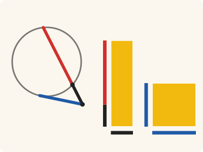
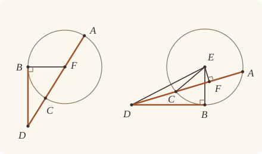

<!-- Generated by scripts/render.py. Do not edit by hand. -->

[Book III](index.md) · [← III.35](35.md) · [III.37 →](37.md)

# Book III, Proposition 36

*The rectangle equals the square on the tangent*

[Euclid's proof](#euclids-proof) · [In Lean](#in-lean) · [What it rests on](#what-it-rests-on) · [Mishnah](#mishnah)

> If a point be taken outside a circle and from it there fall on the circle two straight lines, and if one of them cut the circle and the other touch it, the rectangle contained by the whole of the straight line which cuts the circle and the straight line intercepted on it outside between the point and the convex circumference will be equal to the square on the tangent.

**In Lean:** ✅ proved, as Euclid states it · Euclid's argument

<p align="center"></p>

<p align="center"><em>From D outside the circle, let DCA cut it (DC black, CA red) and DB (blue) touch it: the rectangle contained by AD, DC equals the square on DB (both yellow).</em></p>

## Euclid's proof

<p align="center"></p>

<p align="center"><em>Drawn for every case: DCA through the centre F (left), and DCA off the centre E with EF perpendicular to AC (right).</em></p>

For let a point D be taken outside the circle ABC,

and from D let the two straight lines DCA, DB fall on the circle ABC; let DCA cut the circle ABC and let BD touch it;

I say that the rectangle contained by AD, DC is equal to the square on DB.

Then DCA is either through the centre or not through the centre.

First let it be through the centre, and let F be the centre of the circle ABC;

let FB be joined;

therefore the angle FBD is right. [III. 18]

And, since AC has been bisected at F, and CD is added to it,

the rectangle AD, DC together with the square on FC is equal to the square on FD. [II. 6]

But FC is equal to FB;

therefore the rectangle AD, DC together with the square on FB is equal to the square on FD.

And the squares on FB, BD are equal to the square on FD; [I. 47]

therefore the rectangle AD, DC together with the square on FB is equal to the squares on FB, BD.

Let the square on FB be subtracted from each;

therefore the rectangle AD, DC which remains is equal to the square on the tangent DB.

Again, let DCA not be through the centre of the circle ABC;

let the centre E be taken, and from E let EF be drawn perpendicular to AC;

let EB, EC, ED be joined.

Then the angle EBD is right. [III. 18]

And, since a straight line EF through the centre cuts a straight line AC not through the centre at right angles,

it also bisects it; [III. 3]

therefore AF is equal to FC.

Now, since the straight line AC has been bisected at the point F, and CD is added to it,

the rectangle contained by AD, DC together with the square on FC is equal to the square on FD. [II. 6]

Let the square on FE be added to each;

therefore the rectangle AD, DC together with the squares on CF, FE is equal to the squares on FD, FE.

But the square on EC is equal to the squares on CF, FE, for the angle EFC is right; [I. 47]

and the square on ED is equal to the squares on DF, FE;

therefore the rectangle AD, DC together with the square on EC is equal to the square on ED.

And EC is equal to EB;

therefore the rectangle AD, DC together with the square on EB is equal to the square on ED.

But the squares on EB, BD are equal to the square on ED, for the angle EBD is right; [I. 47]

therefore the rectangle AD, DC together with the square on EB is equal to the squares on EB, BD.

Let the square on EB be subtracted from each;

therefore the rectangle AD, DC which remains is equal to the square on DB.

Therefore etc.

Q. E. D.

## In Lean

| | |
|---|---|
| Proof | ✅ Proved |
| Statement | The whole enunciation. The rectangle AD, DC is equal to the square on the tangent DB, whether or not DCA passes through the centre. |
| Argument | Euclid's. In each case the proof takes the centre from `exists_centre` where Euclid takes it with no reference from Heath to III.1; the perpendiculars and the argument with squares remain his. Where Heath cites I.47, `BookI.Prop47.sq` describes the squares by I.46 and identifies their areas through `Square.described` (I.4, I.28 and I.34); Heath prints no references to these four propositions there. |
| Reviewed | The statement and every passage of the argument read against Heath's text, at commit [`7b71d1782`](https://github.com/jackChallis/stoicheia/commit/7b71d1782) ([the record](../../review/III/36.toml)) |

From [`Elements/BookIII/Prop36.lean`](../../Elements/BookIII/Prop36.lean). Euclid's sentences are the `--` comments, and our own notes are in `/- … -/`; the lines under each sentence are the Lean that carries it out. The list below marks where a lemma does a step Euclid takes for granted and where the statement already gives a step; the `/- … -/` notes in the listing explain smaller adjustments.

**How the Lean follows the text**

- **Done by `Tacit.exists_centre`.** "First let it be through the centre, and let F be the centre of the circle ABC…" The Lean takes F from `Tacit.exists_centre`, as the [introduction](index.md) explains.
- **Already given.** "let FB be joined…" FB is named by its ends, the centre F just obtained and the given point of contact B, so joining it needs no separate construction in the Lean.
- **Done by `Tacit.between_of_inside_chord`.** "And, since AC has been bisected at F…" Euclid takes F to bisect AC. Since the centre is within the circle (`Tacit.centre_inside`), `Tacit.between_of_inside_chord` puts F between A and C. `Definition15`, a rule we assume, makes the two radii equal.
- **Done by `Definition15`.** "But FC is equal to FB…" `Definition15` again gives the equal radii FC and FB.
- **Done by `Touches.not_inside`.** "And the squares on FB, BD are equal to the square on FD…" For I.47, F must be off DB. The centre is within the circle (`Tacit.centre_inside`), and `Touches.not_inside` excludes every point within it from DB.
- **Done by `BookI.Prop12`.** "let the centre E be taken, and from E let EF be drawn perpendicular to AC…" The Lean takes E from `Tacit.exists_centre` as above. `Tacit.centre_unique` puts it off AC in this branch, and I.12 draws EF, with no reference from Heath for that construction.
- **Already given.** "let EB, EC, ED be joined." EB, EC and ED are named by their ends, so the Lean needs no separate construction for these joins.
- **Done by `foot_between`.** "And, since a straight line EF through the centre…" Euclid reads F between A and C from the figure. `foot_between` proves it: I.17 and I.19 make EF shorter than a radius, so F is within the circle and between the ends. Heath gives no reference to I.17 or I.19 here.
- **Done by `Definition15`.** "And EC is equal to EB…" `Definition15` gives the equal radii EC and EB, as it gave FC and FB above.
- **Done by `Touches.not_inside`.** "But the squares on EB, BD are equal to the square on ED…" For I.47, `Touches.not_inside` puts E off DB, since E is within the circle (`Tacit.centre_inside`), as for F in the diameter case.

```lean
/-- If a point be taken outside a circle and from it there fall on the circle two straight lines,
and if one of them cut the circle and the other touch it, the rectangle contained by the whole
of the straight line which cuts the circle and the straight line intercepted on it outside
between the point and the convex circumference will be equal to the square on the tangent. -/
theorem Prop36 {A B C D : Point} {ABC : Circle} (hD : OutsideCircle D ABC)
    (hA : OnCircle A ABC) (hB : OnCircle B ABC) (hC : OnCircle C ABC) (hDCA : Between D C A)
    (hDB : Touches D B ABC) :
    rect A D D C = sq D B := by
  -- For let a point D be taken outside the circle ABC,
  have hDB' : D ≠ B := fun e => hD.2 (e ▸ hB)
  -- and from D let the two straight lines DCA, DB fall on the circle ABC; let DCA cut the
  -- circle ABC and let BD touch it;
  have hACD : Between A C D := between_symm hDCA
  have hAC : A ≠ C := ne_of_between hACD
  obtain ⟨DB, hD_DB, hB_DB⟩ := Postulate1 D B hDB.1
  have hDB_B : Collinear D B B := ⟨DB, hD_DB, hB_DB, hB_DB⟩
  have hDB_D : Collinear D B D := ⟨DB, hD_DB, hB_DB, hD_DB⟩
  -- I say that the rectangle contained by AD, DC is equal to the square on DB.
  have hresult : rect A D D C = sq D B := by
    -- Then DCA is either through the centre or not through the centre.
    by_cases hthrough : ∀ P : Point, Centre P ABC → Collinear A C P
    -- First let it be through the centre, and let F be the centre of the circle ABC;
    · obtain ⟨F, hF⟩ := exists_centre ABC
      -- let FB be joined;
      -- therefore the angle FBD is right. [III. 18]
      have hFBD : ∠ F B D = ∟ := Prop18 hF hB hDB hDB_B D hDB_D hDB'
      -- And, since AC has been bisected at F, and CD is added to it,
      obtain ⟨AC, hA_AC, hC_AC, hF_AC⟩ := hthrough F hF
      have hAFC : Between A F C :=
        between_of_inside_chord hF_AC hA_AC hC_AC (centre_inside hF) hA hC hAC
      have hAF : ‖A F‖ = ‖F C‖ := by
        rw [len_symm A F]
        exact Definition15 hF hA hC
      -- the rectangle AD, DC together with the square on FC is equal to the square on FD. [II. 6]
      have h6 : rect A D D C + sq F C = sq F D := BookII.Prop6 hAFC hAF hACD
      -- But FC is equal to FB;
      have hFC_FB : ‖F C‖ = ‖F B‖ := Definition15 hF hC hB
      -- therefore the rectangle AD, DC together with the square on FB is equal to the square on
      -- FD.
      have h6' : rect A D D C + sq F B = sq F D := by
        rw [← sq_congr hFC_FB]
        exact h6
      -- And the squares on FB, BD are equal to the square on FD; [I. 47]
      have hF_DB : ¬ Collinear D B F := fun h => hDB.not_inside h (centre_inside hF)
      have t : Triangle B F D :=
        (Triangle.of_line hB_DB hD_DB hDB'.symm (Triangle.off_line hF_DB hD_DB hB_DB)).acb
      have h47 : sq F D = sq F B + sq B D := BookI.Prop47.sq t hFBD
      -- therefore the rectangle AD, DC together with the square on FB is equal to the squares on
      -- FB, BD.
      have hsum : rect A D D C + sq F B = sq B D + sq F B := by
        rw [h6', h47]
        ac_rfl
      -- Let the square on FB be subtracted from each;
      have hrect : rect A D D C = sq B D := CommonNotion3 hsum rfl
      -- therefore the rectangle AD, DC which remains is equal to the square on the tangent DB.
      exact hrect.trans (sq_symm B D)
    -- Again, let DCA not be through the centre of the circle ABC;
    -- let the centre E be taken, and from E let EF be drawn perpendicular to AC;
    · obtain ⟨E, hE⟩ := exists_centre ABC
      have hE_AC : ¬ Collinear A C E := fun h => hthrough fun P hP => by
        obtain rfl : P = E := centre_unique hP hE
        exact h
      obtain ⟨F, hF, hEF⟩ := BookI.Prop12 hAC hE_AC
      -- let EB, EC, ED be joined.
      -- Then the angle EBD is right. [III. 18]
      have hEBD : ∠ E B D = ∟ := Prop18 hE hB hDB hDB_B D hDB_D hDB'
      -- And, since a straight line EF through the centre cuts a straight line AC not through the
      -- centre at right angles,
      /- The foot lies within AC, as III.3 asks. -/
      have hAFC : Between A F C := foot_between hE hA hC hE_AC hF hEF
      obtain ⟨AC, hA_AC, hC_AC⟩ := Postulate1 A C hAC
      have hF_AC : OnLine F AC := on_line_of_between_ends hAFC hA_AC hC_AC
      have hD_AC : OnLine D AC := on_line_of_between hACD hA_AC hC_AC
      have hE_off : ¬ OnLine E AC := Triangle.off_line hE_AC hA_AC hC_AC
      have hEF' : E ≠ F := fun e => hE_off (e ▸ hF_AC)
      have hAFE : ∠ A F E = ∟ := by
        rw [angle_symm (ne_of_between hAFC) hEF']
        exact hEF A ⟨AC, hA_AC, hC_AC, hA_AC⟩ (ne_of_between hAFC)
      -- it also bisects it; [III. 3]
      have hbisect := (Prop3 hE hA hC hAFC hE_AC).2 hAFE
      -- therefore AF is equal to FC.
      have hAF : ‖A F‖ = ‖F C‖ := hbisect
      -- Now, since the straight line AC has been bisected at the point F, and CD is added to it,
      -- the rectangle contained by AD, DC together with the square on FC is equal to the square on
      -- FD. [II. 6]
      have h6 : rect A D D C + sq F C = sq F D := BookII.Prop6 hAFC hAF hACD
      -- Let the square on FE be added to each;
      have hadd := CommonNotion2 h6 (rfl : sq F E = sq F E)
      -- therefore the rectangle AD, DC together with the squares on CF, FE is equal to the squares
      -- on FD, FE.
      have hsum : rect A D D C + (sq C F + sq F E) = sq F D + sq F E := by
        rw [sq_symm C F, ← add_assoc]
        exact hadd
      -- But the square on EC is equal to the squares on CF, FE, for the angle EFC is
      -- right; [I. 47]
      have hCF : C ≠ F := ne_of_between (between_symm hAFC)
      have tC : Triangle F E C := (Triangle.of_line hF_AC hC_AC hCF.symm hE_off).acb
      have hEC : sq E C = sq C F + sq F E := by
        rw [BookI.Prop47.sq tC (hEF C ⟨AC, hA_AC, hC_AC, hC_AC⟩ hCF),
          sq_symm C F, sq_symm E F]
        ac_rfl
      -- and the square on ED is equal to the squares on DF, FE;
      have hDF : D ≠ F :=
        ne_of_between (between_symm (between_of_between_left hACD hAFC))
      have tD : Triangle F E D := (Triangle.of_line hF_AC hD_AC hDF.symm hE_off).acb
      have hED : sq E D = sq F D + sq F E := by
        rw [BookI.Prop47.sq tD (hEF D ⟨AC, hA_AC, hC_AC, hD_AC⟩ hDF), sq_symm E F]
        ac_rfl
      -- therefore the rectangle AD, DC together with the square on EC is equal to the square on
      -- ED.
      have h1 : rect A D D C + sq E C = sq E D := by
        rw [hEC, hED]
        exact hsum
      -- And EC is equal to EB;
      have hEC_EB : ‖E C‖ = ‖E B‖ := Definition15 hE hC hB
      -- therefore the rectangle AD, DC together with the square on EB is equal to the square on
      -- ED.
      have h2 : rect A D D C + sq E B = sq E D := by
        rw [← sq_congr hEC_EB]
        exact h1
      -- But the squares on EB, BD are equal to the square on ED, for the angle EBD is
      -- right; [I. 47]
      have hE_DB : ¬ Collinear D B E := fun h => hDB.not_inside h (centre_inside hE)
      have t : Triangle B E D :=
        (Triangle.of_line hB_DB hD_DB hDB'.symm (Triangle.off_line hE_DB hD_DB hB_DB)).acb
      have h47 : sq E D = sq E B + sq B D := BookI.Prop47.sq t hEBD
      -- therefore the rectangle AD, DC together with the square on EB is equal to the squares on
      -- EB, BD.
      have hsum' : rect A D D C + sq E B = sq B D + sq E B := by
        rw [h2, h47]
        ac_rfl
      -- Let the square on EB be subtracted from each;
      have hrect : rect A D D C = sq B D := CommonNotion3 hsum' rfl
      -- therefore the rectangle AD, DC which remains is equal to the square on DB.
      exact hrect.trans (sq_symm B D)
  -- Therefore etc.
  -- Q. E. D.
  exact hresult
```

<details><summary>After the theorem, one theorem later propositions use, <code>Prop36.through_centre</code> (15 lines)</summary>

```lean
/-- The diameter case of III.36, stated on its own for III.37, which takes this case
first. It is proved from III.36. -/
theorem Prop36.through_centre {A B C D F : Point} {ABC : Circle}
    (hF : Centre F ABC)
    (hA : OnCircle A ABC) (hB : OnCircle B ABC)
    (hC : OnCircle C ABC)
    (hDCA : Between D C A) (hACF : Collinear A C F)
    (hDB : Touches D B ABC) :
    rect A D D C = sq D B := by
  obtain ⟨AC, hA_AC, hC_AC, hF_AC⟩ := hACF
  have hAFC : Between A F C := between_of_inside_chord hF_AC hA_AC hC_AC
    (centre_inside hF) hA hC (ne_of_between (between_symm hDCA))
  have hFCD : Between F C D := between_inner hAFC (between_symm hDCA)
  have hD : OutsideCircle D ABC := outside_of_len_gt hF hC (len_lt_of_between hFCD)
  exact Prop36 hD hA hB hC hDCA hDB
```

</details>

## What it rests on

| | |
|---|---|
| Heath's references | [I.47](../I/47.md), [II.6](../II/06.md), [III.3](03.md), [III.18](18.md) |
| Lean cites | [I.4](../I/04.md), [I.12](../I/12.md), [I.17](../I/17.md), [I.19](../I/19.md), [I.28](../I/28.md), [I.34](../I/34.md), [I.46](../I/46.md), [I.47](../I/47.md), [II.6](../II/06.md), [III.3](03.md), [III.18](18.md) |
| Postulates | 1, 2, 3, 4, 5 |
| Definitions taken as axioms | Def. I.15 |
| Common Notions | 1, 2, 3, 4, 5 |
| Tacit rules | 41 (listed below) |
| Its own Lean calls | Postulate 1; Def. I.15; 6 tacit rules |
| Through lemmas | Postulates 2 and 3; 30 tacit rules |

Some of these come in through lemmas [shared](../../CERTIFICATE.md#shared-steps) by many proofs: [`BookI.Prop47.sq`](../../Elements/BookII/Rectangles.lean#L411) (I.4, I.28, I.34, I.46, I.47); [`foot_between`](../../Elements/BookIII/Squares.lean#L95) (I.17, I.19).

_Postulates, definitions, Common Notions and tacit rules: all that this proof rests on, counting those of the propositions it cites. The last two rows say which of the postulates, definitions and tacit rules its own Lean calls, in the proof or a helper written for it, and which it does not call but reaches through lemmas, of Book Zero or shared (a proposition it cites may rest on these too); the rest come in only through the propositions it cites or the Common Notions._

<details><summary>The 41 tacit rules beneath this proof, counting those of the propositions it cites</summary>

_(used here) marks a rule this proof's own Lean calls, in the proof or a helper written for it; (through …) marks one its own Lean does not call but reaches through the lemmas named, of [Book Zero](../../Elements/Figure) or shared, though a proposition it cites may rest on it too; and a rule with no mark comes in only through a proposition it cites or a Common Notion. The names in brackets are System E's: an Intersection rule says when straight lines and circles must meet, and an Intersections rule takes a point where they do (see [Book I's introduction](../I/index.md))._

**Reading the figure**

- [`between_cases`](../../Elements/Foundations/Tacit/Diagram.lean#L54) (through [`BookI.Prop47.sq`](../../Elements/BookII/Rectangles.lean#L411) and [`Tacit.between_of_between_left`](../../Elements/Figure/Incidence.lean#L135)): Of three different points on a straight line, one is between the other two. (Between 6)
- [`between_of_inside_chord`](../../Elements/Foundations/Tacit/Diagram.lean#L81) (used here): A straight line through a point inside a circle has that point between the points where it meets the circle. (Circle 1)
- [`between_symm`](../../Elements/Foundations/Tacit/Diagram.lean#L47) (used here): If B is between A and C, it is between C and A. (Between 1)
- [`circles_meet`](../../Elements/Foundations/Tacit/Diagram.lean#L94) (through [`BookI.Prop47.sq`](../../Elements/BookII/Rectangles.lean#L411), [`Tacit.between_of_between_left`](../../Elements/Figure/Incidence.lean#L135), [`Tacit.on_line_of_between`](../../Elements/Figure/Incidence.lean#L77) and 1 other lemma): If each circle passes through a point inside the other, the circles cut one another. This is the step Euclid takes for granted in I.1. (Intersection 5)
- [`circles_meet_same_side`](../../Elements/Foundations/Tacit/Constructions.lean#L79) (through [`BookI.Prop47.sq`](../../Elements/BookII/Rectangles.lean#L411), [`Tacit.between_of_between_left`](../../Elements/Figure/Incidence.lean#L135), [`Tacit.on_line_of_between`](../../Elements/Figure/Incidence.lean#L77) and 1 other lemma): Two circles that cut one another do so on each side of the straight line through their centres. (Intersections 8)
- [`exists_centre`](../../Elements/Foundations/Tacit/Constructions.lean#L57) (used here): Every circle has a centre. A rule of our own, not one of System E's: its content is Euclid's Definitions I.15 and I.16.
- [`exists_point`](../../Elements/Foundations/Tacit/Constructions.lean#L35) (through [`BookI.Prop47.sq`](../../Elements/BookII/Rectangles.lean#L411), [`Tacit.between_of_between_left`](../../Elements/Figure/Incidence.lean#L135), [`Tacit.centre_unique`](../../Elements/Figure/Circles.lean#L28) and 3 other lemmas): Let a point be taken. (Points 1)
- [`exists_point_inside_circle`](../../Elements/Foundations/Tacit/Constructions.lean#L42) (through [`BookI.Prop47.sq`](../../Elements/BookII/Rectangles.lean#L411), [`Tacit.between_of_between_left`](../../Elements/Figure/Incidence.lean#L135), [`Tacit.centre_inside`](../../Elements/Figure/RuleBase.lean#L87) and 5 other lemmas): Let a point be taken inside the circle α. (Points 8)
- [`exists_point_on_line`](../../Elements/Foundations/Tacit/Constructions.lean#L38) (through [`BookI.Prop47.sq`](../../Elements/BookII/Rectangles.lean#L411), [`Tacit.between_of_between_left`](../../Elements/Figure/Incidence.lean#L135), [`Tacit.on_line_of_between`](../../Elements/Figure/Incidence.lean#L77) and 2 other lemmas): Let a point be taken on the straight line L. (Points 2)
- [`line_circle_between`](../../Elements/Foundations/Tacit/Constructions.lean#L67) (through [`BookI.Prop47.sq`](../../Elements/BookII/Rectangles.lean#L411), [`Tacit.between_of_between_left`](../../Elements/Figure/Incidence.lean#L135), [`Tacit.centre_inside`](../../Elements/Figure/RuleBase.lean#L87) and 5 other lemmas): A straight line through a point B inside a circle, heading out to a point C outside it, cuts the circle between B and C. (Intersections 4)
- [`line_circle_beyond`](../../Elements/Foundations/Tacit/Constructions.lean#L73) (through [`BookI.Prop47.sq`](../../Elements/BookII/Rectangles.lean#L411), [`Tacit.between_of_between_left`](../../Elements/Figure/Incidence.lean#L135), [`Tacit.centre_inside`](../../Elements/Figure/RuleBase.lean#L87) and 5 other lemmas): A straight line through a point B inside a circle, produced beyond B away from C, cuts the circle there. (Intersections 5)
- [`line_unique`](../../Elements/Foundations/Tacit/Diagram.lean#L41) (through [`BookI.Prop47.sq`](../../Elements/BookII/Rectangles.lean#L411), [`Tacit.on_line_of_between`](../../Elements/Figure/Incidence.lean#L77), [`Touches.not_inside`](../../Elements/Figure/OnCircles.lean#L123) and 2 other lemmas): Two points determine a straight line. (Generalities 1)
- [`lines_meet_of_opposite_sides`](../../Elements/Foundations/Tacit/Diagram.lean#L89) (through [`BookI.Prop47.sq`](../../Elements/BookII/Rectangles.lean#L411)): A straight line joining points on opposite sides of L crosses L. (Intersection 1)
- [`not_between_of_between`](../../Elements/Foundations/Tacit/Diagram.lean#L50) (through [`BookI.Prop47.sq`](../../Elements/BookII/Rectangles.lean#L411), [`Tacit.between_of_between_left`](../../Elements/Figure/Incidence.lean#L135), [`Tacit.centre_inside`](../../Elements/Figure/RuleBase.lean#L87) and 6 other lemmas): If B is between A and C, then A is not between B and C. (Between 1)
- [`not_on_line_of_same_side`](../../Elements/Foundations/Tacit/Diagram.lean#L60) (through [`BookI.Prop47.sq`](../../Elements/BookII/Rectangles.lean#L411), [`Tacit.between_of_between_left`](../../Elements/Figure/Incidence.lean#L135), [`Tacit.on_line_of_between`](../../Elements/Figure/Incidence.lean#L77) and 1 other lemma): Points on one side of a straight line are not on it. (Same side 3)
- [`pasch2`](../../Elements/Foundations/Tacit/Diagram.lean#L71) (through [`BookI.Prop47.sq`](../../Elements/BookII/Rectangles.lean#L411), [`Tacit.between_of_between_left`](../../Elements/Figure/Incidence.lean#L135), [`Tacit.on_line_of_between`](../../Elements/Figure/Incidence.lean#L77) and 1 other lemma): If B is between A and C, A is on L and B is off it, then B and C are on the same side of L: a straight line that leaves L at A does not cross it again. (Pasch 2)
- [`same_side_trans`](../../Elements/Foundations/Tacit/Diagram.lean#L64) (through [`BookI.Prop47.sq`](../../Elements/BookII/Rectangles.lean#L411), [`Tacit.between_of_between_left`](../../Elements/Figure/Incidence.lean#L135), [`Tacit.on_line_of_between`](../../Elements/Figure/Incidence.lean#L77) and 1 other lemma): Two points on the same side of a straight line as a third point are on the same side as each other. (Same side 4)

**Lengths, angles and areas**

- [`angle_add_of_inside`](../../Elements/Foundations/Tacit/Transfer.lean#L47) (through [`BookI.Prop47.sq`](../../Elements/BookII/Rectangles.lean#L411)): If D lies within the angle BAC, then BAC is made up of BAD and DAC. (Diagram-angle 2)
- [`angle_eq_of_same_rays`](../../Elements/Foundations/Tacit/Transfer.lean#L54): The angle doesn't change if its arms are traced through other points on the same rays. (Diagram-angle 4)
- [`angle_le_two_right`](../../Elements/Foundations/Tacit/Metric.lean#L33): No angle exceeds two right angles. (Metric 5)
- [`angle_symm`](../../Elements/Foundations/Tacit/Metric.lean#L30) (used here): The angle ABC is the angle CBA. (Metric 4)
- [`area_add_of_between`](../../Elements/Foundations/Tacit/Transfer.lean#L70) (through [`BookI.Prop47.sq`](../../Elements/BookII/Rectangles.lean#L411)): Cutting a triangle in two from a vertex adds up. (Diagram-area 2)
- [`area_congruent`](../../Elements/Foundations/Tacit/Metric.lean#L44): Triangles equal in all their sides and angles are equal in area. Euclid uses this without comment once he has shown two triangles congruent. (Metric 9)
- [`area_degenerate`](../../Elements/Foundations/Tacit/Metric.lean#L36) (through [`BookI.Prop47.sq`](../../Elements/BookII/Rectangles.lean#L411)): A "triangle" with a repeated corner has no area. (Metric 6)
- [`area_eq_zero_of_on_line`](../../Elements/Foundations/Tacit/Transfer.lean#L62) (through [`BookI.Prop47.sq`](../../Elements/BookII/Rectangles.lean#L411)): A "triangle" whose corners lie on one straight line has no area. (Diagram-area 1)
- [`area_rotate`](../../Elements/Foundations/Tacit/Metric.lean#L39) (through [`BookI.Prop47.sq`](../../Elements/BookII/Rectangles.lean#L411)): The triangle ABC is the triangle CAB. (Metric 8)
- [`circle_eq`](../../Elements/Foundations/Tacit/Transfer.lean#L30) (through [`BookI.Prop47.sq`](../../Elements/BookII/Rectangles.lean#L411), [`Tacit.between_of_between_left`](../../Elements/Figure/Incidence.lean#L135), [`Tacit.centre_inside`](../../Elements/Figure/RuleBase.lean#L87) and 5 other lemmas): A circle is fixed by its centre and its radius. (Diagram-segment 2)
- [`len_add_of_between`](../../Elements/Foundations/Tacit/Transfer.lean#L27) (through [`BookI.Prop47.sq`](../../Elements/BookII/Rectangles.lean#L411), [`Tacit.between_of_between_left`](../../Elements/Figure/Incidence.lean#L135), [`Tacit.centre_inside`](../../Elements/Figure/RuleBase.lean#L87) and 5 other lemmas): If B is between A and C, then AB and BC together make up AC. (Diagram-segment 1)
- [`len_self`](../../Elements/Foundations/Tacit/Metric.lean#L24) (through [`BookI.Prop47.sq`](../../Elements/BookII/Rectangles.lean#L411), [`Tacit.between_of_between_left`](../../Elements/Figure/Incidence.lean#L135), [`Tacit.centre_inside`](../../Elements/Figure/RuleBase.lean#L87) and 5 other lemmas): The "straight line" from a point to itself has no length. (Metric 1)
- [`len_symm`](../../Elements/Foundations/Tacit/Metric.lean#L27) (used here): The straight line AB is the straight line BA. (Metric 3)
- [`on_line_of_area_eq_zero`](../../Elements/Foundations/Tacit/Transfer.lean#L66): A triangle with no area has its corners on one straight line. (Diagram-area 1)
- [`same_ray_of_angle_eq_zero`](../../Elements/Foundations/Tacit/Transfer.lean#L42) (through [`BookI.Prop47.sq`](../../Elements/BookII/Rectangles.lean#L411)): If the angle BAC is nothing, C lies on the ray from A through B. (Diagram-angle 1)

**Superposition**

- [`superposition`](../../Elements/Foundations/Tacit/Superposition.lean#L52): **Superposition.** A hypothetical placement of a triangle on a given ray and side permits a restricted derivation of metric equalities about the figure already given. The derivation introduces no further objects, cites each geometric law it uses, and exports no symbol of the placement.

**Laws of magnitude**

- [`add_assoc`](../../Elements/Foundations/Tacit/Magnitudes.lean#L23) (used here): Adding three magnitudes in a row, it makes no difference whether the first two or the last two are added first. (System E §3.5)
- [`add_comm`](../../Elements/Foundations/Tacit/Magnitudes.lean#L26) (through [`BookI.Prop47.sq`](../../Elements/BookII/Rectangles.lean#L411), [`Magnitude.instCommutative`](../../Elements/Figure/Areas.lean#L40), [`Tacit.between_of_between_left`](../../Elements/Figure/Incidence.lean#L135) and 6 other lemmas): The order of adding does not matter. (System E §3.5)
- [`add_lt_add_right`](../../Elements/Foundations/Tacit/Magnitudes.lean#L45) (through [`BookI.Prop47.sq`](../../Elements/BookII/Rectangles.lean#L411), [`Tacit.centre_unique`](../../Elements/Figure/Circles.lean#L28) and [`foot_between`](../../Elements/BookIII/Squares.lean#L95)): Adding the same thing to both sides keeps "less than". (System E §3.5)
- [`add_zero`](../../Elements/Foundations/Tacit/Magnitudes.lean#L29) (through [`BookI.Prop47.sq`](../../Elements/BookII/Rectangles.lean#L411)): Adding nothing changes nothing. (System E §3.5)
- [`lt_irrefl`](../../Elements/Foundations/Tacit/Magnitudes.lean#L32) (through [`BookI.Prop47.sq`](../../Elements/BookII/Rectangles.lean#L411), [`Tacit.between_of_between_left`](../../Elements/Figure/Incidence.lean#L135), [`Tacit.centre_inside`](../../Elements/Figure/RuleBase.lean#L87) and 5 other lemmas): No magnitude is less than itself. (System E §3.5)
- [`lt_trans`](../../Elements/Foundations/Tacit/Magnitudes.lean#L35) (through [`BookI.Prop47.sq`](../../Elements/BookII/Rectangles.lean#L411), [`Tacit.between_of_between_left`](../../Elements/Figure/Incidence.lean#L135), [`Tacit.centre_inside`](../../Elements/Figure/RuleBase.lean#L87) and 5 other lemmas): What is less than the less is less still. (System E §3.5)
- [`lt_trichotomy`](../../Elements/Foundations/Tacit/Magnitudes.lean#L39) (through [`BookI.Prop47.sq`](../../Elements/BookII/Rectangles.lean#L411), [`Tacit.between_of_between_left`](../../Elements/Figure/Incidence.lean#L135), [`Tacit.centre_inside`](../../Elements/Figure/RuleBase.lean#L87) and 5 other lemmas): Of two magnitudes, one is less, or they are equal, or the other is less. (System E §3.5)
- [`not_lt_zero`](../../Elements/Foundations/Tacit/Magnitudes.lean#L42) (through [`BookI.Prop47.sq`](../../Elements/BookII/Rectangles.lean#L411), [`Tacit.between_of_between_left`](../../Elements/Figure/Incidence.lean#L135), [`Tacit.centre_inside`](../../Elements/Figure/RuleBase.lean#L87) and 5 other lemmas): Nothing is less than zero. (System E §3.5)

</details>

## Mishnah

_Our commentary: what Euclid assumes, what Lean made us say out loud, and how the result looks by modern means._

**II.6 comes back to the circle.** III.35 cut within the circle and called on II.5; here D lies on AC produced, and II.6 takes its place. When DCA passes through the centre F, II.6 makes the rectangle AD, DC together with the square on the radius FC equal to the square on FD, and I.47, at the right angle FBD (III.18), makes that the squares on FB, BD. Take the square on the radius from each, and the rectangle AD, DC equals the square on DB. When DCA misses the centre E, the perpendicular EF bisects AC instead (III.3), and adding the square on FE turns each side into a square on a straight line from the centre.

A modern text would first show that two straight lines from D which cut the circle give equal rectangles, then turn one of them until its two points on the circle come together at the point of contact. Heath explains that "Euclid and the Greek geometers generally did not allow themselves to infer the truth of a proposition in a *limiting case* directly from the general case including it, but preferred a separate proof of the limiting case", and concludes, "This accounts for the form of III. 36" (vol. 2, p. 75).

**F has two jobs.** We keep Euclid's letters as Heath prints them: F is the centre in the first figure and the foot of the perpendicular in the second, whose centre is E. In the first, I.47 needs FBD to be a triangle, and we show it is: a straight line that touches the circle (Definition III.2) has no point within it, and the centre is within. The diameter case is also stated on its own after the proposition, as `Prop36.through_centre`, proved from III.36, for III.37 to take this case first.

**The modern way.** Put the centre E at the origin, let the radius be $r$, let $\mathbf{d}$ be the position of D, and let $\mathbf{u}$ be the unit vector from D towards A. The points $\mathbf{d} + t\mathbf{u}$ on the circle satisfy $t^2 + 2(\mathbf{d} \cdot \mathbf{u})t + \mathrm{ED}^2 - r^2 = 0$, whose roots are DC and DA, so $\mathrm{DA} \thinspace \mathrm{DC} = \mathrm{ED}^2 - r^2$. The angle EBD is right, so $\mathrm{DB}^2 = \mathrm{ED}^2 - r^2$ too: both are the power of D, found here by vectors rather than by Euclid's squares.

## Further reading

- David Eugene Smith lets the point move until the cutting straight line becomes the tangent, the modern habit Heath sets against Euclid's separate proof, and calls it "an excellent example of the Principle of Continuity": [*The Teaching of Geometry*](https://www.gutenberg.org/ebooks/37681) (1911, free online), ch. XVI, "The Leading Propositions of Book III" (pp. 247–248) (also on [III.14](14.md)).
- The modern way's route, two roots of a quadratic whose product is the power, is S. L. Loney's in ch. VIII, Art. 173 (p. 146), of [*The Elements of Coordinate Geometry*](https://archive.org/details/elementsofcoordi00lone) (1895, free online), where he remarks, "This is Euc. iii. 36, Cor." (also on [III.10](10.md)).
- Roger A. Johnson recasts III.35 and III.36 "into a single theorem", and defines the power of a point as OP² − r², in ch. III, "Coaxal Circles and Inversion", §§40–41 (pp. 28–29), of [*Modern Geometry*](https://archive.org/details/bwb_P9-AFM-481) (1929, free online) (also on [III.6](06.md)).

[Book III](index.md) · [← III.35](35.md) · [III.37 →](37.md)

---

<sub>Euclid's text: T. L. Heath, *The Thirteen Books of Euclid's Elements*, vol. 2 (Cambridge, 1908), pp. 73–75; [scan leaves n85–n87](https://archive.org/details/thirteenbookseu00heibgoog/page/n85); [figures on n86](https://archive.org/details/thirteenbookseu00heibgoog/page/n86). Public domain.</sub>

<sub>The tacit rules follow the System E of Jeremy Avigad, Edward Dean and John Mumma, read alongside LeanEuclid (Logan Murphy, Kaiyu Yang, Jialiang Sun, Zhaoyu Li, Anima Anandkumar and Xujie Si).</sub>
