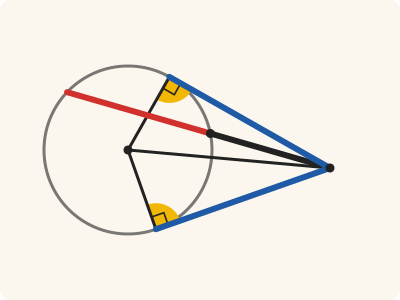
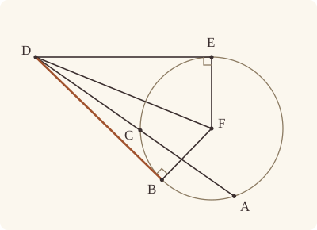

<!-- Generated by scripts/render.py. Do not edit by hand. -->

[Book III](index.md) · [← III.36](36.md)

# Book III, Proposition 37

*If the rectangle equals the square, the straight line touches*

[Euclid's proof](#euclids-proof) · [In Lean](#in-lean) · [What it rests on](#what-it-rests-on) · [Mishnah](#mishnah)

> If a point be taken outside a circle and from the point there fall on the circle two straight lines, if one of them cut the circle, and the other fall on it, and if further the rectangle contained by the whole of the straight line which cuts the circle and the straight line intercepted on it outside between the point and the convex circumference be equal to the square on the straight line which falls on the circle, the straight line which falls on it will touch the circle.

**In Lean:** ✅ proved, as Euclid states it · Euclid's argument

<p align="center"></p>

<p align="center"><em>Let the square on DB (blue) equal the rectangle contained by AD (red and black) and DC (black). Then DB equals DE (blue), drawn touching the circle, so DB too meets the radius FB at right angles (yellow), and touches.</em></p>

## Euclid's proof

<p align="center"></p>

<p align="center"><em>Drawn for one case: the centre F off AC, with distinct contacts B and E on opposite sides of DF.</em></p>

For let a point D be taken outside the circle ABC; from D let the two straight lines DCA, DB fall on the circle ACB; let DCA cut the circle and DB fall on it; and let the rectangle AD, DC be equal to the square on DB.

I say that DB touches the circle ABC.

For let DE be drawn touching ABC; let the centre of the circle ABC be taken, and let it be F; let FE, FB, FD be joined.

Thus the angle FED is right. [III. 18]

Now, since DE touches the circle ABC, and DCA cuts it,

the rectangle AD, DC is equal to the square on DE. [III. 36]

But the rectangle AD, DC was also equal to the square on DB;

therefore the square on DE is equal to the square on DB;

therefore DE is equal to DB.

And FE is equal to FB;

therefore the two sides DE, EF are equal to the two sides DB, BF;

and FD is the common base of the triangles;

therefore the angle DEF is equal to the angle DBF. [I. 8]

But the angle DEF is right;

therefore the angle DBF is also right.

And FB produced is a diameter;

and the straight line drawn at right angles to the diameter of a circle, from its extremity, touches the circle; [III. 16, Por.]

therefore DB touches the circle.

Similarly this can be proved to be the case even if the centre be on AC.

Therefore etc.

Q. E. D.

## In Lean

| | |
|---|---|
| Proof | ✅ Proved |
| Statement | The whole enunciation. A straight line DB whose square is the rectangle AD, DC touches the circle. |
| Argument | Euclid's. The proof first splits on whether a centre lies on AC. In Euclid's case, the centre off AC, it takes F from the rule where Euclid takes the centre without a bracket for III.1; III.17 supplies the touching straight line, and III.36 the equality of squares. The case with the centre on AC names that centre F from the split. That branch uses III.17, III.18, III.36, the square comparison (I.3, I.4, I.28, I.34 and I.46), I.20, I.8 and III.16's porism as in the other branch; Heath prints no references in his closing sentence, and `Prop36.through_centre` first puts F between A and C by `Tacit.centre_inside` (System E, Generalities 3) and `Tacit.between_of_inside_chord` (System E, Circle 1), both rules we assume. |
| Reviewed | The statement and every passage of the argument read against Heath's text, at commit [`2f2c3c2f`](https://github.com/jackChallis/stoicheia/commit/2f2c3c2f) ([the record](../../review/III/37.toml)) |

From [`Elements/BookIII/Prop37.lean`](../../Elements/BookIII/Prop37.lean). Euclid's sentences are the `--` comments, and our own notes are in `/- … -/`; the lines under each sentence are the Lean that carries it out. The list below marks where a lemma does a step Euclid takes for granted, where the Lean takes a case Euclid's figure leaves aside and where the statement already gives a step; the `/- … -/` notes in the listing explain smaller adjustments.

**How the Lean follows the text**

- **Done by `Prop17`.** "For let DE be drawn touching ABC…" Euclid draws DE touching ABC without a reference in Heath; III.17 supplies its contact E as well as its touching.
- **Done by `Tacit.exists_centre`.** "let the centre of the circle ABC be taken, and let it be F…" The rule supplying Euclid's centre F is `Tacit.exists_centre`, an assumption with no System E number.
- **Already given.** "let FE, FB, FD be joined." FE, FB and FD are named by their ends, so the Lean needs no separate construction for these joins.
- **Done by `BookI.Prop46.sq`.** "therefore DE is equal to DB." Euclid passes from equal squares to equal straight lines without a reference in Heath. The Lean uses `BookI.Prop46.sq`, which describes squares by I.46, identifies their areas through `Square.described` (I.4, I.28 and I.34), and applies `BookI.Prop46.side_eq` (also using I.3); Heath prints no references to these propositions here.
- **Done by `Definition15`.** "And FE is equal to FB…" Euclid uses the equality of the radii FE and FB without giving a reason. The Lean obtains it from `Definition15`, Euclid's definition of a circle, which we assume as a rule.
- **Done by `Prop37.triangle`.** "and FD is the common base of the triangles…" Euclid's figure makes DBF a triangle; the Lean proves it: B, with DB equal to DE, is not on the straight line through D and the centre F. It uses I.20, for which Heath prints no reference here, with the assumed rules `Tacit.between_cases` (System E, Between 6), `Tacit.len_add_of_between` (System E, Diagram-segment 1) and `Tacit.inside_of_len_lt` (System E, Diagram-segment 4); DEF is a triangle by `Touches.not_inside`, using `Tacit.line_meets_circle_of_inside` (System E, Intersection 3), and `Tacit.centre_inside` (System E, Generalities 3), also rules we assume.
- **Already given.** "And FB produced is a diameter…" Our porism to III.16 is said at the end of a radius, so the Lean applies it to FB itself and does not produce FB to a diameter.
- **A further case, by `Prop37.centre_on_secant`.** "Similarly this can be proved to be the case even if the centre be on AC." Euclid leaves the case with the centre on AC to the reader; `Prop37.centre_on_secant` proves it in the first branch. It uses `Prop36.through_centre`, proved from III.36, and the given equality to obtain equal squares on DE and DB, and Euclid's argument with the two triangles finishes the proof.

<details><summary>Before the theorem, two lemmas: <code>Prop37.triangle</code> and <code>Prop37.centre_on_secant</code> (60 lines)</summary>

```lean
/-- Euclid's figure makes DBF a triangle, and this is why. A point B of the circle, with
DB equal to a straight line DE from D to a point E of the circle, and DEF a triangle, is
not on the straight line through D and the centre F. Were B between D and F, the sides
DE, EF would make up DF; were F between D and B, the sides DF, FE would make up DE;
either way two sides of the triangle DEF would not be greater than the third [I. 20].
And D, outside the circle, is not between B and the centre. -/
theorem Prop37.triangle {B D E F : Point} {ABC : Circle} (hF : Centre F ABC)
    (hD : OutsideCircle D ABC) (hB : OnCircle B ABC) (hE : OnCircle E ABC)
    (hDEF : Triangle D E F) (hDE_DB : ‖D E‖ = ‖D B‖) : Triangle D B F := by
  rintro ⟨L, hD_L, hB_L, hF_L⟩
  have hDB : D ≠ B := fun e => hD.2 (e ▸ hB)
  have hBF : B ≠ F := fun e => inside_not_on (centre_inside hF) (e ▸ hB)
  have hDF : D ≠ F := fun e => hD.1 (e ▸ centre_inside hF)
  have hFE_FB : ‖F E‖ = ‖F B‖ := Definition15 hF hE hB
  rcases between_cases hDB hBF hDF hD_L hB_L hF_L with h | h | h
  · have h1 : ‖D B‖ + ‖B F‖ = ‖D F‖ := len_add_of_between h
    have h20 : ‖D F‖ < ‖D E‖ + ‖E F‖ := (BookI.Prop20 hDEF).2.1
    rw [← h1, hDE_DB, len_symm E F, hFE_FB, len_symm F B] at h20
    exact lt_irrefl _ h20
  · exact hD.1 (InsideCircle.of_between_centre hF hB (between_symm h))
  · have h1 : ‖D F‖ + ‖F B‖ = ‖D B‖ := len_add_of_between h
    have h20 : ‖D E‖ < ‖E F‖ + ‖F D‖ := (BookI.Prop20 hDEF).2.2
    rw [hDE_DB, ← h1, len_symm E F, hFE_FB, len_symm F D, add_comm] at h20
    exact lt_irrefl _ h20

/-- The centre-on-AC case left to the reader at the end of III.37. The diameter case,
stated as `Prop36.through_centre` and proved from III.36, and the given rectangle
equality give equal squares on DE and DB.
Euclid's equal radii and I.8 then carry the right angle at E to B, where III.16's porism
gives the tangent. -/
theorem Prop37.centre_on_secant {A B C D F : Point} {ABC : Circle}
    (hF : Centre F ABC) (hD : OutsideCircle D ABC)
    (hA : OnCircle A ABC) (hB : OnCircle B ABC)
    (hC : OnCircle C ABC)
    (hDCA : Between D C A) (hACF : Collinear A C F)
    (h : rect A D D C = sq D B) :
    Touches D B ABC := by
  /- Draw DE touching the circle, then use the diameter case of III.36. -/
  obtain ⟨E, hE, hDE⟩ := Prop17 hD
  obtain ⟨L, hD_L, hE_L⟩ := Postulate1 D E hDE.1
  have hFED : ∠ F E D = ∟ :=
    Prop18 hF hE hDE ⟨L, hD_L, hE_L, hE_L⟩ D ⟨L, hD_L, hE_L, hD_L⟩ hDE.1
  have h36 : rect A D D C = sq D E :=
    Prop36.through_centre hF hA hE hC hDCA hACF hDE
  /- Equal squares give equal lengths. With the equal radii and the common base FD,
     I.8 identifies the angles of the two triangles. -/
  have hDE_DB : ‖D E‖ = ‖D B‖ := BookI.Prop46.sq (h36.symm.trans h)
  have hFE_FB : ‖F E‖ = ‖F B‖ := Definition15 hF hE hB
  have hDEF : Triangle D E F := fun hc => hDE.not_inside hc (centre_inside hF)
  have hDBF : Triangle D B F := Prop37.triangle hF hD hB hE hDEF hDE_DB
  have hED_BD : ‖E D‖ = ‖B D‖ := by rw [len_symm E D, hDE_DB, len_symm]
  have hEF_BF : ‖E F‖ = ‖B F‖ := by rw [len_symm E F, hFE_FB, len_symm]
  have h8 : ∠ D E F = ∠ D B F := BookI.Prop8 hDEF.bac hDBF.bac hED_BD hEF_BF rfl
  have hDBF_right : ∠ D B F = ∟ :=
    h8.symm.trans ((angle_symm hDEF.ne₁₂ hDEF.ne₂₃.symm).trans hFED)
  /- The right angle at B gives touching by III.16's porism, stated for a radius. -/
  have hBD : Touches B D ABC := Prop16.porism hF hB hDBF.cba
    ((angle_symm hDBF.ne₂₃.symm hDBF.ne₁₂).trans hDBF_right)
  obtain ⟨M, hB_M, hD_M⟩ := Postulate1 B D hDBF.ne₁₂.symm
  exact hBD.of_collinear ⟨M, hB_M, hD_M, hD_M⟩ ⟨M, hB_M, hD_M, hB_M⟩ hDBF.ne₁₂
```

</details>

```lean
/-- If a point be taken outside a circle and from the point there fall on the circle two straight
lines, if one of them cut the circle, and the other fall on it, and if further the rectangle
contained by the whole of the straight line which cuts the circle and the straight line
intercepted on it outside between the point and the convex circumference be equal to the square
on the straight line which falls on the circle, the straight line which falls on it will touch
the circle. -/
theorem Prop37 {A B C D : Point} {ABC : Circle} (hD : OutsideCircle D ABC)
    (hA : OnCircle A ABC) (hB : OnCircle B ABC) (hC : OnCircle C ABC) (hDCA : Between D C A)
    (h : rect A D D C = sq D B) :
    Touches D B ABC := by
  -- For let a point D be taken outside the circle ABC; from D let the two straight lines DCA,
  -- DB fall on the circle ACB; let DCA cut the circle and DB fall on it; and let the rectangle
  -- AD, DC be equal to the square on DB.
  -- I say that DB touches the circle ABC.
  have hresult : Touches D B ABC := by
    /- We take the case of Euclid's last sentence first: the centre on AC, proved in
       `Prop37.centre_on_secant`. The general argument below takes every other
       position of the centre. -/
    by_cases hthrough : ∃ F : Point, Centre F ABC ∧ Collinear A C F
    · obtain ⟨F, hF, hACF⟩ := hthrough
      exact Prop37.centre_on_secant hF hD hA hB hC hDCA hACF h
    -- For let DE be drawn touching ABC; let the centre of the circle ABC be taken, and let it be
    -- F; let FE, FB, FD be joined.
    · obtain ⟨E, hE, hDE⟩ := Prop17 hD
      obtain ⟨F, hF⟩ := exists_centre ABC
      have hDE' : D ≠ E := hDE.1
      have hDB : D ≠ B := fun e => hD.2 (e ▸ hB)
      have hFE : F ≠ E := fun e => inside_not_on (centre_inside hF) (e ▸ hE)
      have hFB : F ≠ B := fun e => inside_not_on (centre_inside hF) (e ▸ hB)
      -- Thus the angle FED is right. [III. 18]
      obtain ⟨L, hD_L, hE_L⟩ := Postulate1 D E hDE'
      have hFED : ∠ F E D = ∟ :=
        Prop18 hF hE hDE ⟨L, hD_L, hE_L, hE_L⟩ D ⟨L, hD_L, hE_L, hD_L⟩ hDE'
      -- Now, since DE touches the circle ABC, and DCA cuts it,
      -- the rectangle AD, DC is equal to the square on DE. [III. 36]
      have h36 : rect A D D C = sq D E := Prop36 hD hA hE hC hDCA hDE
      -- But the rectangle AD, DC was also equal to the square on DB;
      -- therefore the square on DE is equal to the square on DB;
      have hsq : sq D E = sq D B := CommonNotion1 h36.symm h.symm
      -- therefore DE is equal to DB.
      have hDE_DB : ‖D E‖ = ‖D B‖ := BookI.Prop46.sq hsq
      -- And FE is equal to FB;
      have hFE_FB : ‖F E‖ = ‖F B‖ := Definition15 hF hE hB
      -- therefore the two sides DE, EF are equal to the two sides DB, BF;
      have hED_BD : ‖E D‖ = ‖B D‖ := by rw [len_symm E D, hDE_DB, len_symm]
      have hEF_BF : ‖E F‖ = ‖B F‖ := by rw [len_symm E F, hFE_FB, len_symm]
      -- and FD is the common base of the triangles;
      have hDEF : Triangle D E F := fun hcol => hDE.not_inside hcol (centre_inside hF)
      have hDBF : Triangle D B F := Prop37.triangle hF hD hB hE hDEF hDE_DB
      -- therefore the angle DEF is equal to the angle DBF. [I. 8]
      have h8 : ∠ D E F = ∠ D B F := BookI.Prop8 hDEF.bac hDBF.bac hED_BD hEF_BF rfl
      -- But the angle DEF is right;
      have hDEF_right : ∠ D E F = ∟ := (angle_symm hDE' hFE).trans hFED
      -- therefore the angle DBF is also right.
      have hDBF_right : ∠ D B F = ∟ := h8.symm.trans hDEF_right
      -- And FB produced is a diameter;
      /- Our porism of III.16 is stated at the end of a radius, so we need not produce FB. -/
      -- and the straight line drawn at right angles to the diameter of a circle, from its
      -- extremity, touches the circle; [III. 16, Por.]
      have hBD : Touches B D ABC :=
        Prop16.porism hF hB hDBF.cba ((angle_symm hFB hDB).trans hDBF_right)
      -- therefore DB touches the circle.
      obtain ⟨M, hB_M, hD_M⟩ := Postulate1 B D hDB.symm
      have hDB_touch : Touches D B ABC :=
        hBD.of_collinear ⟨M, hB_M, hD_M, hD_M⟩ ⟨M, hB_M, hD_M, hB_M⟩ hDB
      exact hDB_touch
  -- Similarly this can be proved to be the case even if the centre be on AC.
  /- The first branch above proves this case. -/
  -- Therefore etc.
  -- Q. E. D.
  exact hresult
```

## What it rests on

| | |
|---|---|
| Heath's references | [I.8](../I/08.md), [III.16 Por.](16.md#porism), [III.18](18.md), [III.36](36.md) |
| Lean cites | [I.3](../I/03.md), [I.4](../I/04.md), [I.8](../I/08.md), [I.20](../I/20.md), [I.28](../I/28.md), [I.34](../I/34.md), [I.46](../I/46.md), [III.16 Por.](16.md#porism), [III.17](17.md), [III.18](18.md), [III.36](36.md) |
| Postulates | 1, 2, 3, 4, 5 |
| Definitions taken as axioms | Def. I.15 |
| Common Notions | 1, 2, 3, 4, 5 |
| Tacit rules | 67 (listed below) |
| Its own Lean calls | Postulate 1; Def. I.15; 10 tacit rules |
| Through lemmas | Postulates 2 and 3; 43 tacit rules |

Some of these come in through lemmas [shared](../../CERTIFICATE.md#shared-steps) by many proofs: [`BookI.Prop46.sq`](../../Elements/BookIII/Squares.lean#L59) (I.3, I.4, I.28, I.34, I.46); [`Prop36.through_centre`](../../Elements/BookIII/Prop36.lean#L164) (III.36).

_Postulates, definitions, Common Notions and tacit rules: all that this proof rests on, counting those of the propositions it cites. The last two rows say which of the postulates, definitions and tacit rules its own Lean calls, in the proof or a helper written for it, and which it does not call but reaches through lemmas, of Book Zero or shared (a proposition it cites may rest on these too); the rest come in only through the propositions it cites or the Common Notions._

<details><summary>The 67 tacit rules beneath this proof, counting those of the propositions it cites</summary>

_(used here) marks a rule this proof's own Lean calls, in the proof or a helper written for it; (through …) marks one its own Lean does not call but reaches through the lemmas named, of [Book Zero](../../Elements/Figure) or shared, though a proposition it cites may rest on it too; and a rule with no mark comes in only through a proposition it cites or a Common Notion. The names in brackets are System E's: an Intersection rule says when straight lines and circles must meet, and an Intersections rule takes a point where they do (see [Book I's introduction](../I/index.md))._

**Reading the figure**

- [`between_cases`](../../Elements/Foundations/Tacit/Diagram.lean#L73) (used here): Of three different points on a straight line, one is between the other two. (Between 6)
- [`between_of_between_left`](../../Elements/Foundations/Tacit/Diagram.lean#L65) (through [`BookI.Prop46.sq`](../../Elements/BookIII/Squares.lean#L59) and [`Prop36.through_centre`](../../Elements/BookIII/Prop36.lean#L164)): If B is between A and C, and D is between A and B, then D is between A and C. (Between 4)
- [`between_of_between_right`](../../Elements/Foundations/Tacit/Diagram.lean#L69) (through [`BookI.Prop46.sq`](../../Elements/BookIII/Squares.lean#L59)): If B is between A and C, and C is between B and D, then B is between A and D. (Between 5)
- [`between_of_inside_chord`](../../Elements/Foundations/Tacit/Diagram.lean#L146) (through [`Prop36.through_centre`](../../Elements/BookIII/Prop36.lean#L164)): A straight line through a point inside a circle has that point between the points where it meets the circle. (Circle 1)
- [`between_symm`](../../Elements/Foundations/Tacit/Diagram.lean#L42) (used here): If B is between A and C, it is between C and A. (Between 1)
- [`centre_inside`](../../Elements/Foundations/Tacit/Diagram.lean#L34) (used here): The centre of a circle is inside it. (Generalities 3)
- [`circles_meet`](../../Elements/Foundations/Tacit/Diagram.lean#L176) (through [`BookI.Prop46.sq`](../../Elements/BookIII/Squares.lean#L59)): If each circle passes through a point inside the other, the circles cut one another. This is the step Euclid takes for granted in I.1. (Intersection 5)
- [`circles_meet_of_on_inside_outside`](../../Elements/Foundations/Tacit/Diagram.lean#L170): Two circles cut one another if the first passes through a point A inside the second, and a point B outside the second is inside or on the first. (Intersection 4, in LeanEuclid's corrected form)
- [`circles_meet_same_side`](../../Elements/Foundations/Tacit/Constructions.lean#L94): Two circles that cut one another do so on each side of the straight line through their centres. (Intersections 8)
- [`exists_centre`](../../Elements/Foundations/Tacit/Constructions.lean#L72) (used here): Every circle has a centre. A rule of our own, not one of System E's: its content is Euclid's Definitions I.15 and I.16.
- [`exists_point`](../../Elements/Foundations/Tacit/Constructions.lean#L29) (through [`BookI.Prop46.sq`](../../Elements/BookIII/Squares.lean#L59), [`Triangle.ne₁₂`](../../Elements/Figure/Triangles.lean#L22) and [`Triangle.ne₂₃`](../../Elements/Figure/Triangles.lean#L29)): Let a point be taken. (Points 1)
- [`exists_point_between`](../../Elements/Foundations/Tacit/Constructions.lean#L41): Let a point be taken between B and C. (Points 3)
- [`exists_point_on_circle`](../../Elements/Foundations/Tacit/Constructions.lean#L53): Let a point be taken on the circle α. (Points 7)
- [`exists_point_on_line`](../../Elements/Foundations/Tacit/Constructions.lean#L32): Let a point be taken on the straight line L. (Points 2)
- [`exists_point_on_line_off_line`](../../Elements/Foundations/Tacit/Constructions.lean#L37): Let a point be taken on L, not on the different straight line M. (Points 2, with "distinct from M")
- [`exists_point_opposite_side`](../../Elements/Foundations/Tacit/Constructions.lean#L49): Let a point be taken on the other side of L from B. (Points 6)
- [`exists_point_same_side`](../../Elements/Foundations/Tacit/Constructions.lean#L45) (through [`BookI.Prop46.sq`](../../Elements/BookIII/Squares.lean#L59)): Let a point be taken on the same side of L as B. (Points 5)
- [`inside_not_on`](../../Elements/Foundations/Tacit/Diagram.lean#L37) (used here): A point inside a circle is not on it. (Generalities 4)
- [`line_circle_between`](../../Elements/Foundations/Tacit/Constructions.lean#L82): A straight line through a point B inside a circle, heading out to a point C outside it, cuts the circle between B and C. (Intersections 4)
- [`line_circle_beyond`](../../Elements/Foundations/Tacit/Constructions.lean#L88): A straight line through a point B inside a circle, produced beyond B away from C, cuts the circle there. (Intersections 5)
- [`line_meets_circle_of_inside`](../../Elements/Foundations/Tacit/Diagram.lean#L164) (through [`Touches.not_inside`](../../Elements/Figure/OnCircles.lean#L168)): A straight line through a point inside a circle cuts the circle. (Intersection 3)
- [`line_unique`](../../Elements/Foundations/Tacit/Diagram.lean#L30) (through [`BookI.Prop46.sq`](../../Elements/BookIII/Squares.lean#L59), [`Touches.not_inside`](../../Elements/Figure/OnCircles.lean#L168) and [`Touches.of_collinear`](../../Elements/Figure/OnCircles.lean#L187)): Two points determine a straight line. (Generalities 1)
- [`lines_meet_of_opposite_sides`](../../Elements/Foundations/Tacit/Diagram.lean#L159) (through [`BookI.Prop46.sq`](../../Elements/BookIII/Squares.lean#L59)): A straight line joining points on opposite sides of L crosses L. (Intersection 1)
- [`ne_of_between`](../../Elements/Foundations/Tacit/Diagram.lean#L45) (through [`BookI.Prop46.sq`](../../Elements/BookIII/Squares.lean#L59), [`InsideCircle.of_between_centre`](../../Elements/Figure/Circles.lean#L223) and [`Prop36.through_centre`](../../Elements/BookIII/Prop36.lean#L164)): A point between two others differs from the first. (Between 1)
- [`ne_of_between_ends`](../../Elements/Foundations/Tacit/Diagram.lean#L48) (through [`BookI.Prop46.sq`](../../Elements/BookIII/Squares.lean#L59) and [`Prop36.through_centre`](../../Elements/BookIII/Prop36.lean#L164)): The ends of a finite straight line differ. (Between 1)
- [`not_between_of_between`](../../Elements/Foundations/Tacit/Diagram.lean#L51) (through [`BookI.Prop46.sq`](../../Elements/BookIII/Squares.lean#L59) and [`Prop36.through_centre`](../../Elements/BookIII/Prop36.lean#L164)): If B is between A and C, then A is not between B and C. (Between 1)
- [`not_between_of_between_between`](../../Elements/Foundations/Tacit/Diagram.lean#L78) (through [`BookI.Prop46.sq`](../../Elements/BookIII/Squares.lean#L59) and [`Prop36.through_centre`](../../Elements/BookIII/Prop36.lean#L164)): If B is between A and C, and also between A and D, then B is not between C and D: C and D lie on the same side of B. (Between 7)
- [`not_on_line_of_same_side`](../../Elements/Foundations/Tacit/Diagram.lean#L91) (through [`BookI.Prop46.sq`](../../Elements/BookIII/Squares.lean#L59)): Points on one side of a straight line are not on it. (Same side 3)
- [`on_line_of_between`](../../Elements/Foundations/Tacit/Diagram.lean#L55) (through [`BookI.Prop46.sq`](../../Elements/BookIII/Squares.lean#L59) and [`Prop36.through_centre`](../../Elements/BookIII/Prop36.lean#L164)): A straight line through A and B, with B between A and C, passes through C. (Between 2)
- [`on_line_of_between_ends`](../../Elements/Foundations/Tacit/Diagram.lean#L60) (through [`BookI.Prop46.sq`](../../Elements/BookIII/Squares.lean#L59) and [`Prop36.through_centre`](../../Elements/BookIII/Prop36.lean#L164)): A straight line through A and C passes through every point between them. (Between 3)
- [`pasch1`](../../Elements/Foundations/Tacit/Diagram.lean#L105): If A and C are on the same side of L, so is any point between them: if B is between A and C, then A and B are on the same side of L. (Pasch 1)
- [`pasch2`](../../Elements/Foundations/Tacit/Diagram.lean#L110) (through [`BookI.Prop46.sq`](../../Elements/BookIII/Squares.lean#L59)): If B is between A and C, A is on L and B is off it, then B and C are on the same side of L: a straight line that leaves L at A does not cross it again. (Pasch 2)
- [`pasch3`](../../Elements/Foundations/Tacit/Diagram.lean#L113) (through [`BookI.Prop46.sq`](../../Elements/BookIII/Squares.lean#L59)): A straight line through a point between A and C separates them. (Pasch 3)
- [`pasch4`](../../Elements/Foundations/Tacit/Diagram.lean#L118) (through [`BookI.Prop46.sq`](../../Elements/BookIII/Squares.lean#L59)): If two different straight lines L and M meet at B, and A and C are points of M, different from each other and from B, that are not on the same side of L, then B is between A and C. (Pasch 4)
- [`same_side_or`](../../Elements/Foundations/Tacit/Diagram.lean#L98): A straight line has only two sides. (Same side 5)
- [`same_side_refl`](../../Elements/Foundations/Tacit/Diagram.lean#L84) (through [`BookI.Prop46.sq`](../../Elements/BookIII/Squares.lean#L59)): A point off a straight line is on the same side of it as itself. (Same side 1)
- [`same_side_symm`](../../Elements/Foundations/Tacit/Diagram.lean#L88) (through [`BookI.Prop46.sq`](../../Elements/BookIII/Squares.lean#L59)): If A is on the same side of a straight line as B, then B is on the same side as A. (Same side 2)
- [`same_side_trans`](../../Elements/Foundations/Tacit/Diagram.lean#L95) (through [`BookI.Prop46.sq`](../../Elements/BookIII/Squares.lean#L59)): Two points on the same side of a straight line as a third point are on the same side as each other. (Same side 4)
- [`triple_incidence1`](../../Elements/Foundations/Tacit/Diagram.lean#L130) (through [`BookI.Prop46.sq`](../../Elements/BookIII/Squares.lean#L59)): Take B on L, C on M and D on N, three straight lines through A. If C lies within the angle BAD (on D's side of L and on B's side of N), then B and D are not on the same side of M: the straight line AC separates them. (Triple incidence 1)
- [`triple_incidence2`](../../Elements/Foundations/Tacit/Diagram.lean#L138) (through [`BookI.Prop46.sq`](../../Elements/BookIII/Squares.lean#L59)): Take B on L, C on M and D on N, three straight lines through A, with B other than A and D off M. If C and D are on the same side of L, and B and D are not on the same side of M, then B and C are on the same side of N: C lies within the angle BAD. (Triple incidence 2)

**Lengths, angles and areas**

- [`angle_add_of_inside`](../../Elements/Foundations/Tacit/Transfer.lean#L55) (through [`BookI.Prop46.sq`](../../Elements/BookIII/Squares.lean#L59)): If D lies within the angle BAC, then BAC is made up of BAD and DAC. (Diagram-angle 2)
- [`angle_eq_of_same_rays`](../../Elements/Foundations/Tacit/Transfer.lean#L62) (through [`BookI.Prop46.sq`](../../Elements/BookIII/Squares.lean#L59)): The angle doesn't change if its arms are traced through other points on the same rays. (Diagram-angle 4)
- [`angle_le_two_right`](../../Elements/Foundations/Tacit/Metric.lean#L29): No angle exceeds two right angles. (Metric 5)
- [`angle_symm`](../../Elements/Foundations/Tacit/Metric.lean#L26) (used here): The angle ABC is the angle CBA. (Metric 4)
- [`area_add_of_between`](../../Elements/Foundations/Tacit/Transfer.lean#L78) (through [`BookI.Prop46.sq`](../../Elements/BookIII/Squares.lean#L59)): Cutting a triangle in two from a vertex adds up. (Diagram-area 2)
- [`area_congruent`](../../Elements/Foundations/Tacit/Metric.lean#L43): Triangles equal in all their sides and angles are equal in area. Euclid uses this without comment once he has shown two triangles congruent. (Metric 9)
- [`area_degenerate`](../../Elements/Foundations/Tacit/Metric.lean#L32) (through [`BookI.Prop46.sq`](../../Elements/BookIII/Squares.lean#L59)): A "triangle" with a repeated corner has no area. (Metric 6)
- [`area_eq_zero_of_on_line`](../../Elements/Foundations/Tacit/Transfer.lean#L70) (through [`BookI.Prop46.sq`](../../Elements/BookIII/Squares.lean#L59)): A "triangle" whose corners lie on one straight line has no area. (Diagram-area 1)
- [`area_rotate`](../../Elements/Foundations/Tacit/Metric.lean#L35) (through [`BookI.Prop46.sq`](../../Elements/BookIII/Squares.lean#L59)): The triangle ABC is the triangle CAB. (Metric 8)
- [`area_swap`](../../Elements/Foundations/Tacit/Metric.lean#L38) (through [`BookI.Prop46.sq`](../../Elements/BookIII/Squares.lean#L59)): The triangle ABC is the triangle ACB. (Metric 8)
- [`eq_of_len_eq_zero`](../../Elements/Foundations/Tacit/Metric.lean#L17) (through [`BookI.Prop46.sq`](../../Elements/BookIII/Squares.lean#L59), [`InsideCircle.of_between_centre`](../../Elements/Figure/Circles.lean#L223) and [`Prop36.through_centre`](../../Elements/BookIII/Prop36.lean#L164)): A finite straight line with distinct ends has length. (Metric 1)
- [`inside_of_len_lt`](../../Elements/Foundations/Tacit/Transfer.lean#L34) (through [`InsideCircle.of_between_centre`](../../Elements/Figure/Circles.lean#L223)): A point nearer the centre than the circumference is inside. (Diagram-segment 4)
- [`len_add_of_between`](../../Elements/Foundations/Tacit/Transfer.lean#L22) (used here): If B is between A and C, then AB and BC together make up AC. (Diagram-segment 1)
- [`len_lt_of_inside`](../../Elements/Foundations/Tacit/Transfer.lean#L38) (through [`Prop36.through_centre`](../../Elements/BookIII/Prop36.lean#L164)): A point inside is nearer the centre than the circumference. (Diagram-segment 4)
- [`len_self`](../../Elements/Foundations/Tacit/Metric.lean#L20) (through [`BookI.Prop46.sq`](../../Elements/BookIII/Squares.lean#L59)): The "straight line" from a point to itself has no length. (Metric 1)
- [`len_symm`](../../Elements/Foundations/Tacit/Metric.lean#L23) (used here): The straight line AB is the straight line BA. (Metric 3)
- [`on_line_of_area_eq_zero`](../../Elements/Foundations/Tacit/Transfer.lean#L74) (through [`BookI.Prop46.sq`](../../Elements/BookIII/Squares.lean#L59)): A triangle with no area has its corners on one straight line. (Diagram-area 1)
- [`same_ray_of_angle_eq_zero`](../../Elements/Foundations/Tacit/Transfer.lean#L50) (through [`BookI.Prop46.sq`](../../Elements/BookIII/Squares.lean#L59)): If the angle BAC is nothing, C lies on the ray from A through B. (Diagram-angle 1)

**Superposition**

- [`superposition`](../../Elements/Foundations/Tacit/Superposition.lean#L48): **Superposition.** A hypothetical placement of a triangle on a given ray and side permits a restricted derivation of metric equalities about the figure already given. The derivation introduces no further objects, cites each geometric law it uses, and exports no symbol of the placement.

**Laws of magnitude**

- [`add_assoc`](../../Elements/Foundations/Tacit/Magnitudes.lean#L23) (through [`BookI.Prop46.sq`](../../Elements/BookIII/Squares.lean#L59)): Adding three magnitudes in a row, it makes no difference whether the first two or the last two are added first. (System E §3.5)
- [`add_comm`](../../Elements/Foundations/Tacit/Magnitudes.lean#L26) (used here): The order of adding does not matter. (System E §3.5)
- [`add_lt_add_right`](../../Elements/Foundations/Tacit/Magnitudes.lean#L45) (through [`BookI.Prop46.sq`](../../Elements/BookIII/Squares.lean#L59)): Adding the same thing to both sides keeps "less than". (System E §3.5)
- [`add_zero`](../../Elements/Foundations/Tacit/Magnitudes.lean#L29) (through [`BookI.Prop46.sq`](../../Elements/BookIII/Squares.lean#L59)): Adding nothing changes nothing. (System E §3.5)
- [`lt_irrefl`](../../Elements/Foundations/Tacit/Magnitudes.lean#L32) (used here): No magnitude is less than itself. (System E §3.5)
- [`lt_trans`](../../Elements/Foundations/Tacit/Magnitudes.lean#L35) (through [`BookI.Prop46.sq`](../../Elements/BookIII/Squares.lean#L59) and [`Prop36.through_centre`](../../Elements/BookIII/Prop36.lean#L164)): What is less than the less is less still. (System E §3.5)
- [`lt_trichotomy`](../../Elements/Foundations/Tacit/Magnitudes.lean#L39) (through [`BookI.Prop46.sq`](../../Elements/BookIII/Squares.lean#L59), [`InsideCircle.of_between_centre`](../../Elements/Figure/Circles.lean#L223) and [`Prop36.through_centre`](../../Elements/BookIII/Prop36.lean#L164)): Of two magnitudes, one is less, or they are equal, or the other is less. (System E §3.5)
- [`not_lt_zero`](../../Elements/Foundations/Tacit/Magnitudes.lean#L42) (through [`BookI.Prop46.sq`](../../Elements/BookIII/Squares.lean#L59), [`InsideCircle.of_between_centre`](../../Elements/Figure/Circles.lean#L223) and [`Prop36.through_centre`](../../Elements/BookIII/Prop36.lean#L164)): Nothing is less than zero. (System E §3.5)

</details>

## Mishnah

_Our commentary: what Euclid assumes, what Lean made us say out loud, and how the result looks by modern means._

III.36 goes from a straight line that touches to the equal square; III.37 comes back from the square to the touching. Euclid's way in is a second straight line from D, DE, that touches already. By III.36 its square is the rectangle too, so DE is equal to DB, and with the equal radii FE, FB and the common base FD, I.8 carries the right angle at E across to B.

**Can a drawing hide an indirect proof?** Augustus De Morgan, Heath reports, finds here "the same defect as in I. 48, i.e. an apparent avoidance of indirect demonstration by drawing the tangent DE on the opposite side of DF from DB" (vol. 2, pp. 76–77). As in I.48, the appeal to I.8 only hides one to I.7, on which I.8 rests.

Euclid's figure makes DBF a triangle without a word. If D, B and F lay on one straight line, either D would be within the circle, or two sides of the triangle DEF would together be equal to the third, which I.20 forbids; we prove it as `Prop37.triangle`. After that the proof works whichever straight line III.17 draws touching, even if E is B, for I.8 does not ask on which side of DF the triangles lie.

When the centre lies on AC, Euclid leaves the proof to the reader. We take this case first in `Prop37.centre_on_secant`: III.36 holds wherever the centre lies, and its corollary `Prop36.through_centre` states the diameter case on its own. That corollary supplies the equality between the rectangle AD, DC and the square on DE; the hypothesis then makes the squares on DE and DB equal. The same two triangles carry the right angle from E to B, so the argument follows Euclid here too.

**"The undisguised indirect proof is easy."** Heath first sets Johannes Campanus' proof beside Euclid's: through the centre, by II.6 and then I.48, "the very proposition to which De Morgan's original remark relates" (vol. 2, p. 77). Then he gives the open one: "If DB does not touch the circle, it must cut it if produced, and it follows that the square on DB must be equal to the rectangle contained by DB and a longer line: which is absurd" (vol. 2, p. 77). We keep Euclid's two triangles.

**The modern way.** With centre F and radius $r$, the power of D is $\mathrm{DA} \thinspace \mathrm{DC} = \mathrm{DF}^2 - r^2$, so the hypothesis gives $\mathrm{DB}^2 = \mathrm{DF}^2 - \mathrm{FB}^2$. Since $\mathrm{DF}^2 = \mathrm{DB}^2 + \mathrm{FB}^2 - 2 \thinspace \overrightarrow{\mathrm{BD}} \cdot \overrightarrow{\mathrm{BF}}$, it follows that $\overrightarrow{\mathrm{BD}} \cdot \overrightarrow{\mathrm{BF}} = 0$: FB is at right angles to DB. This is Campanus' route, by the converse of Pythagoras' theorem, rather than Euclid's.

## Further reading

- De Morgan's remark on III.37 (p. 11), "The same defect as in I. 48", names the drawing that hides an indirect proof: Augustus De Morgan's ["Short Supplementary Remarks on the First Six Books of Euclid's Elements"](https://archive.org/details/sim_british-almanac-companion_1849) (1849, free online) (also on [III.7](07.md)).
- III.37 is the converse of the power of a point in the touching case, and the power of a point has its own section in Kiran S. Kedlaya's [*Geometry Unbound*](https://kskedlaya.org/geometryunbound/) (2006, free online), ch. 6, "Circular reasoning", §6.1, "Power of a point" (also on [III.34](34.md)).

[Book III](index.md) · [← III.36](36.md)

---

<sub>Euclid's text: T. L. Heath, *The Thirteen Books of Euclid's Elements*, vol. 2 (Cambridge, 1908), pp. 75–76; [scan leaves n87–n88](https://archive.org/details/thirteenbookseu00heibgoog/page/n87); [figure on n88](https://archive.org/details/thirteenbookseu00heibgoog/page/n88). Public domain.</sub>

<sub>The tacit rules follow the System E of Jeremy Avigad, Edward Dean and John Mumma, read alongside LeanEuclid (Logan Murphy, Kaiyu Yang, Jialiang Sun, Zhaoyu Li, Anima Anandkumar and Xujie Si).</sub>
