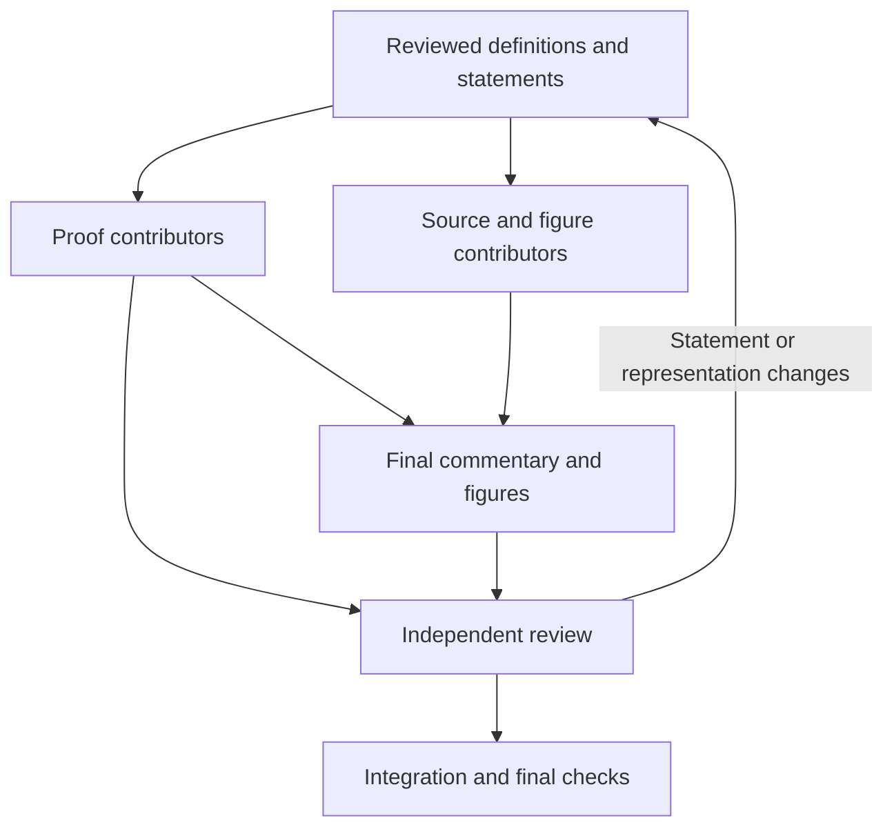

# An outside review: Astra, October 2026

On 17 October 2026, at our request, Astra, an OpenAI model run in ChatGPT, read
Stoicheia cold at commit
[676244a](https://github.com/jackChallis/stoicheia/tree/676244a617e59e527b4ba0a3f33b8797c1552b90)
and wrote four things: an assessment, a score against the README's own goal, a route to
95/100 for each book, and a draft guide for contributors working in parallel. We are very
grateful. The review is careful and generous, it is right on nearly every point, and it
found a real bug. This page keeps it as written and says what we are doing about each
point. The plan behind the response is [brief 0005](../briefs/0005-astra-review.md), and
[PROGRAM.md](../PROGRAM.md) tracks its progress.

## What we checked first

We checked every claim against the code before planning, and all of them hold. Two details
to add. III.16's porism is certified only through its parent, as III.1's is, but it uses
nothing III.16 does not, so only III.1's page is short (by `centre_unique`). And III.24's
second clause, like the statements of III.26 and III.27, follows from its angle hypothesis
alone, because our measure of a circumference carries no radius.

## Our response, point by point

| Astra's point | What we are doing | Stage |
|---|---|---|
| The porism bug (III.1's `centre_unique`); porisms outside the policy checks | Porisms get certificate entries of their own and every policy check. Regression tests pin III.1's porism and plant Postulate 5, superposition and a later citation in a porism only. | 1 |
| The dependency walk reads values, not types | One walk for every certificate field, checked against Lean's own `collectAxioms`, with a regression for a dependency hidden in a type. | 1 |
| One green badge for every kind of coverage | A review record for each proposition (statement scope, route, representation, overlap, passages, the commit reviewed), shown under the enunciation and beside the badge, with clause maps for III.16 and III.31. | 1 |
| The generic "Lean that carries it out" sentence | Made true page by page. Sentences with no Lean beneath them are found mechanically and must be declared. | 1 |
| "Needs" the parallel postulate | "This proof uses it", everywhere, with a lint. | 1 |
| "Euclid cites" | "Heath's references", and a second graph drawn from the Lean's own dependencies. | 1 |
| Axioms checked by count only | A lock file holding every axiom's exact statement and the definitions it mentions. | 1 |
| The model evidence is not reproducible | The model and mutation harness committed with seeds and results, a law-by-law account, and a CI job. A formal model in Lean is a named later milestone. | 1 |
| Axiom–proposition overlap (III.2) | An overlap catalogue with compiled audit lemmas, and III.2's page says so before the proof. | 1 |
| "Lean cannot give a segment without its circle" | "Our representation of a segment includes its circle." | 1 |
| Jump links, navigation, folding, scope by the badge, scan links | All of them: helpers folded, the main proof open. | 1 |
| A guide for parallel work | AGENTS.md, STYLE.md, FORMALIZATION.md, WORKFLOW.md and templates, with statements and representations reviewed before proofs, and the voice rules as defaults rather than quotas. | 1b |
| I.40 for any placement; I.45 for any dissection | Companion theorems beside Euclid's worked configuration, which stays as it is. | 2 |
| II.1 for any number of pieces; II.14 for any figure, returning a drawn square | Companion theorems, reusing the new I.45. | 2 |
| Arcs and segments with geometric meaning; III.24 | Arcs and segments defined by their points; a proved placement lemma, with no new axiom; III.24 concluding congruence, its radius proof kept and labelled as an alternative; bridge theorems placed after III.29. | 3 |
| III.14's diameters; III.15's diameter bound | A foot that may be the centre itself, and the bound as a theorem of its own. | 4 |
| III.25 from the segment alone | A construction that never sees the circle, and a separate correctness theorem. | 4 |
| A semantic review of all 99; figures; the hardest blocks | Full review records keyed to a commit, figures checked against Heath's scans, and a start-to-finish read-through. | 5 |
| Confidence that Books I–III meet the bar | An acceptance checklist, a CI checker, an independent audit by a third model family, and a cold re-score. | 6 |
| Prototype each new foundation; settle Book IV's interfaces first | Written into WORKFLOW.md and PROGRAM.md. | after 6 |

Astra also named what to keep, and we keep it: the named, localized assumptions; careful
construction conclusions; lengths, angles and areas as separate magnitudes; the
commentary's candour; and the modern way kept apart from the synthetic proofs.

## The review, as written

The review is reproduced as Astra wrote it, with only its links to the reviewed commit
kept. The draft contributor guide is in [outside-review-01-guide.md](outside-review-01-guide.md).

### 1. Coming in cold

*We asked:* "I have been working to formalize Euclid's Elements. Review the project at GitHub jackchallis/stoicheia and tell me what it's missing, what's wrong, what should be improved. Come in cold."

#### My cold assessment

**Stoicheia is a substantial, working project. Its highest-priority improvement is to make “what has been proved” more precise.** The Lean development builds, the generated material is reproducible, and the commentary frequently identifies important limitations candidly. But the headline claims—“complete,” “sentence by sentence,” and what the certificate establishes—sometimes go further than the formal statements and checks support.

I reviewed commit **[676244a](https://github.com/jackchallis/stoicheia/tree/676244a617e59e527b4ba0a3f33b8797c1552b90)**, dated October 17, 2026, using the repository as my starting point. I surveyed the statements of all 99 propositions, examined the foundations and certificate machinery, read selected proofs closely, and compiled additional audit examples.

My recommendation is to spend the next development cycle on **statement coverage, the arc/segment representation, and the certificate**, before extending those conventions into Book IV.

##### What I verified

| Check | Result |
|---|---|
| Build with the pinned Lean 4.35.0 compiler | **Passed: all 134 build jobs** |
| Regenerate the certificate | **Passed: 99 propositions recorded as proved** |
| Heath text-fidelity and house-rule checks | **Passed for all 99 propositions** |
| Regenerate the book, certificate, and graph | **No changes to tracked output** |
| Existing negative tests | **All planted mistakes caught** |
| Additional mathematical audit lemmas | **Confirmed the III.2 axiom overlap and the III.26–27 representation issue described below** |
| Additional certificate audit | **Confirmed an omitted assumption in the treatment of III.1’s porism** |

These checks reproduce the workflow in the repository’s [CI configuration](https://github.com/jackchallis/stoicheia/blob/676244a617e59e527b4ba0a3f33b8797c1552b90/.github/workflows/ci.yml). I found no counterexample to a sampled formal theorem. This was a broad statement review and selective deep proof review, rather than an independent reconstruction of every proof or a formal consistency proof of the foundations.

---

#### 1. There is a concrete bug in the certificate’s handling of porisms

**This is the first thing I would fix, because it already affects published output.**

The certificate treats a porism—an appended corollary—as part of its parent proposition in two respects:

- A citation of the porism is recorded as a citation of the parent proposition.
- The parent proposition is not marked finished unless its porism is finished.

However, it only retains the porism’s **“does this depend on `sorry`?”** information. Its axioms, direct dependencies, Common Notions, and shared steps are not incorporated into the parent’s certificate. You can see the asymmetry in [Certificate/Facts.lean](https://github.com/jackchallis/stoicheia/blob/676244a617e59e527b4ba0a3f33b8797c1552b90/Certificate/Facts.lean#L210).

##### The current example: III.1

`Prop1.porism` uses:

```lean
have hFG : F = G := centre_unique hF hG
```

That is at [BookIII/Prop01.lean, line 161](https://github.com/jackchallis/stoicheia/blob/676244a617e59e527b4ba0a3f33b8797c1552b90/Elements/BookIII/Prop01.lean#L161).

The main III.1 theorem does not use `centre_unique`. Comparing Lean’s own axiom lists for the two declarations produced:

```text
Elements.BookIII.Prop1:
porism missing axioms = [Elements.Tacit.centre_unique]
```

The [III.1 page](https://github.com/jackchallis/stoicheia/blob/676244a617e59e527b4ba0a3f33b8797c1552b90/book/III/01.md#L242) displays both proofs and reports **56 tacit rules**. That is correct for the main theorem alone. If the certificate describes the proposition together with its porism, consistently with the completion status, it should include **57**.

This also creates a policy gap: a use of Postulate 5, superposition, or a later proposition confined to a porism can escape the checks applied to its parent.

**The proofs remain kernel-checked. The defect concerns the completeness of their reported dependencies.** Downstream propositions still have their transitive axiom lists collected by Lean; the omission is not universal.

##### What to change

Either give porisms their own certificate entries, or aggregate the main theorem and porism before computing the displayed fields and applying the rules. I slightly prefer separate entries: they make the distinction visible and avoid ambiguity about whether “III.1” means the construction, its porism, or both.

Add regression tests for:

- III.1’s actual `centre_unique` discrepancy.
- A porism-only use of Postulate 5.
- A porism-only use of superposition or a later proposition.

There is also a smaller hardening issue: `directDeps` traverses declaration **values**, but not their **types**, unlike `allNotions`. A compiled example demonstrated a dependency hidden in a dependent type. A comparison across all 99 current main propositions found **no affected current rows**, so this is a future regression risk rather than another current mathematical error. Unifying the declaration traversal would address it. [Source: dependency walkers](https://github.com/jackchallis/stoicheia/blob/676244a617e59e527b4ba0a3f33b8797c1552b90/Certificate/Facts.lean#L68).

---

#### 2. “Complete” currently combines several different levels of coverage

The project has a checked declaration for every proposition number in Books I–III. Some declarations cover restricted configurations; some replace the historical objects with modern invariants; some omit clauses.

The commentary discloses most of this well. The problem is that **the same green completion presentation covers all of those cases**, and the generic assurance says that the Lean beneath each sentence carries it out.

Here are the clearest scope boundaries I found:

| Proposition | What the formal statement currently covers | What remains to complete the displayed enunciation |
|---|---|---|
| **I.40** | Equal triangles on adjacent equal bases `BC` and `CE`, with `Between B C E` | Arbitrary equal bases on the same supporting line, including separated or overlapping placements. [Statement](https://github.com/jackchallis/stoicheia/blob/676244a617e59e527b4ba0a3f33b8797c1552b90/Elements/BookI/Prop40.lean#L20) |
| **I.45** | A parallelogram equal to the sum of two triangle areas | An arbitrary rectilineal figure, with a formal account of its area or triangulation. The two input triangles need not even be nonoverlapping. [Statement](https://github.com/jackchallis/stoicheia/blob/676244a617e59e527b4ba0a3f33b8797c1552b90/Elements/BookI/Prop45.lean#L24) |
| **II.1** | A line partitioned into exactly three pieces | “Any number of segments whatever”: an arbitrary finite partition and corresponding finite sum. [Statement](https://github.com/jackchallis/stoicheia/blob/676244a617e59e527b4ba0a3f33b8797c1552b90/Elements/BookII/Prop01.lean#L25) |
| **II.14** | A square-area expression equal to a two-triangle area sum | General polygon input. Returning the square’s four vertices would also make the construction interface more complete. [Statement](https://github.com/jackchallis/stoicheia/blob/676244a617e59e527b4ba0a3f33b8797c1552b90/Elements/BookII/Prop14.lean#L26) |
| **III.14** | Two chords whose supporting lines do not contain the centre | Diameter chords, whose distance from the centre is zero. [Statement](https://github.com/jackchallis/stoicheia/blob/676244a617e59e527b4ba0a3f33b8797c1552b90/Elements/BookIII/Prop14.lean#L21) |
| **III.16 and III.31** | The rectilineal-angle and tangent conclusions represented by the chosen vocabulary | Clauses involving mixed angles formed by a straight line and a curve. [Explicit representation limitation](https://github.com/jackchallis/stoicheia/blob/676244a617e59e527b4ba0a3f33b8797c1552b90/Elements/Foundations/DefinitionsIII.lean#L42) |
| **III.25** | A construction and centre identification given the entire circle and a proof that it has a centre | Completing a circle from access to its given segment alone. [Statement](https://github.com/jackchallis/stoicheia/blob/676244a617e59e527b4ba0a3f33b8797c1552b90/Elements/BookIII/Prop25.lean#L25) |

These are not equally serious. II.1’s finite generalization is a natural extension of an existing proof. The mixed-angle and segment issues require decisions about the objects being formalized.

##### III.31 exposes the presentation problem particularly clearly

The theorem’s docstring includes the mixed-angle clauses. Its conclusion contains only the rectilineal-angle assertions. Near the end, the historical mixed-angle argument appears as a sequence of comments, followed by an `exact` returning the earlier results. The commentary acknowledges that those clauses were left out. [Formal conclusion](https://github.com/jackchallis/stoicheia/blob/676244a617e59e527b4ba0a3f33b8797c1552b90/Elements/BookIII/Prop31.lean#L22); [unformalized closing clauses](https://github.com/jackchallis/stoicheia/blob/676244a617e59e527b4ba0a3f33b8797c1552b90/Elements/BookIII/Prop31.lean#L133).

Yet the renderer still supplies the general statement that the lines under each sentence are the Lean that carries it out. That sentence is inaccurate for this page. [Renderer](https://github.com/jackchallis/stoicheia/blob/676244a617e59e527b4ba0a3f33b8797c1552b90/scripts/render.py#L512).

##### What to change

Give every proposition distinct fields for:

1. **Proof status:** checked, pending, or incomplete.
2. **Statement coverage:** full enunciation, restricted configuration, or omitted clauses.
3. **Argument fidelity:** follows the displayed route, modifies it, or uses an alternative proof.
4. **Representation qualifications:** arcs represented by angular measure, polygon represented by an area sum, and so forth.

Put a short scope note beside the enunciation or proof badge. Readers should encounter the qualification before interpreting the green check.

For the mathematics, I would prioritize **arbitrary finite partitions, finite triangulations/polygon area, and zero-distance chord cases**. They would close concrete gaps while improving the reusable library.

---

#### 3. The arc representation needs a theorem connecting it to geometric arcs

**This is the most important representational issue I found.**

The definitions

```lean
circumference … : Angle
standing … : Angle
```

represent an arc by twice an inscribed angle. They do not represent a curve, a curve’s length, or an arc equipped with its radius. This is clearly explained in [DefinitionsIII.lean](https://github.com/jackchallis/stoicheia/blob/676244a617e59e527b4ba0a3f33b8797c1552b90/Elements/Foundations/DefinitionsIII.lean#L100).

That can be a useful representation. Within a fixed circle, angular measure determines the arc’s size. Across equal circles, it provides a criterion for congruent arcs. But the correspondence needs to be established explicitly.

##### The diagnostic result

I compiled the **complete formal statements of III.26 and III.27 with the `EqualCircles` hypothesis removed**. Both remain provable.

For III.26, the shorter proof rewrites each circumference into its central angle or doubled inscribed angle. For III.27, it cancels equal doubled angles, then uses III.20 for the central-angle conclusion. The necessary representation lemmas are already in [Circumferences.lean](https://github.com/jackchallis/stoicheia/blob/676244a617e59e527b4ba0a3f33b8797c1552b90/Elements/BookIII/Circumferences.lean#L44).

The submitted proofs do use the equality of radii and follow a longer geometric argument. Nevertheless, **the statements themselves no longer need the equal-circle condition**.

Consider quarter-circle arcs with radii 1 and 2. Both receive the same normalized angular measure, \(\pi/2\). Their lengths are \(\pi/2\) and \(\pi\). The project acknowledges precisely this limitation in its [Book III introduction](https://github.com/jackchallis/stoicheia/blob/676244a617e59e527b4ba0a3f33b8797c1552b90/mishnah/intro/III.md#L7).

Keeping the equal-circle hypothesis restricts the original statements to an appropriate domain. It does not itself prove that the encoded equality means the geometric equality the reader has in mind.

##### III.24 has the related segment issue

III.24 concludes:

```lean
EqualCircles AEB CFD ∧
  circumference AEB A E B = circumference CFD C F D
```

That proves equal radii and equal normalized arc measures. It does not conclude that an isometry maps one circular segment onto the other, or that two segment regions are congruent. [Statement](https://github.com/jackchallis/stoicheia/blob/676244a617e59e527b4ba0a3f33b8797c1552b90/Elements/BookIII/Prop24.lean#L80).

The radius-equality proof is substantial; the case analysis is doing real work. The missing step is the formal connection between those invariants and segment congruence.

##### What to change

I would preserve angular measure as a useful representation, while adding:

- An **arc object** with its supporting circle, endpoints, and chosen side.
- A **circular-segment object** or region predicate.
- A congruence relation, with a theorem showing that the relevant radius and angular data characterize congruence.
- An explicit theorem connecting the current statements to those geometric objects.

This need not introduce analytic arc length into every synthetic proof. Congruence under a suitable motion could provide the relevant meaning directly.

Your rectangle development already offers a useful pattern: define a convenient area expression, then prove that actual rectangles with the prescribed sides have that area. The arc development needs a comparable connection to the geometric object. [Rectangle development](https://github.com/jackchallis/stoicheia/blob/676244a617e59e527b4ba0a3f33b8797c1552b90/Elements/BookII/Rectangles.lean).

---

#### 4. Some propositions are already contained in the foundational assumptions

III.2 is the clearest example.

Its conclusion says that every point strictly between two points on a circle lies inside the circle. The axiom `inside_of_between` says the stronger thing: the endpoints may be **on or inside** the circle. [Axiom](https://github.com/jackchallis/stoicheia/blob/676244a617e59e527b4ba0a3f33b8797c1552b90/Elements/Foundations/Tacit/Diagram.lean#L159).

The full III.2 statement therefore has this proof:

```lean
by
  intro E hAEB
  exact inside_of_between (Or.inr hA) (Or.inr hB) hAEB
```

I compiled it. Lean reported exactly one axiom:

```text
[inside_of_between]
```

The actual III.2 proof also depends on that axiom, through earlier results. Its commentary openly acknowledges the path through III.1. [III.2 commentary](https://github.com/jackchallis/stoicheia/blob/676244a617e59e527b4ba0a3f33b8797c1552b90/mishnah/III/02.md#L7).

##### The dependence goes deeper than that one call

Replacing the call to III.1 with direct extraction of the centre from the existing hypothesis does **not** remove the dependence. Another path runs through I.5 and `exists_between_nearer`, whose proof uses circle convexity. [I.5’s helper call](https://github.com/jackchallis/stoicheia/blob/676244a617e59e527b4ba0a3f33b8797c1552b90/Elements/BookI/Prop05.lean#L37); [helper implementation](https://github.com/jackchallis/stoicheia/blob/676244a617e59e527b4ba0a3f33b8797c1552b90/Elements/Figure/Circles.lean#L43).

Thus this is not something a one-line edit to III.2 resolves.

**The derivation is valid relative to the stated axioms. It does not establish III.2 independently of an assumption at least as strong as III.2.**

That distinction matters because the project presents both a reconstruction of Euclid’s argument and a picture of the book’s foundational development. System E’s diagram rules can legitimately support the first goal while changing what the second picture means.

##### What to change

Add an explicit catalogue of **axiom–proposition overlap**:

- Which proposition content a foundational rule already supplies.
- Where that rule first enters the development.
- Which dependencies bring it into the proposition’s own proof.

The existing gap catalogues are a good starting point. This would make a scientifically useful result out of the overlap: it would show exactly where a modern account of diagrammatic reasoning front-loads content Euclid later proves.

If deriving these propositions from weaker assumptions is a goal, make that a separate, dependency-audited workstream. A prohibition on citing later proposition names cannot detect an earlier axiom with equivalent mathematical content.

---

#### 5. The assurance about the foundations needs clearer levels of evidence

The foundations have a described intended interpretation:

- Ordinary plane points and lines.
- Positive-radius circles.
- Strict betweenness and open half-planes.
- Nonnegative real magnitudes.
- Usual distances, angles, and triangle areas.

That interpretation is described in [Words.lean](https://github.com/jackchallis/stoicheia/blob/676244a617e59e527b4ba0a3f33b8797c1552b90/Elements/Foundations/Words.lean#L19). The internal review also reports roughly eight million sampled configurations, mutation tests against weakened axioms, and manual review. Those are valuable checks. [Soundness discussion](https://github.com/jackchallis/stoicheia/blob/676244a617e59e527b4ba0a3f33b8797c1552b90/docs/reports/read-through-01.md#L92).

What I did not find is a committed executable version of those model tests or a machine-checked interpretation proving all 87 exact laws.

The distinction is:

| Evidence | What it establishes |
|---|---|
| Lean checks a proof term | The formal conclusion follows from the formal assumptions |
| Numerical model tests | No counterexample was found among the tested configurations |
| An informal mathematical model argument | A mathematical justification whose details must be assessed by readers |
| A formal interpretation of every axiom | A checked connection between the abstract theory and the chosen model |

An informal model argument can be correct. The issue is that readers should be able to tell which kind of assurance they are receiving, and independently reproduce the reported evidence.

##### A worthwhile major milestone

I would build an optional model package, separate from the synthetic proofs:

1. Express the geometric vocabulary as an interpretable signature.
2. Instantiate it in an ordinary plane, potentially using Mathlib.
3. Prove the **exact declared laws**, including their degeneracy conditions.
4. Arrange for changes to an axiom’s statement to invalidate its model proof until updated.

The main proofs can remain coordinate-free. A coordinate model used to justify the foundations does not change how those proofs reason.

Before that larger milestone, commit the existing numerical test harness, seeds, mutation cases, and a law-by-law account of the informal model argument. Also consider recording the exact axiom signatures in the review manifest. Counting 87 axioms catches additions and removals; it does not detect a change in strength that leaves the count unchanged.

##### The parallel-postulate claim also needs tightening

The README says the certificate establishes whether a proposition **needs** the parallel postulate. The implemented check establishes whether **this proof uses** the named postulate or a designated Euclidean-only axiom. [README claim](https://github.com/jackchallis/stoicheia/blob/676244a617e59e527b4ba0a3f33b8797c1552b90/README.md#L64); [implemented check](https://github.com/jackchallis/stoicheia/blob/676244a617e59e527b4ba0a3f33b8797c1552b90/scripts/check_fidelity.py#L199).

Those are different statements:

- A proof using Postulate 5 does not show that every proof needs it.
- A proof avoiding the named Postulate 5 is a proof in the remaining theory, but does not establish that the remaining assumptions themselves avoid encoding its strength.

A hyperbolic interpretation of the relevant remaining axioms would address the latter question. Until then, **“this proof uses”** is the precise wording. The existing dependency results remain valuable with that wording.

---

#### 6. The historical dependency graph is mislabeled

The graph describes its edges as following **“Euclid’s own bracketed references.”** The certificate similarly labels the extracted references “Euclid cites.” [Graph](https://github.com/jackchallis/stoicheia/blob/676244a617e59e527b4ba0a3f33b8797c1552b90/GRAPH.md#L5); [reference extraction](https://github.com/jackchallis/stoicheia/blob/676244a617e59e527b4ba0a3f33b8797c1552b90/scripts/render.py#L224).

The numbered justification brackets belong to the editorial apparatus of the translation. They should not be presented as Euclid explicitly supplying those numbered references. Green Lion Press’s edition of Heath explains that the bracketed additions supplied by Heath clarify material not literally present in the Greek. [greenlion.com](https://greenlion.com/PDFs/Eu-I-1-7.pdf)

I would rename the column **“References in Heath’s text”** or **“Heath’s references.”**

This is more than a wording detail. An absent bracket does not necessarily mean that Euclid omitted the relevant reasoning. Conversely, a bracket identifies an editorially supplied dependency, not a machine-established reconstruction of the whole argument.

There are three useful objects here:

1. The references printed in Heath’s edition.
2. The dependencies of the Lean development.
3. A scholarly reconstruction of the reasoning in the historical argument.

The repository has useful material for all three. They should be distinguished.

A practical improvement would be to generate a second graph from the actual Lean dependency data. The existing graph is generated from the references in the text, even though the certificate already has the formal dependency information. [Graph generator](https://github.com/jackchallis/stoicheia/blob/676244a617e59e527b4ba0a3f33b8797c1552b90/scripts/render.py#L766).

---

#### 7. Construction problems need a clearer account of what is given

I would not criticize III.1 simply for assuming that the circle has a centre. Its conclusion provides considerably more than bare existence: it constructs the relevant midpoints and perpendicular chord, then verifies that the constructed point is the centre. That is meaningful mathematical work. [III.1 statement](https://github.com/jackchallis/stoicheia/blob/676244a617e59e527b4ba0a3f33b8797c1552b90/Elements/BookIII/Prop01.lean#L60).

III.25 presents a more consequential interface problem. Euclid’s task is to recover the complete circle from a segment. The formal statement receives the complete circle as an input, together with centre existence. Its construction is still substantial, but the theorem does not certify that the construction used only information obtainable from the given segment. The commentary acknowledges this directly. [III.25 commentary](https://github.com/jackchallis/stoicheia/blob/676244a617e59e527b4ba0a3f33b8797c1552b90/mishnah/III/25.md#L3).

This points to a broader design question for the coming construction books: **existence of an object with the right properties and construction from the permitted initial data are separate claims.**

A useful long-term improvement would be a representation of the initial configuration and allowed construction steps, with a correctness theorem for the resulting object. You need not retrofit every proposition immediately; III.25 would be a revealing pilot.

One sentence should change immediately: “Lean cannot give a segment without its circle” describes the current project representation, not a limitation of Lean. Say **“Our current representation of a segment includes its supporting circle.”** [Current wording](https://github.com/jackchallis/stoicheia/blob/676244a617e59e527b4ba0a3f33b8797c1552b90/mishnah/intro/III.md#L15).

---

#### 8. The reader’s edition would benefit from a few small, concrete changes

The paired figures and proposition-specific commentary are worth preserving. The edition is also technically well assembled: the file-level coverage is present, and checks of reader-facing relative paths found no missing local targets.

The main usability problem is the distance between the proposition and its commentary.

The renderer places the complete expanded Lean listing before the certificate and mishnah, with navigation only at the top. The displayed Lean listings have a median of 94 lines; II.8 has 309. That is a substantial amount of scrolling for someone trying to understand the geometry or find the qualification to a claim. [Page layout](https://github.com/jackchallis/stoicheia/blob/676244a617e59e527b4ba0a3f33b8797c1552b90/scripts/render.py#L463); [II.8](https://github.com/jackchallis/stoicheia/blob/676244a617e59e527b4ba0a3f33b8797c1552b90/book/II/08.md).

I would make four changes:

- Add jump links to **proof, Lean, certificate, and commentary** near the top.
- Repeat previous/next navigation at the bottom.
- Fold the Lean helpers, or optionally the entire Lean listing, using the same `<details>` pattern already used for tacit rules.
- Put scope qualifications beside the theorem badge.

##### Make the primary sources one click away

The source footers carefully record volumes, pages, and scan leaves, but emit them as plain text. The renderer already knows the archive identifiers and can construct scan links; it currently does so chiefly for missing-figure fallbacks. [Source-footer code](https://github.com/jackchallis/stoicheia/blob/676244a617e59e527b4ba0a3f33b8797c1552b90/scripts/render.py#L265).

Turn those page references into direct links to the scans. That would materially improve the project’s usefulness as an auditable scholarly edition.

The existing structure can support all of these changes. A new publishing platform is not a prerequisite.

---

#### 9. What is missing from the full thirteen-book project

The current coverage is 99 proposition numbers out of the planned 465, roughly 21% by count. That is a coverage measure, not an estimate of the work completed. The original plan already identifies the major additional foundations, which is sensible. [Original plan](https://github.com/jackchallis/stoicheia/blob/676244a617e59e527b4ba0a3f33b8797c1552b90/docs/briefs/0001-plan.md).

The remaining work will require more than extending the current proposition pipeline:

- **Proportion:** Book V needs a precise theory of magnitude ratios, multiples, and the relevant Archimedean assumptions.
- **Arithmetic:** Books VII–IX need decisions about which arithmetic laws are foundational and which Euclid is meant to establish.
- **Incommensurability:** Book X needs a durable connection between magnitude, ratio, commensurability, and geometric constructions.
- **Solid geometry and exhaustion:** Books XI–XIII need planes, spatial incidence, solid magnitudes, and the infrastructure for exhaustion arguments.

I would prototype one difficult statement from each new foundation before committing to a broad parallel proof effort. The current project illustrates why: once many proofs depend on a representation, correcting that representation becomes expensive.

The same applies immediately to Book IV. Settling the arc, segment, and construction-input interfaces now would reduce the risk of having to revise them after another book depends on them.

---

#### What I would preserve

Several choices are doing useful work:

**Named, localized assumptions.** The 87 assumptions are inspectable and attributed. The use of Lean’s actual axiom collector provides a strong basis for auditing dependencies.

**Careful construction conclusions.** Many statements retain the betweenness, noncollinearity, ray, and side conditions that make a geometric construction meaningful. I.9 and I.22, for example, do more than assert an unlocated point with a numerical equality.

**The distinction between magnitudes.** Keeping lengths, angles, and areas as different types is a good foundation for preventing accidental conflation.

**The commentary’s candour.** The discussions of III.2, III.24, and III.25 are valuable precisely because they explain where the formal development differs from a straightforward reading of Euclid.

**The separation of synthetic proofs and modern commentary.** That is a coherent editorial purpose. It can coexist with a separate model package that justifies the synthetic assumptions.

The strongest improvements would make those existing strengths easier for readers to assess.

#### My recommended order of work

| Priority | Action | Concrete completion criterion |
|---|---|---|
| **1** | Repair porism certificates and policy checks | III.1’s additional assumption is reported; porism-only forbidden dependencies fail the checks |
| **2** | Separate proof status from statement and argument coverage | Each affected proposition carries an accurate scope note beside its badge |
| **3** | Correct the assurance and historical-reference wording | “This proof uses” replaces necessity claims; Heath’s editorial references are labeled correctly |
| **4** | Strengthen arc and segment semantics | A checked theorem connects the current invariants to geometric arc/segment congruence |
| **5** | Close concrete generality gaps | Finite partitions, polygon/triangulation input, and diameter cases have general statements |
| **6** | Make the model evidence reproducible | Numerical tests are committed; a formal interpretation becomes an explicit major milestone |
| **7** | Improve navigation and source links | Commentary and primary scans are reachable directly from every proposition page |

**The next version should let a reader answer four questions immediately: what Lean proved, how closely that matches Euclid’s full claim, which argument it followed, and what assumptions or representations made the proof possible.** Much of that information already exists in Stoicheia. The remaining work is to make it complete, formally connected where necessary, and central to the project’s definition of “done.”

### 2. A score against the README

*We asked:* "As an outsider on a scale from 0-100 how well would you say for the first three books it addresses the goals of the Readme, Lean review sentence by sentence in Euclid with text, Lean + commentary."

I would give it about 85/100 for Books I–III, judged against the goal you just stated: reading Euclid sentence by sentence, with his text, checked Lean, and useful commentary.

As an outsider, I would see a substantial, usable realization of that idea. The central experience promised by the README is already present. My previous review concentrated on defects because that was the assignment; those defects should be weighed against the considerable amount that works.

##### How I would score the three books

These are editorial judgments, rather than measurements from a benchmark.

| Book | Score | My assessment |
|---|---|---|
| I | 90/100 | The most convincing realization of the project’s goal. The progression, constructions, proofs, and commentary fit together well. The main reservations concern a few restricted statements and the strength of some certificate claims. |
| II | 85/100 | A strong continuation, particularly the treatment of rectangles and squares as areas. The gap between the general enunciations and the particular configurations formalized becomes more noticeable. |
| III | 80/100 | Substantial mathematical work and good commentary, with more significant representational compromises: arcs as angular measures, omitted mixed-angle clauses, and the treatment of a given circular segment. |
| Overall | 85/100 | The intended edition works well. Completing the correspondence between some formal statements and their historical meanings would move it into the 90s. |

The repository itself documents several of these qualifications in the README and especially the Book III introduction.

##### Why the score is that high

The promised material exists throughout the three books. There are 99 proposition entries with historical text, Lean proofs, commentary, and paired figures. I independently reproduced the full build, certificate generation, text-fidelity checks, page generation, and existing negative tests. That is a strong foundation for judging the project as a functioning edition. Verification workflow.

The sentence-by-sentence approach is meaningful. In the proofs examined closely, the historical sentences generally organize the actual mathematical development. The formalization often supplies the missing incidence, betweenness, side, and nondegeneracy facts that make Euclid’s argument work. That is exactly the kind of value the project promises.

The commentary substantially improves the experience. It explains local difficulties, historical observations, and modern alternatives. Its willingness to discuss awkward cases—such as III.2’s dependence on circle convexity and III.25’s complete-circle input—is a particular strength. Those discussions help a reader understand formalization as a mathematical activity. III.2 commentary; III.25 commentary.

##### What costs it the remaining 15 points

###### 1. Some complete historical statements have only partial formal counterparts

This is the largest deduction.

Examples include II.1 proving the three-piece case of “any number of segments,” I.45 and II.14 working with two-triangle area sums, and III.16/III.31 omitting mixed-angle clauses. Those choices can be reasonable stages of development, but they fall short of fully delivering every displayed sentence. II.1 statement; III.31 statement and conclusion.

###### 2. In a few important places, the formal representation changes what the result means

The arc issue matters here. III.26–27’s encoded statements remain provable without equal circles because their arc equality is equality of angular measure. The missing connection to geometric arc congruence is substantive mathematical work.

Similarly, III.24 proves equal radii and equal angular measures; a formal theorem connecting those invariants to segment congruence would complete the interpretation. Arc definitions; III.24 conclusion.

###### 3. The presentation sometimes promises more than the checks establish

The porism certificate omission is a concrete bug. More broadly, a green “proved” badge does not distinguish full coverage from restricted coverage, and the generic sentence-by-sentence assurance is too strong on pages containing unformalized clauses. These are concentrated, fixable problems. Certificate handling; generated assurance.

##### What I would not penalize heavily for this particular goal

I would give relatively little weight to the absence of a fully machine-checked real-plane model. That would strengthen the project’s foundational assurance, but the reader’s-edition goal does not require solving every metamathematical question first.

Likewise, using a substantial synthetic axiom system is a defensible choice. The important requirements are to state those assumptions, explain consequential overlaps, and describe accurately what the resulting proofs establish.

To reach roughly 90/100, I would fix the certificate, surface the qualifications beside each proposition, and close the more straightforward generality gaps. To reach 95/100 or above, I would want the arc/segment interpretation completed and a substantially stronger account of every clause in the historical enunciations.

So my judgment is: 85 is earned by the existing text–proof–commentary experience. The next gains come from making the formal coverage as complete and precise as the presentation invites the reader to believe.

### 3. The road to 95

*We asked:* "OK if I want 95/100 for all three books, accepting that the quality seems to be falling off over time what improvements would you specifically mention to go to 95/100?"

**I would aim for a consolidation release, with most of the new mathematical work concentrated in Book III.** To give each book roughly 95/100, I would want the remaining generality gaps closed, the meanings of Book III’s arcs and segments better established, and a systematic review of whether the Lean actually carries out the sentences printed above it.

I would qualify the “quality falling off over time” interpretation. What my 90/85/80 scores reflect is an increasing gap between the reader-facing promise and the formal coverage. Book III introduces representation problems that the line-and-triangle framework handles less directly. There is careful work there, including substantial case analysis. My recommendation is to give those harder representation questions another design pass.

These recommendations refer to the [same reviewed revision, `676244a`](https://github.com/jackchallis/stoicheia/tree/676244a617e59e527b4ba0a3f33b8797c1552b90).

#### What I would mean by 95/100

For your stated goal, a 95-point edition would let a reader confidently answer:

- **What does Euclid claim?**
- **What does the formal theorem actually prove?**
- **How does each substantive step of his argument appear in the Lean?**
- **What has the formalization added, changed, or left outside its scope?**

I would allow a few small, prominently declared limitations at 95. In particular, the mixed-angle clauses of III.16 and III.31 could remain outside the formalization. One clearly identified alternative proof, in III.24, could also remain. But the principal geometric claims should have the intended meaning, and the presentation should make those exceptions easy to see.

Here is the specific work I would require.

#### 1. Across all three books: review semantic correspondence, sentence by sentence

**This is the highest-value improvement to the project’s central promise.**

The existing fidelity check preserves the text: it extracts the theorem docstring and the `--` comments, then compares their normalized wording with the Heath transcription. It does not check whether the Lean beneath a sentence expresses that sentence’s mathematical content. That distinction is visible in [`check_fidelity.py`](https://github.com/jackchallis/stoicheia/blob/676244a617e59e527b4ba0a3f33b8797c1552b90/scripts/check_fidelity.py#L75-L116).

I would perform a semantic review of all 99 propositions. For each substantive passage, the reviewer should establish which of these descriptions applies:

| Relationship to the text | What the reader should see |
|---|---|
| The Lean carries out the stated inference or construction. | The existing annotated proof. |
| A helper supplies a justification Euclid omits. | A short explanation of the helper’s mathematical job. |
| Several sentences are implemented by one argument, or “similarly” is handled by a shared lemma. | An explanation of that grouping where it is not obvious. |
| The formal proof uses a different argument. | An explicit alternative-proof label and an account of the difference. |
| A claim has no formal counterpart. | A clear statement that this clause remains unformalized. |

This should be a mathematical review, not a rule requiring one tactic after every sentence. Setting-out, restatements, and concluding sentences often need no separate proof term. Conversely, a long block of valid Lean does not establish historical fidelity merely because the right quotation precedes it.

##### The concrete implementation

Add a small review record for each proposition, with notes only where needed:

- Statement scope and additional hypotheses.
- Any unformalized clauses.
- Any material change of proof route.
- The revision reviewed.

Have the renderer put exceptions beside the theorem status. The current renderer gives every finished proof the same sentence-by-sentence description, which is too broad for the known exceptions. [`render.py`, proof introduction](https://github.com/jackchallis/stoicheia/blob/676244a617e59e527b4ba0a3f33b8797c1552b90/scripts/render.py#L512-L524)

**Done when:** every proposition has a current semantic review, and no material restriction, omitted clause, or replacement argument has to be discovered by reading far down into the commentary.

That would improve all three books substantially without requiring more prose everywhere.

#### 2. Book I: close two specific generality gaps

##### I.40: handle arbitrary equal bases on the same line

The current statement uses adjoining bases `BC` and `CE`, with `Between B C E`. Euclid’s enunciation is broader. [`Prop40.lean`](https://github.com/jackchallis/stoicheia/blob/676244a617e59e527b4ba0a3f33b8797c1552b90/Elements/BookI/Prop40.lean#L19-L23)

I would add a general companion theorem whose inputs are:

- Two triangles of equal area.
- Bases of equal length, with all four base endpoints on one line.
- Vertices on the same side of that line.

Its conclusion should say that **a line parallel to the baseline contains both vertices**. That formulation also handles coincident vertices; a separate corollary can identify the line joining distinct vertices.

This is a focused extension. The existing proof already draws a parallel, meets the other triangle’s side, and uses equality of areas to identify the intersection. Preserve that annotated proof as Euclid’s worked configuration, and explain how the general result extends it.

**Done when:** one statement covers separated, touching, overlapping, and oppositely named bases, and the present statement follows as a specialization.

##### I.45: formalize the repetition over a finite dissection

The existing conclusion gives a parallelogram equal in area to **two triangles**. The idea that the process continues for a larger figure is not yet expressed by the theorem. [`Prop45.lean`](https://github.com/jackchallis/stoicheia/blob/676244a617e59e527b4ba0a3f33b8797c1552b90/Elements/BookI/Prop45.lean#L23-L34)

I would extract the operation already present in the proof:

> Given the parallelogram assembled so far, append one more triangle’s area while preserving the specified angle.

Then start with I.42 and iterate using I.44 and the assembly argument from I.45.

The appropriate input for this edition is a **rectilineal figure with a supplied finite dissection into triangles**. That is a bounded and useful target. The input should record the relationship between the pieces and the figure: a list of arbitrary overlapping triangles does not automatically represent its ordinary area.

There is a further theorem one could pursue—every suitable polygon specified by its vertices admits such a dissection—but I would regard that as a separate extension. The reader-facing description should state the supplied-dissection convention accurately.

**Done when:** the construction accepts any nonempty finite number of valid pieces, returns a parallelogram with the requested angle and total area, and handles a pentagon’s dissection without changing its theorem statement.

##### Why this would move Book I to about 95

Book I already has the strongest fit to the intended format. I would preserve most of it. The combination of these two extensions, a complete semantic review, and the shared certificate/presentation fixes below would address the main reasons I withheld those five points.

#### 3. Book II: give the opening and closing propositions their advertised scope

##### II.1: prove “any number of segments”

The current theorem has exactly three pieces, despite the general quantifier in its enunciation. [`Prop01.lean`](https://github.com/jackchallis/stoicheia/blob/676244a617e59e527b4ba0a3f33b8797c1552b90/Elements/BookII/Prop01.lean#L25-L29)

The concrete extension is:

1. Prove a binary rectangle-splitting lemma for one interior division point.
2. Represent a finite subdivision of a segment.
3. Induct over that subdivision.

Schematically, for an ordered subdivision \(P_0,\ldots,P_n\),

\[
\operatorname{rect}(A;P_0P_n)
=
\sum_{i=0}^{n-1}\operatorname{rect}(A;P_iP_{i+1}),
\]

where \(A\) denotes the uncut segment.

This uses finite addition of areas and the existing geometric decomposition. It fits the project’s treatment of magnitudes.

Keep the three-piece proof as the annotated presentation of Euclid’s diagram. The general theorem should be explicitly connected to it.

**Done when:** the statement quantifies over a finite subdivision, includes the one-piece and two-piece cases, and gives the current three-piece result as a specialization. Allowing duplicate cut points and zero-length pieces is optional convenience.

##### II.14: construct a square for the same general class of figures as I.45

The current theorem again takes two triangles, and returns a segment whose associated square area equals their sum. [`Prop14.lean`](https://github.com/jackchallis/stoicheia/blob/676244a617e59e527b4ba0a3f33b8797c1552b90/Elements/BookII/Prop14.lean#L26-L45)

I would factor its work into two reusable constructions:

- Convert a supplied finite dissection into a rectangle, through generalized I.45.
- Convert a nondegenerate rectangle into an equal square, through the existing II.14 argument.

Then add the small construction corollary returning the square’s four vertices and its `Square` proof, using I.46. Returning its side is mathematically useful, but explicitly returning the requested figure would make the construction’s completion easier for the reader to inspect.

Preserve the semicircle construction and the already-square/unequal-sides cases. Those are central to the historical argument.

**Done when:** II.14 accepts the same general finite-figure input as I.45 and returns a proved square of equal area.

##### Review the area correspondence throughout Book II

For the remaining propositions, I would concentrate the semantic review on:

- Which expression denotes which drawn piece.
- Why the pieces form the claimed subdivision.
- Whether the required incidence and order facts are established.
- Whether each addition or subtraction is an equality of the intended areas.

The project already has useful machinery such as `Rectangle.eq_rect`. The improvement is to make that correspondence easy to follow at its important uses. One compact explanation linked from the introduction would help more than expanding every “modern way” paragraph.

**This would be my Book II route to 95:** generalize II.1 and II.14, reuse the improved I.45, and check the geometric meaning of the area manipulations throughout the book.

#### 4. Book III: establish the geometric meaning of arcs and segments

**This is the largest substantive task in the whole plan.**

The present `circumference` is an `Angle`, defined through a doubled inscribed angle. The supporting lemmas establish useful facts about that measure, including independence of the measuring point and the semicircle cases. [`DefinitionsIII.lean`](https://github.com/jackchallis/stoicheia/blob/676244a617e59e527b4ba0a3f33b8797c1552b90/Elements/Foundations/DefinitionsIII.lean#L100-L115), [`Circumferences.lean`](https://github.com/jackchallis/stoicheia/blob/676244a617e59e527b4ba0a3f33b8797c1552b90/Elements/BookIII/Circumferences.lean)

I would retain that work and add a small geometric layer explaining exactly what the measure represents.

##### Define arcs and circular segments through membership

An arc needs its supporting circle, two distinct endpoints, and a choice of side of the chord. A circular segment needs the corresponding portion of the circle’s interior and boundary.

These could be lightweight predicates:

- A point belongs to the arc when it is on the circle and on the selected side, with the endpoints included.
- A point belongs to the circular segment when it is inside or on the circle and in the selected closed half-plane.

Classify the segment as minor, semicircular, or major from the **position of the centre relative to the chord and selected side**. That gives the classification a geometric definition independent of the measure being validated.

##### Prove the missing correspondence

I would want two explicit results.

**First: measure and shape agree in equal circles.**

For valid arcs of equal circles:

\[
\text{equal angular measures}
\quad\Longleftrightarrow\quad
\text{equal chord lengths and matching minor/semicircle/major types}.
\]

**Second: the geometric data determine the placed figure.**

For segments already on the same chord and selected on the same side, equal radii and matching types should imply that the circles, arcs, and segment point-sets coincide.

The second result is particularly valuable: it gives the representation geometric content beyond renaming a conjunction of equalities.

This work can remain synthetic. Minor arcs can use central triangle congruence; major arcs can use complementary minor arcs; diameters need their own case.

There is an implementation trap to avoid: **do not prove the bridge using III.26–29 and then feed it back into III.24.** Those later propositions already depend on III.24. Build the needed bridge from earlier results, or place it later as an independent validation theorem. The existing dependency is visible in [`Prop26.lean`](https://github.com/jackchallis/stoicheia/blob/676244a617e59e527b4ba0a3f33b8797c1552b90/Elements/BookIII/Prop26.lean#L1-L7).

**Done when:** a reader can trace an asserted equality of circumferences through the measure to independently specified radius, chord, and side geometry. The distinction between equal angular size and equal geometric size must remain clear.

#### 5. Book III: repair III.24’s conclusion and its presentation

III.24 currently concludes that the circles are equal and that their selected circumference measures are equal. Its proof obtains this through a radius comparison, while Euclid applies one segment to the other. The difference is acknowledged in the code and commentary. [`Prop24.lean`](https://github.com/jackchallis/stoicheia/blob/676244a617e59e527b4ba0a3f33b8797c1552b90/Elements/BookIII/Prop24.lean#L80-L162)

I would use the new geometric layer to give the conclusion a properly justified **segment-shape or congruence meaning**.

Here precision matters: proving that figures coincide when already aligned is not itself a proof that arbitrary figures can be placed in that alignment. State the chosen meaning of congruence and establish whatever placement result it requires.

For the proof route, my preferred eventual improvement is a bounded placement lemma followed by Euclid’s within/outside/overlap argument, including III.23 and III.10.

However, **I would accept the existing radius argument at 95**, provided that:

- Its conclusion has the repaired geometric meaning.
- It is displayed as an alternative formal proof.
- Euclid’s original proof remains available in full.
- A short correspondence note explains where the arguments differ.
- Lean proving the radius comparison does not appear to implement the sentences about superposition and falling awry.

That is a manageable exception in a reader’s edition. It should be deliberately presented as one.

#### 6. Book III: make III.25 a clearer reconstruction from the given segment

The current III.25 accepts the whole supporting circle and proves that its construction finds the centre. The substantial three-case geometry is there, but the interface does not closely express “given a segment, complete its circle.” [`Prop25.lean`](https://github.com/jackchallis/stoicheia/blob/676244a617e59e527b4ba0a3f33b8797c1552b90/Elements/BookIII/Prop25.lean#L25-L31)

I would separate **construction** from **verification**:

1. Extract a construction core using the chord endpoints, their midpoint, and the point where the perpendicular meets the given arc.
2. Have it construct \(E\) and prove \(EA=EB=EC\).
3. Describe the resulting circle using Postulate 3.
4. Separately prove that the new circle contains the entire supplied arc, using the evidence that the input really is a circular arc.

The core that reconstructs \(E\) should not receive the backing circle or its centre. A correctness theorem may quantify over a supporting circle; that is different from making all its geometric data available to the construction.

This is a useful interface repair, and much of its local geometry can be extracted from the existing proof.

**Done when:** the output includes the described circle, all three centre-location cases remain covered, and the correctness theorem connects the result to every point of the given arc.

Also change commentary such as “Lean cannot give a segment without its circle” to describe the project’s representation choice. The current statement is about your model, rather than a limitation of Lean. [`Book III introduction`](https://github.com/jackchallis/stoicheia/blob/676244a617e59e527b4ba0a3f33b8797c1552b90/mishnah/intro/III.md#L15)

#### 7. Book III: finish the elementary boundary cases in III.14 and III.15

These are smaller, more conventional theorem improvements.

##### III.14: include diameter chords

The current hypotheses put the centre off both chord lines, excluding diameters. [`Prop14.lean`](https://github.com/jackchallis/stoicheia/blob/676244a617e59e527b4ba0a3f33b8797c1552b90/Elements/BookIII/Prop14.lean#L21-L26)

Introduce a distance-to-chord convention that admits zero distance: when the centre lies on the chord line, the foot is the centre itself. This should be a separate case, without manufacturing a right angle with a zero-length arm.

Then cover:

- Two nondiameter chords, through the existing proof.
- Two diameters, whose distances are both zero and lengths equal.
- One diameter and one nondiameter chord.

**Done when:** equal chord lengths are equivalent to equal distances from the centre throughout the intended domain.

##### III.15: expose the diameter bound independently

The current theorem bundles “the diameter is greatest” with a second chord and a strict nearer/farther comparison. [`Prop15.lean`](https://github.com/jackchallis/stoicheia/blob/676244a617e59e527b4ba0a3f33b8797c1552b90/Elements/BookIII/Prop15.lean#L67-L76)

Expose two results:

- Every chord is no longer than a diameter, with the appropriate equality case.
- A chord strictly nearer the centre is strictly longer.

**Done when:** a reader can apply the diameter bound without supplying an unrelated more-remote chord. Keep the combined annotated proof as Euclid’s presentation.

#### 8. Make the remaining Book III exceptions prominent and exact

##### III.16 and III.31: explicitly mark the mixed-angle clauses

These propositions contain claims about angles bounded partly by a curved circumference. The existing angle type handles angles between straight lines, and those historical clauses do not have matching formal conclusions. [`DefinitionsIII.lean`](https://github.com/jackchallis/stoicheia/blob/676244a617e59e527b4ba0a3f33b8797c1552b90/Elements/Foundations/DefinitionsIII.lean#L42-L45)

For a 95-point edition, I would allow that limitation after the substantive Book III repairs above.

Require a short clause map before the Lean showing:

- The rectilineal claims that are checked.
- Any rectilineal result used to explain the historical argument.
- The mixed-angle claims retained only in the text and commentary.

The same qualification should appear in the book’s completion summary. Developing a faithful theory of these curved angles would be valuable further work; replacing them with ordinary tangent angles without an interpretation argument would not close the gap.

##### III.2: explain the axiomatic overlap before the proof

The commentary already acknowledges that the foundation assumes a convexity rule containing III.2’s conclusion, and that the displayed reconstruction depends on it indirectly. [`III.2 commentary`](https://github.com/jackchallis/stoicheia/blob/676244a617e59e527b4ba0a3f33b8797c1552b90/mishnah/III/02.md#L7)

Move that fact into the visible proof summary and make its meaning precise: this is a reconstruction of Euclid’s reasoning within the chosen foundation; it does not independently establish that foundational rule.

The dependency is also broader than the route through III.1, so replacing the call to III.1 alone would not remove it.

For this scoring goal, transparent treatment is sufficient. Removing all such overlaps would be a separate foundations project.

#### 9. Fix the certificate, then make the commentary easier to reach

##### Correct the porism accounting

The certificate currently checks porisms for unfinished proofs but does not combine their dependency information with the parent proposition’s displayed dependencies. III.1’s porism supplies the concrete counterexample: it uses `centre_unique`, which is absent from the main theorem’s list. [`Certificate/Facts.lean`](https://github.com/jackchallis/stoicheia/blob/676244a617e59e527b4ba0a3f33b8797c1552b90/Certificate/Facts.lean#L210-L228), [`III.1 porism`](https://github.com/jackchallis/stoicheia/blob/676244a617e59e527b4ba0a3f33b8797c1552b90/Elements/BookIII/Prop01.lean#L154-L161)

I would give porisms their own entries, or explicitly union all dependencies when a page certifies them together. The new generalization theorems should also receive certificates if displayed as part of the proposition’s formal coverage.

Add a regression case where a forbidden dependency occurs only in a porism. It must be detected just as it would be in the main theorem.

Also consistently say **“this proof uses Postulate 5.”** The certificate reports dependencies of a particular proof; that is not a determination that every possible proof requires the postulate.

**Done when:** every formal claim marked complete is covered by the certificate being shown.

##### Improve access to the existing exposition

The current renderer places the full Lean listing before the commentary. [`Page renderer`](https://github.com/jackchallis/stoicheia/blob/676244a617e59e527b4ba0a3f33b8797c1552b90/scripts/render.py#L519-L533)

I would make these modest changes:

- Add jump links to the text, Lean, certificate, and commentary.
- Repeat previous/next navigation at the bottom.
- Fold supporting declarations where they interrupt the main proof.
- Put important scope and proof-route notes near the statement.
- Link the source footer directly to the relevant scan.
- Make figure captions identify the illustrated case when the theorem covers several.

For the commentary itself, focus additions on the hardest formal blocks: what mathematical obstacle does this block resolve, and why did Euclid not need to say it explicitly? That would serve the reader better than generally making every commentary longer.

#### The order I would do this in

| Stage | Concrete deliverable | Why this order |
|---|---|---|
| **1. Accurate status and certificates** | Porism fix, visible scope/route exceptions, consistent completion wording. | Establishes a reliable account of the present work. |
| **2. Book I and II generalizations** | General I.40, finite-dissection I.45, finite-partition II.1, generalized II.14. | Closes identifiable gaps and lets II.14 reuse I.45. |
| **3. Book III representation work** | Geometric arc/segment predicates and correspondence theorems; repaired III.24 conclusion and presentation. | Addresses the largest reason for Book III’s lower score. |
| **4. Remaining Book III statements** | III.14/15 boundary cases and III.25 reconstruction interface. | Brings the formal statements closer to their enunciations. |
| **5. Consolidation review** | All 99 propositions reviewed for sentence correspondence, figures, commentary, and current generated pages. | Tests the actual reading experience against the README promise. |

I would expect **Book I to reach about 95 after its focused generality work and the shared review; Book II after its finite-partition and finite-figure extensions; and Book III after the geometric representation repairs and statement improvements above**. Book III would earn that score with its few remaining exceptions stated plainly.

To sustain that standard in later books, I would make the **formal statement and representation review happen before assigning the proof**. Approve the intended quantifiers, clauses, construction inputs, and meaning of the geometric objects first. Then review the proof’s correspondence to Euclid before marking the proposition complete. That directly addresses the pattern behind the falling scores and should reduce the amount of repair needed after a book is finished.

### 4. A guide for parallel work

*We asked:* "And if we want a general style guide for OpenAI style approaches here. What would that look like? In terms of the overall structure. So that we can keep a common voice, and approach throughout. And help to parallelize the work!"

**I would give it three parts: an editorial standard, a mathematical authoring standard, and a protocol for parallel work.** Then put a short agent brief in front of those documents so each OpenAI/Codex contributor knows what to read, what it owns, and what evidence it must return.

The voice and mathematical obligations should be shared by every contributor. Model-specific instructions should mostly concern how an agent receives an assignment, works within its scope, and hands its work back.

I drafted the full guide, including proposition briefs, handback and review templates, and proposed `AGENTS.md` content:

*(The draft guide is reproduced in full in [outside-review-01-guide.md](outside-review-01-guide.md).)*
This is a proposed guide for adoption. Here is the structure I recommend and the decisions behind it.

#### 1. Build on the existing house style

Your existing [`docs/STYLE.md`](https://github.com/jackchallis/stoicheia/blob/676244a617e59e527b4ba0a3f33b8797c1552b90/docs/STYLE.md) already provides a strong editorial foundation: a knowledgeable companion reading Euclid with the reader, proposition-specific commentary, careful attribution, a recognizable visual design, and a distinction between historical text and project explanation.

I would keep that voice. The additions should make it easier for several contributors to apply it consistently.

##### Proposed document structure

| Document | What belongs there |
|---|---|
| **`AGENTS.md`** | A short entry brief: what to read, how to interpret an assignment, what requires coordination, and how to report completion. |
| **`CONTRIBUTING.md`** | The human entry point, with the kinds of contributions supported and links to the standards. |
| **`docs/STYLE.md`** | Voice, public page structure, commentary, terminology, citations, typography, and figures. |
| **`docs/FORMALIZATION.md`** | How to translate the enunciation, choose representations, handle cases, follow Euclid’s argument, and describe what has been proved. |
| **`docs/WORKFLOW.md`** | Ownership, parallel assignments, shared changes, review, integration, and final checks. |
| **`docs/templates/proposition.md`** | A compact task brief, contributor handback, and review record. |
| **The relevant book brief** | That book’s definitions, representation choices, shared lemmas, conventions, and known exceptions. |

Some of these already exist; the new documents would give the missing responsibilities a clear home.

**Each rule should have one authoritative location.** `AGENTS.md` should point to the standards. It should not become a second enormous style guide that slowly disagrees with the first.

The book briefs are especially important for parallelism. Each contributor should receive the settled meaning of the book’s objects instead of independently inventing a representation of an arc, ratio, magnitude, or solid.

#### 2. State the order of priorities explicitly

I would put this near the beginning:

> Preserve the source, state the mathematics accurately, follow the declared proof route, and explain the result clearly. Stylistic defaults serve those obligations.

That gives contributors a way to resolve conflicts. A necessary hypothesis stays even if it makes the modern explanation three sentences long. A historical uncertainty stays even if the ordinary voice is confident. An omitted clause gets disclosed even if that makes the page less tidy.

I would distinguish **requirements** from **defaults**.

| Requirements | Defaults |
|---|---|
| Accurate mathematical statements and honest scope. | Commentary usually 250–450 words. |
| Exact historical quotations and checked attribution. | Usually three to five paragraphs. |
| Accurate description of the proof route. | Short, proposition-specific bold paragraph leads. |
| Visible treatment of omitted or reformulated clauses. | Sparse Lean identifiers in the commentary. |
| Valid dependency and certificate claims. | “The modern way” as a concise final paragraph. |
| Figures that agree with the argument. | The existing dimensions, palette, and typography. |

Your present guide includes a quota of two to four uses of “we,” strict paragraph targets, and the instruction “nothing hedged.” I would relax those particular rules while preserving their underlying aims. They can make an automated contributor optimize the surface of the prose at the expense of its meaning. [`Current voice and commentary rules`](https://github.com/jackchallis/stoicheia/blob/676244a617e59e527b4ba0a3f33b8797c1552b90/docs/STYLE.md#L10-L71)

#### 3. Define the voice through concrete choices

My proposed voice instruction would be:

> Write as one project examining Euclid closely. Use plain language, name the geometric objects, and explain the inference that matters. State established facts directly. Keep necessary conditions and uncertainty beside the claims they qualify.

##### The practical rules

- **Use “we” for the project’s choices and constructions.** Use it naturally, without a quota.
- **Use “Euclid” for the historical argument, “Heath” for the translation or commentary, and “Lean” for the formal language and checker.**
- **Put the mathematical subject first.** Say what point is constructed, where it lies, what is equal, or why an inference follows.
- **Explain technical terms when they help.** Preserve Euclid’s vocabulary while giving the reader necessary modern glosses.
- **Keep production details out of the public mathematics.** Agent roles, model names, and work allocation belong in internal records and the project’s account of how it was made.
- **Make each paragraph earn its place.** It should contribute mathematics, historical evidence, reader orientation, or an explanation of a formalization choice.
- **Use confidence accurately.** A proved equality and a conjecture about textual transmission should sound different.
- **Prefer proposition-specific explanation.** Ask whether a paragraph could be pasted unchanged onto ten neighboring propositions.

##### Examples I would put in the guide

| Avoid | Prefer |
|---|---|
| “Lean cannot represent a segment without its circle.” | “Our current representation of a segment includes its supporting circle.” |
| “This proposition needs Postulate 5.” | “This formal proof uses Postulate 5.” |
| “The diagram is obviously valid.” | “The intersection lies between B and C; the helper establishes the order needed for the next step.” |
| “This elegant approach reveals Euclid’s deep intuition.” | Explain the construction or inference that makes the approach useful. |
| “The remaining cases are analogous.” | Identify the symmetry, interchange, or shared lemma that handles them. |
| “The first mate added a helper for this case.” | Explain the case and the mathematical fact the helper proves. |

This would produce a common voice without requiring every paragraph to have the same rhythm.

I would also permit a modern method to recur. Coordinates may be the clearest comparison on two neighboring pages. The second page should explain its own mathematical point and link to the shared machinery. Forcing a different method can produce novelty without clarity.

#### 4. Give every public page the same reading structure

I would retain the present overall arrangement and make the formal scope visible earlier.

1. **Navigation, proposition number, and title.**
2. **Heath’s complete enunciation.**
3. **A compact status and scope note.**
4. **The at-a-glance figure.**
5. **The lettered figure and complete historical proof.**
6. **The annotated Lean.**
7. **The certificate.**
8. **The mishnah.**
9. **Further reading, source-scan link, and repeated navigation.**

Jump links should make the text, Lean, certificate, and commentary easy to reach. Supporting Lean declarations can be folded or visually separated from the main argument.

The status note should distinguish three things:

| Question | Possible descriptions |
|---|---|
| **Is the formal proof finished?** | Checked; unfinished; checked against unfinished dependencies. |
| **What does its statement cover?** | Full enunciation; restricted case; reformulation; some clauses. |
| **Which argument does it use?** | Euclid’s route; Euclid with explicit supplementary cases; alternative proof. |

Those distinctions can usually fit in one sentence. Normal pages need very little additional apparatus; exceptional pages need enough to prevent a false impression.

This matters because the current renderer chooses its sentence-by-sentence assurance from the proof status alone. A finished proof and a reviewed correspondence with Euclid are separate facts. [`Current page generation`](https://github.com/jackchallis/stoicheia/blob/676244a617e59e527b4ba0a3f33b8797c1552b90/scripts/render.py#L512-L524)

##### A common structure for the mishnah

I would describe four functions, with flexibility about paragraph count:

**The mathematical move.** What does Euclid do here, and why does that choice matter?

**The historical point.** What does Heath or another source contribute to understanding this proposition? Include a quotation only when it adds something.

**The formalization’s important decision.** What fact was left implicit, which case needed treatment, or what representation or proof-route choice matters?

**The modern way.** Give a correct modern comparison, with the conditions needed to understand it.

The useful distinction is:

> The commentary explains why the formalization looks as it does. The local Lean note explains how a particular step works.

Shared machinery belongs in the book introduction. A local qualification still needs to appear on the affected page, even when its full explanation lives elsewhere.

#### 5. Make the proposition brief the unit of parallel work

**This is the most important structural addition.**

The repository already supports proving propositions in parallel against stable statements. I would strengthen that approach by reviewing the statements’ meaning before other contributors depend on them. [`Current contribution workflow`](https://github.com/jackchallis/stoicheia/blob/676244a617e59e527b4ba0a3f33b8797c1552b90/CONTRIBUTING.md#L7-L49)

A proposition brief should usually fit on one page and settle:

- The exact formal declaration.
- Its meaning in ordinary mathematical language.
- Which clauses of the enunciation it covers.
- Additional hypotheses and relevant cases.
- Construction inputs and outputs.
- Representation choices and any correspondence theorem needed.
- The intended proof route.
- Available and pending dependencies.

##### The central review questions

**Do the quantifiers survive?**  
“Any number of segments” should not quietly become three named pieces.

**Do all the conclusions survive?**  
A converse, uniqueness claim, porism, or final clause still counts even if later propositions do not use it.

**Are the hypotheses appropriate?**  
Distinguish requirements defining the intended objects from convenient restrictions taken from the picture.

**Does the representation preserve the claim’s meaning?**  
A definition of a measure needs the relevant connection to the geometric object whose equality it represents.

**Does the construction receive the right information?**  
Distinguish data available to the construction from evidence used to prove its correctness.

**Does the intended proof route remain available?**  
Check that a convenient helper does not establish the result by a substantially different argument.

##### A compact task template

```text
Task:
Role and concrete result:
Base commit:
Brief revision:
Owned files:
Reviewer:

Source:
Heath file, source pages, relevant definitions and book brief.

Mathematical contract:
Exact declaration and plain-language meaning.
Coverage, additional hypotheses, and relevant cases.
Construction inputs and outputs.
Representation bridges, if needed.

Argument and dependencies:
Euclid’s main route and any approved departure.
Available helpers and pending declarations.

Finish:
Deliverables and required validation.
```

For an editorial correction, most of this is unnecessary. Reuse the existing reviewed brief and record the baseline, owned files, requested change, and relevant checks.

For a new proposition or a changed representation, the mathematical contract deserves careful attention.

#### 6. Freeze interfaces with a clear correction process

“Frozen” should mean **other contributors may rely on it**. It should not mean a flawed statement becomes impossible to correct.

If a prover discovers a problem, the handoff to the coordinator should contain:

- The exact failed case or discrepancy.
- The current declaration.
- The proposed corrected declaration.
- The reason for the change.
- The affected consumers.

The coordinator can resolve changes within its delegated scope and issue a new brief revision. Independent work continues.

The consequential rule is:

> A change to a statement, representation, or shared helper invalidates the affected proof, commentary, figure, and review claims.

Even a proof change with the same theorem type may alter the historical route or certificate.

This is how you prevent parallel work from producing individually plausible pages that no longer agree with one another.

#### 7. Separate responsibilities without multiplying bureaucracy

I would define these responsibilities:

| Role | Owns |
|---|---|
| **Statement and representation owner** | Mathematical meaning, hypotheses, cases, shared vocabulary, and permitted exceptions. |
| **Proof contributor** | The assigned declarations, local helpers, porisms, and correspondence with the source argument. |
| **Edition contributor** | Commentary, source notes, further reading, and figures. |
| **Independent reviewer** | Statement meaning, proof route, sources, diagrams, and the accuracy of the public explanation. |
| **Integrator** | Shared files, conflict resolution, generated output, and validation of the delivered revision. |

These are roles, rather than a requirement to employ five agents for every proposition. A coordinator can also own statements and integration. A proposition contributor can handle both proof and exposition. A separate reviewer should assess the changed mathematical claims.

The parallel structure would look like this:



Source research and figure drafts can proceed while the proof is being written. Final commentary should describe the settled proof, including its actual dependencies and departures.

##### Ownership rules that make this practical

**One writer per file during a work assignment.** Prefer isolated branches or worktrees. When contributors share a working tree, assign disjoint files.

**Give shared infrastructure a named owner.** Foundations, Book Zero, shared helper modules, transcriptions, bibliography, certificate extraction, and the renderer should not receive competing uncoordinated edits.

**Send shared-lemma requests with a proposed type.** Include the purpose, dependency constraints, and expected consumers. That is much easier to integrate than “I need something about circles.”

**Have one integrator own committed generated output.** Contributors can build local previews; the integrator regenerates `facts.json`, the certificate, graph, and reading pages from the integrated sources.

**Keep pending dependencies visible.** A proof developed against an unfinished earlier theorem is useful progress. Its status remains provisional until that dependency is proved.

**Run mutation tests in isolation.** The existing negative tests deliberately modify source and build artifacts, so they should run in a disposable checkout or separate CI job.

#### 8. Review meaning independently of the author’s explanation

I would instruct a mathematical reviewer to begin with **the source and the formal statement**. Establish what each says before relying on the contributor’s account of their agreement.

Then review the argument, including relevant helpers.

The guide should explicitly discourage two shortcuts:

- **Dummy citations:** adding theorem calls merely to make the dependency list resemble the source’s references.
- **Artificial hypothesis uses:** mentioning an assumption merely to silence an unused-hypothesis warning.

At the same time, a checked intermediate assertion corresponding to a real sentence of Euclid can be legitimate even if the final proof term could be simplified without it. The reviewer needs to assess its mathematical role.

##### Keep the evidence categories distinct

| Evidence | What it establishes |
|---|---|
| **Lean accepts the theorem.** | The formal derivation is accepted under its dependencies. |
| **The proof closure contains no `sorryAx`.** | No admitted proof hole remains in that closure. |
| **The fidelity script passes.** | The checked comments match the approved transcription under the checker’s normalization. |
| **The semantic review passes.** | The reviewer found that the statement, steps, and declared route agree with the source and the stated qualifications. |
| **The edition review passes.** | Commentary, citations, figures, and scope descriptions agree with the reviewed mathematics. |
| **Regeneration is clean.** | The generated edition matches the integrated source and generator. |

The present fidelity script checks extracted comments and the enunciation. It does not inspect the mathematical meaning of the Lean beneath each sentence. That distinction should appear once in the standards and then govern every completion claim. [`Fidelity checker`](https://github.com/jackchallis/stoicheia/blob/676244a617e59e527b4ba0a3f33b8797c1552b90/scripts/check_fidelity.py#L75-L116)

##### A useful handback

```text
Status: ready for review / provisional dependencies / blocked
Source revision:
Brief revision:
Changed files and declarations:

Coverage and route:
Clauses and cases completed.
Remaining qualifications and where readers see them.

Dependencies:
Shared changes, added dependencies, and pending proof roots.

Checks:
Exact commands and outcomes.
Sources checked and renders inspected.

Open items:
Exact problem, affected work, and proposed next step.
```

This should be brief and factual. “None” is a perfectly good answer for an exception field.

#### 9. Validate the integrated edition

The final evidence should belong to the revision being delivered.

Use the existing build, certificate, fidelity, and rendering sequence:

```sh
lake build
lake env lean Certificate/Facts.lean
python3 scripts/check_fidelity.py
python3 scripts/render.py
```

Review the generated changes and verify that regeneration leaves them unchanged. Run the existing negative-test job against the same candidate revision in isolation. These commands and the generated-output check already form the basis of the project’s CI. [`CI workflow`](https://github.com/jackchallis/stoicheia/blob/676244a617e59e527b4ba0a3f33b8797c1552b90/.github/workflows/ci.yml)

A passing build from a contributor’s earlier branch is evidence about that branch. If integration changes the mathematics, dependencies, or public description, refresh the affected checks and review.

I would also require the completion label and certificate to cover the same declarations: main theorem, porisms, and any displayed general companions. The porism issue from the review is exactly the sort of defect this rule should catch.

For small changes, keep the work proportionate. A wording correction needs relevant source and editorial checks. A changed representation may require checking many consumers. The guide should make that distinction explicit.

#### 10. Keep the OpenAI agent entry brief short

The full reusable draft contains proposed `AGENTS.md` text. Its operational core is:

> Read the current contributor rules, house style, formalization standard, workflow, relevant book brief, and your assigned proposition brief.
>
> Confirm the statement, cases, representations, and proof route before proving. Preserve the source and comment conventions.
>
> Work in assigned files. Coordinate shared changes with their owners. Propose a concrete correction when an interface is wrong, and continue useful unaffected work.
>
> Explain mathematical correspondence. Record restrictions, omitted clauses, and alternative arguments. Return the revision, coverage, dependency changes, actual checks, and remaining issues.
>
> Treat locally compiling work with unfinished dependencies as provisional.

That gives an OpenAI worker a clear operating brief while leaving the public voice in the shared house style.

#### How I would introduce it

I would pilot this on three kinds of assignment:

1. A straightforward proposition, to test whether the process stays lightweight.
2. A construction or generalization, to test the mathematical brief and shared interfaces.
3. A proposition with a representation or route exception, to test whether the page tells the truth clearly.

Give those assignments to parallel contributors, then have an independent editor read the resulting pages consecutively. Assess whether the terminology, explanatory depth, and treatment of uncertainty feel consistent.

Use that pilot to refine the defaults and choose reviewed examples. Then apply the standard across the book. That would give you a common voice anchored in shared mathematical and editorial decisions, with enough structure for contributors to work independently.
